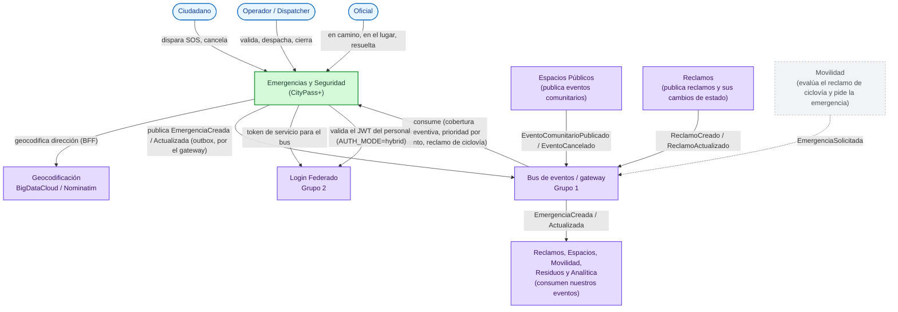

# Contexto (C4 nivel 1)

Para qué sirve: ubicar el módulo **Emergencias y Seguridad** dentro de CityPass+ y de la
cátedra: quién lo usa, qué otros sistemas propios y externos lo rodean, y cuáles de esas
conexiones ya funcionan hoy contra cuáles todavía son intención de integración. Es el nivel más
alto de C4 (contexto): no muestra contenedores ni componentes internos — eso está en
`03-arquitectura.md`.

## Leyenda

| Estilo | Significado |
|---|---|
| Azul sólido (persona) | Actor con grupo propio en `src/auth/groups.js` (`citizen`, `dispatcher`, `officer`) |
| Verde sólido (sistema propio) | El sistema que este repo (y `Frontend`) implementan: Emergencias y Seguridad |
| Violeta sólido (sistema externo en uso) | Sistema de otro proveedor o grupo, ya integrado y llamado hoy en producción |
| Gris punteado (sistema externo) | Sistema de otro grupo previsto, sin tráfico real hoy |
| Línea punteada | Integración programada pero apagada o prevista |

## Qué está conectado hoy y qué no

- **Geocodificación inversa** (BigDataCloud, con Nominatim de respaldo) desde el BFF al reportar
  una emergencia.
- **Consumo del bus del Grupo 1**: con `KAFKA_CONSUMER_ENABLED=true`, el backend escucha
  `EventoComunitarioPublicado` y `EventoCancelado` de Espacios Públicos: programa o cancela una
  cobertura preventiva (emergencia `PREVENTIVA`) y eleva la prioridad de lo que se crea cerca del
  evento. Para el caso del auto en la ciclovía escucha `EmergenciaSolicitada` de Movilidad y
  `ReclamoCreado` / `ReclamoActualizado` de Reclamos, y crea o cancela una intervención
  `TRANSITO`. El disparador por default es el de Movilidad (`RECLAMO_INTERVENCION_DISPARADOR`),
  que arma ese pedido a partir del `ReclamoCreado` v3 de Reclamos. Se conecta con
  SASL/OAUTHBEARER y SSL, y lee Avro con el schema registry del gateway.
- **Login Federado (Grupo 2)**: da el token client-credentials que pide el bus (`EDA_OAUTH_*`)
  y, desde el 12/11/2026, valida al personal: el backend acepta los JWT del IdP contra su JWKS.
- **Publicación al bus**: prendida desde el 05/11 por el gateway (`EDA_PUBLISHER_MODE=gateway`):
  `EmergenciaCreada` y `EmergenciaActualizada` llegan a Analítica, Reclamos, Movilidad, Residuos y Espacios.
- **Login de usuarios**: `AUTH_MODE=hybrid`. El personal entra por el Login Federado y los
  ciudadanos siguen con cuentas locales (email y contraseña, JWT propio con el mismo contrato de
  claims que el IdP real).
- **Oficial**: el grupo `officer` existe, los endpoints `en-route`, `on-scene` y `resolve`
  funcionan y el `Frontend` tiene su vista en `/oficial`: lista lo que tiene asignado y avanza
  el estado con un botón por paso.

## Fuente en el código

- `src/auth/groups.js` (`citizen`, `dispatcher`, `officer`), `src/auth/dev-login-policy.js`
  (subs demo de ciudadano; en modo estricto no emite dispatcher ni officer)
- `src/auth/setup.js`, `src/auth/config.js` (`AUTH_MODE=hybrid` en producción desde el 12/11/2026)
- `src/services/kafka.service.js`, `src/services/eda-auth-client.js`,
  `src/services/outbox-publisher.js`, `src/listeners/`, `render.yaml`
- `Frontend/app/api/geocode/route.js`, `Frontend/lib/geocode-server.js` (BigDataCloud primario,
  Nominatim de respaldo)
- Documento de producto: `Grupo 6 - Emergencias - Casos de Uso.md` (CU-03 recibir emergencia
  de otro módulo, CU-07/CU-08 rol oficial)
