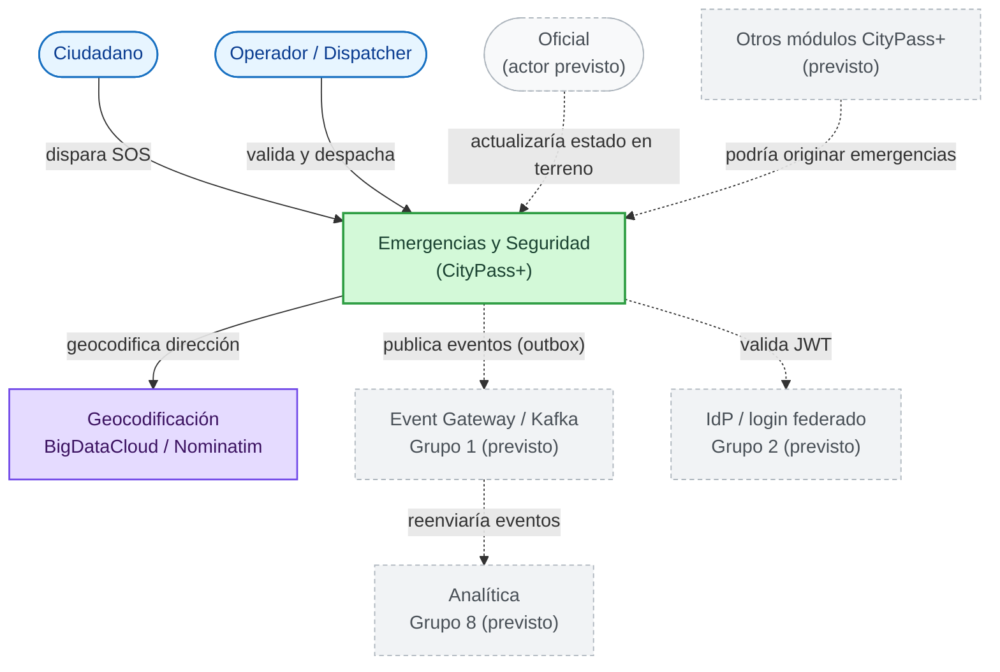

# Contexto (C4 nivel 1)

Para qué sirve: ubicar el módulo **Emergencias y Seguridad** dentro de CityPass+ y de la
cátedra: quién lo usa, qué otros sistemas propios y externos lo rodean, y cuáles de esas
conexiones ya funcionan hoy contra cuáles todavía son intención de integración (bus de eventos,
IdP federado, otros módulos del producto). Es el nivel más alto de C4 (contexto): no muestra
contenedores ni componentes internos — eso está en `03-arquitectura.md`.

## Leyenda

| Estilo | Significado |
|---|---|
| Azul sólido (persona) | Actor real de hoy: humano que interactúa con el sistema en producción |
| Gris punteado (persona) | Actor previsto: el rol todavía no existe en `src/auth/groups.js` (`oficial`, HU-08) |
| Verde sólido (sistema propio) | El sistema que este repo (y `Frontend`) implementan: Emergencias y Seguridad |
| Violeta sólido (sistema externo en uso) | Sistema de otro proveedor, ya integrado y llamado hoy en producción |
| Gris punteado (sistema externo) | Sistema de otro grupo/proveedor previsto, sin integración de código todavía |

## Fuente en el código

- `src/auth/groups.js` (`GROUPS.CITIZEN`, `GROUPS.DISPATCHER`; no existe `officer`)
- `src/auth/setup.js`, `src/auth/config.js` (`AUTH_MODE=local` hoy, `AUTH_MODE=idp` previsto — el
  IdP real del Grupo 2 validaría JWT vía JWKS, ver `03-CONTRATO-TOKEN.md`)
- `src/services/kafka.service.js`, `src/services/outbox-publisher.js`, `render.yaml`
  (`KAFKA_ENABLED=false`): el Event Gateway del Grupo 1 es el consumidor previsto de nuestro
  outbox, hoy nada sale de `outbox_events`
- `Frontend/app/api/geocode/route.js`, `Frontend/lib/geocode-server.js` (BigDataCloud primario,
  Nominatim de respaldo — el único sistema externo con el que el módulo integra de verdad hoy)
- Documento de producto: `tableros-analitica.md` (contrato que pide Analítica), `Grupo 6 -
  Emergencias - Casos de Uso.md` (CU-03 recibir emergencia de otro módulo, CU-07/CU-08 rol
  oficial)

## Qué está conectado hoy y qué no

- Lo único que funciona de punta a punta contra un sistema externo real es la geocodificación
  inversa (BigDataCloud, con Nominatim de respaldo) desde el BFF al reportar una emergencia.
- El bus de eventos (Kafka / Event Gateway del Grupo 1) tiene su lado productor listo
  (`KafkaService`, outbox transaccional) pero está apagado en producción
  (`KAFKA_ENABLED=false`): los eventos quedan en `outbox_events` sin salir, así que Analítica y
  cualquier otro consumidor previsto no reciben nada todavía.
- El login es local (`AUTH_MODE=local`, JWT propio con el mismo contrato de claims que usaría el
  IdP real): la validación contra el IdP federado del Grupo 2 es la integración prevista, sin
  cambios de código pendientes salvo variables de entorno.
- El rol `oficial` (actualizar estado en terreno, HU-08) y la recepción de emergencias
  originadas en otros módulos de CityPass+ (CU-03) son casos de uso planificados: no hay grupo
  de auth, endpoint ni consumidor Kafka para ninguno de los dos en este repo hoy.
