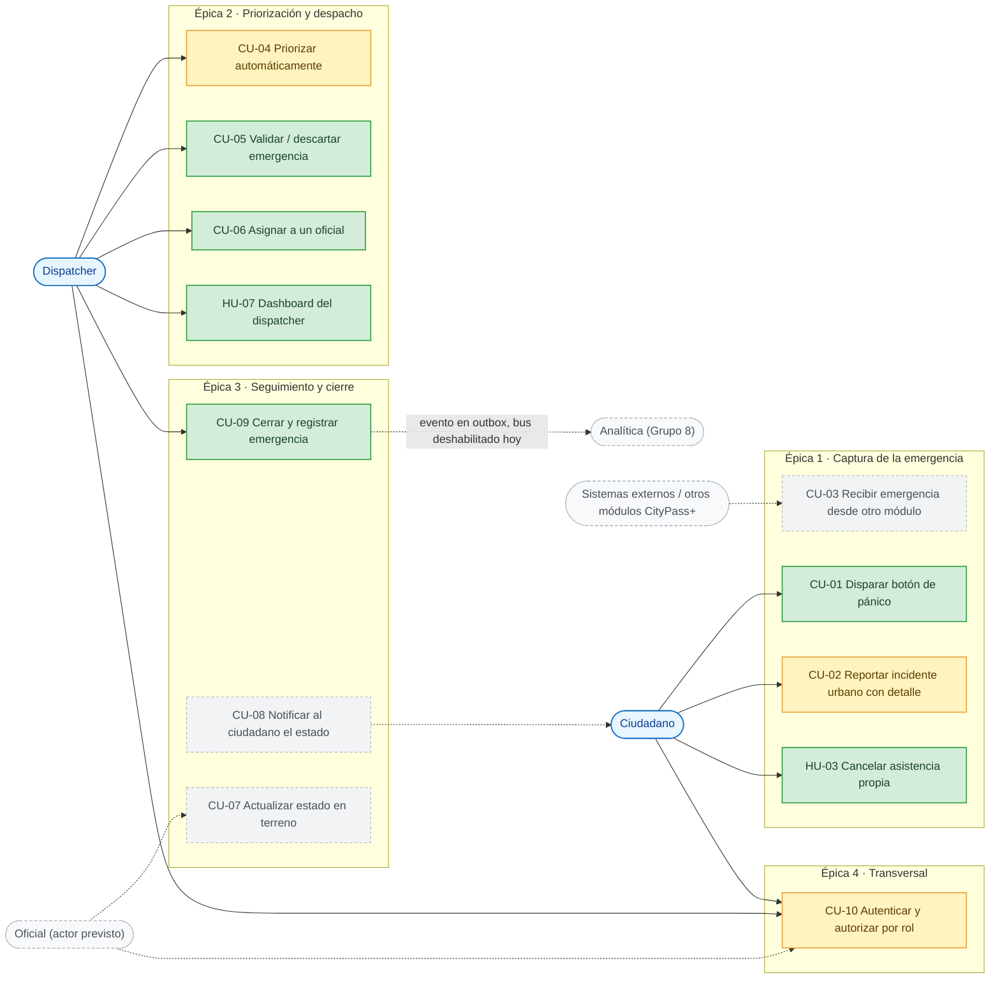

# Casos de uso

Para qué sirve: mapear los casos de uso del documento de producto (`Grupo 6 - Emergencias -
Casos de Uso.md` y el roadmap de HU) contra lo que hoy existe en el código, para que quede
claro qué se puede mostrar en la demo del Hito 1 y qué es trabajo futuro.

Mermaid no tiene un diagrama de casos de uso UML nativo: se modela como `flowchart` con
actores como nodos y los casos de uso agrupados por épica en subgrafos. El estilo del nodo
indica el estado real (verificado contra `src/routes/*.js`), no la intención del documento de
producto.

## Leyenda

| Estilo | Significado |
|---|---|
| Verde sólido | **Implementado**: hay endpoint(s) reales que lo cubren, verificados en `src/routes/*.js` |
| Amarillo | **Parcial**: existe una versión reducida del caso de uso, no el alcance completo del documento de producto |
| Gris punteado | **Planificado**: no hay endpoint ni código en este repo (roadmap Sprint 3-6 / Hito 2, o rol sin implementar) |

## Detalle por caso de uso

| Caso de uso | Estado | Evidencia en el código |
|---|---|---|
| CU-01 Disparar botón de pánico | Implementado | `POST /api/panic-button` (`src/routes/panic-button.routes.js`), `PanicButtonController.triggerPanicButton` |
| CU-02 Reportar incidente urbano con detalle | Parcial | Mismo endpoint `POST /api/panic-button` con `emergencyType` + `address` (`app/lib/api.js#reportIncident` en el front). No hay carga de foto (el backend no tiene endpoint ni columna para adjuntos) |
| CU-03 Recibir emergencia desde otro módulo | Planificado | HU-13, Sprint 3-6 / Hito 2. No hay consumer de Kafka en `src/services/kafka.service.js` (solo producer) |
| HU-03 Cancelar asistencia propia | Implementado | `PATCH /api/emergencies/:id/cancel` (`requireCitizen` + `canCancelEmergency`, solo dueño) |
| CU-04 Priorizar automáticamente | Parcial | La severidad se **deriva** de `emergencyType` con una tabla fija (`src/domain/severity.js#severityForType`), no hay motor de reglas por ubicación/cantidad de reportes/hora. La tabla `incidents` (migración V12) existe como destino de un futuro Risk Engine (rama `feature/incident-detection-rule-based`, ver ADR "detectar incidentes y priorizar con motor determinístico"), pero ningún código de este repo escribe filas ahí |
| CU-05 Validar / descartar emergencia | Implementado | `PATCH /api/emergencies/:id/validate` y `.../discard` (`requireDispatcher`) |
| CU-06 Asignar a un oficial | Implementado | `PATCH /api/emergencies/:id/assign` + catálogo `GET /api/officers` (`src/repositories/officer.repository.js`) |
| HU-07 Dashboard del dispatcher | Implementado | `DispatcherView` (front) hace polling de `GET /api/emergencies` cada 5 s (`POLLING_INTERVAL_MS`); no hay push/WebSocket |
| CU-07 Actualizar estado en terreno | Planificado | No existe rol `officer` en `src/auth/groups.js` (solo `citizen`/`dispatcher`) ni endpoint para `EN_ROUTE`/`ON_SCENE`/`RESOLVED`. Ver TODO(#13) en `emergency.controller.js` y stub 501 `updateEmergencyStatus` en el front |
| CU-08 Notificar al ciudadano el estado | Planificado | El ciudadano ve el estado solo si entra a `/mis-alertas/:id` (fetch manual); no hay notificación push ni email |
| CU-09 Cerrar y registrar emergencia | Implementado | `PATCH /api/emergencies/:id/close` (`requireDispatcher`, transición `RESOLVED → CLOSED`) |
| CU-10 Autenticar y autorizar por rol | Parcial | JWT + `groups` funciona end-to-end (`src/auth/*`), pero hoy corre en `AUTH_MODE=local` (JWT propio, mismo contrato); la integración con el IdP real del Grupo 2 (HU-12, `AUTH_MODE=idp`) está prevista y sin cambios de código pendientes salvo variables de entorno |

## Fuente en el código

- `src/routes/panic-button.routes.js`, `src/routes/emergencies.routes.js`, `src/routes/officer.routes.js`, `src/routes/user.routes.js`, `src/routes/outbox.routes.js`, `src/routes/dev-auth.routes.js`
- `src/auth/groups.js`, `src/auth/authorize.js` (roles `citizen`/`dispatcher`, sin `officer`)
- `src/domain/severity.js`, `db/migrations/V12__add_incidents_table.sql`
- `app/lib/api.js` (`reportIncident`, stubs 501 `updateEmergencyStatus`/`addObservation`/`requestReinforcements`/`overridePriority`) en el repo `Frontend`
- Documento de producto: `Grupo 6 - Emergencias - Casos de Uso.md`, `Emergencias - Roadmap y Historias de Usuario.md`
