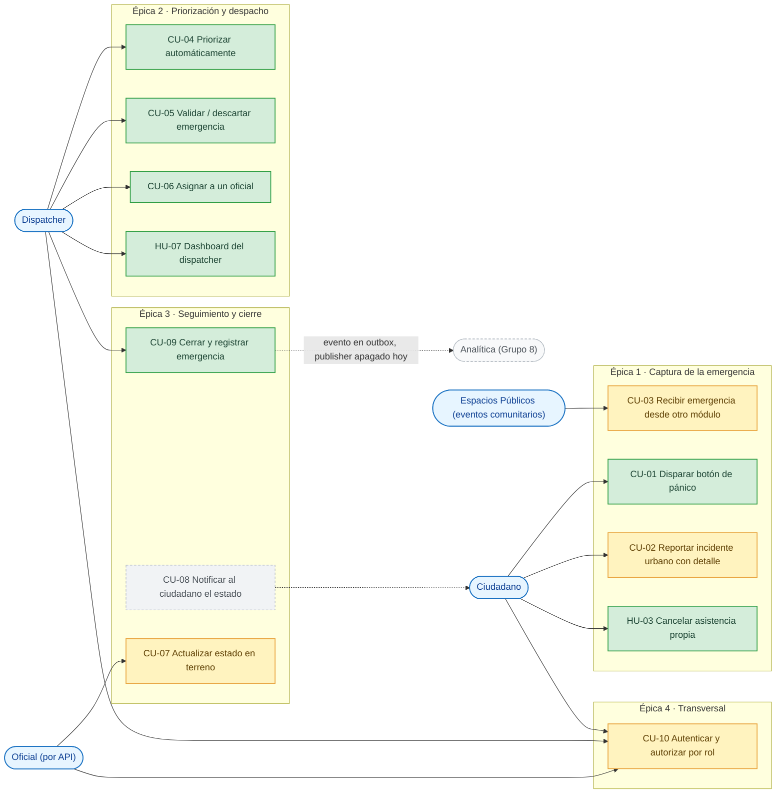

# Casos de uso

Para qué sirve: mapear los casos de uso del documento de producto (`Grupo 6 - Emergencias -
Casos de Uso.md` y el roadmap de HU) contra lo que hoy existe en el código, para que quede
claro qué se puede mostrar en la demo y qué no está implementado.

Mermaid no tiene un diagrama de casos de uso UML nativo: se modela como `flowchart` con
actores como nodos y los casos de uso agrupados por épica en subgrafos. El estilo del nodo
indica el estado real (verificado contra `src/routes/*.js`), no la intención del documento de
producto.

## Leyenda

| Estilo | Significado |
|---|---|
| Verde sólido | **Implementado**: hay endpoint(s) reales que lo cubren, verificados en `src/routes/*.js` |
| Amarillo | **Parcial**: existe una versión reducida del caso de uso, no el alcance completo del documento de producto |
| Gris punteado | **No implementado**: no hay endpoint ni código en este repo |

## Detalle por caso de uso

| Caso de uso | Estado | Evidencia en el código |
|---|---|---|
| CU-01 Disparar botón de pánico | Implementado | `POST /api/panic-button` (`src/routes/panic-button.routes.js`), `PanicButtonController.triggerPanicButton` |
| CU-02 Reportar incidente urbano con detalle | Parcial | Mismo endpoint `POST /api/panic-button` con `emergencyType` + `address` (`app/lib/api.js#reportIncident` en el front). No hay carga de foto (el backend no tiene endpoint ni columna para adjuntos) |
| CU-03 Recibir emergencia desde otro módulo | Parcial | Hay consumer de Kafka (`src/listeners/`, `KAFKA_CONSUMER_ENABLED=true` en producción). **Asistencia en bicicleta pública**: `EmergenciaBicicleta` de Movilidad crea una emergencia externa `MEDICA`, deduplicada por `data.emergenciaId`, que se propaga como `correlationId`. **Cobertura preventiva**: un `EventoComunitarioPublicado` de Espacios con capacidad ≥ 500 crea una emergencia `PREVENTIVA` (`causaTipo = EVENTO_PUBLICO`) y un `EventoCancelado` la cancela. **Reclamo por ciclovía obstruida**: `EmergenciaSolicitada` de Movilidad sigue creando una intervención `TRANSITO` (`causaTipo = RECLAMO`); `ReclamoCreado` es el plan B configurable y `ReclamoActualizado` final la cancela. **Reserva grande de un espacio**: un `ReservaCreada` de Espacios (`tipoReserva = ESPACIO`, 500 personas o más) crea una `PREVENTIVA` con `causaTipo = RESERVA` (opt-in con `EDA_TOPIC_RESERVA_CREADA`). **Alerta climática**: un `CriticidadClimaticaConfirmada` de Espacios `ALTA` o `CRITICA` crea una `PREVENTIVA` con `causaTipo = EVENTO_CLIMATICO` y sube la prioridad cerca de los puntos de la alerta; `CriticidadClimaticaFinalizada` la cancela (opt-in con `EDA_TOPIC_CRITICIDAD_CLIMATICA_*`). No se consumen incidentes viales |
| HU-03 Cancelar asistencia propia | Implementado | `PATCH /api/emergencies/:id/cancel` (`requireCitizen` + `canCancelEmergency`, solo dueño) |
| CU-04 Priorizar automáticamente | Implementado | La severidad base se deriva de `emergencyType` (`src/domain/severity.js#severityForType`) y desde los PRs #36/#39/#41 hay un motor de incidentes real corriendo cada 60s (`src/services/incident-detection-job.js`): agrupa emergencias del mismo tipo cercanas entre sí y calcula un score/prioridad determinístico (`RiskEngine`) que nunca puede bajar la severity individual (`applyPriorityInvariant`). Desde el PR #51 (tarea #61, verificado en producción el 23/09) el agrupamiento pasa por `IncidentDetectionStrategy` (`src/domain/incident-detection-strategy.js#detectGroups`): `DbscanGrouper` (`src/domain/dbscan-grouper.js`, librería `density-clustering`) es la estrategia primaria y `RuleBasedGrouper` (Union-Find + Haversine, radio 300m) queda como fallback, activado solo si DBSCAN lanza una excepción — nunca por un resultado vacío. `incidents.algorithm_version` registra cuál corrió (`dbscan-v1` o `rule-based-v1`). El resultado se expone en `GET /api/incidents`, `GET /api/incidents/:id` y como `incident`/`effectivePriority` en el listado/detalle de emergencias del dispatcher (`sortBy=priority` ordena por `effectivePriority`). **No implementado**: el override manual de prioridad por el dispatcher (no hay endpoint, la prioridad solo la fija el motor automático). Los parámetros de DBSCAN se probaron solo con el dataset sintético de `scripts/demo-dbscan.js` |
| CU-05 Validar / descartar emergencia | Implementado | `PATCH /api/emergencies/:id/validate` y `.../discard` (`requireDispatcher`) |
| CU-06 Asignar a un oficial | Implementado | `PATCH /api/emergencies/:id/assign` + catálogo `GET /api/officers` (`src/repositories/officer.repository.js`); `PATCH .../return` devuelve la emergencia para reasignar |
| HU-07 Dashboard del dispatcher | Implementado | `DispatcherView` (front) hace polling de `GET /api/emergencies` cada 30 s (`POLLING_INTERVAL_MS`); no hay push/WebSocket |
| CU-07 Actualizar estado en terreno | Parcial | Backend: grupo `officer`, `GET /api/emergencies` filtrado por el oficial del token y `PATCH /api/emergencies/:id/en-route`, `.../on-scene` y `.../resolve`, solo para el oficial asignado (`canAdvanceEmergencyStatus`). `Frontend`: vista `/oficial` con lo asignado y un botón por paso. No hay observaciones ni pedido de refuerzos (el detalle los devuelve vacíos) |
| CU-08 Notificar al ciudadano el estado | No implementado | El ciudadano ve el estado solo si entra a `/mis-alertas/:id` (fetch manual); no hay notificación push ni email |
| CU-09 Cerrar y registrar emergencia | Implementado | `PATCH /api/emergencies/:id/close` (`requireDispatcher`, transición `RESOLVED → CLOSED`, libera al oficial). Se llega a `RESOLVED` con `PATCH .../resolve` del oficial |
| CU-10 Autenticar y autorizar por rol | Parcial | JWT + `groups` (`citizen`, `dispatcher`, `officer`) funciona end-to-end (`src/auth/*`). Producción corre en `AUTH_MODE=hybrid` desde el 12/11/2026: el personal entra por el Login Federado del Grupo 2 (HU-12) y los ciudadanos siguen con cuentas locales (JWT propio, mismo contrato) |

## Fuente en el código

- `src/routes/panic-button.routes.js`, `src/routes/emergencies.routes.js`, `src/routes/officer.routes.js`, `src/routes/user.routes.js`, `src/routes/outbox.routes.js`, `src/routes/dev-auth.routes.js`, `src/routes/citizen-profile.routes.js`
- `src/auth/groups.js`, `src/auth/authorize.js` (`citizen`, `dispatcher`, `officer`)
- `src/listeners/cobertura-preventiva/` y `src/listeners/reclamo-intervencion/` (CU-03 parcial)
- `src/domain/severity.js`, `db/migrations/V12__add_incidents_table.sql`, `db/migrations/V14__add_incident_factors.sql`
- `src/domain/rule-based-grouper.js`, `src/domain/dbscan-grouper.js`, `src/domain/incident-detection-strategy.js`, `src/domain/risk-engine.js`, `src/domain/incident-detector.js`, `src/services/incident-detection-job.js`, `scripts/demo-dbscan.js`
- `src/repositories/incident.repository.js`, `src/routes/incidents.routes.js`, `src/controllers/incident.controller.js`
- `app/lib/api.js` (`reportIncident`) en el repo `Frontend`
- Documento de producto: `Grupo 6 - Emergencias - Casos de Uso.md`, `Emergencias - Roadmap y Historias de Usuario.md`
