# Modelo entidad-relación

Para qué sirve: mostrar el schema de Postgres tal como queda después de aplicar las
migraciones Flyway hasta **V35** (`db/migrations/`), con tipos, PK/FK y
los `CHECK` que importan para entender las reglas de negocio. Las versiones V17 a V20 no
existen en el repo: la numeración salta de V16 a V21. Si se suma una migración, este
diagrama se actualiza en el mismo PR.

```mermaid
erDiagram
    EMERGENCIES ||--o{ EMERGENCY_STATUS_HISTORY : "historial de estados"
    EMERGENCIES ||--o{ EMERGENCY_ACCESS_AUDIT : "auditoria de lecturas"
    INCIDENTS |o--o{ EMERGENCIES : "agrupa (opcional, incident_id)"
    OFFICERS |o..o{ EMERGENCIES : "asignado por id (sin FK en DB)"
    OFFICERS |o..o{ EMERGENCY_STATUS_HISTORY : "officer_id de cada asignacion (sin FK, V35)"
    EMERGENCIES ||--o{ EMERGENCIA_CONTEXTO_ZONA : "vinculada al crearse (V31)"
    CONTEXTO_ZONA ||--o{ EMERGENCIA_CONTEXTO_ZONA : "alcanza a (V31)"
    EMERGENCIES ||--o{ IDEMPOTENCY_KEYS : "alta con Idempotency-Key (V34)"
    CITIZEN_PROFILES |o..o{ CITIZEN_SAVED_LOCATIONS : "mismo user_id (sin FK)"

    EMERGENCIES {
        uuid id PK
        text correlation_id "correlación externa o = id si no viene (V9 + V32)"
        text user_id "sub del JWT, sin FK. NULL solo si source=EXTERNAL (V23)"
        double latitude "NULL desde V3 (viaja cifrado)"
        double longitude "NULL desde V3 (viaja cifrado)"
        text location_encrypted "AES-256-GCM, JSON con lat/lng/address (V3). NULL si llego sin ubicacion"
        timestamptz location_anonymized_at "set por el job de retencion 72h post-cierre (V3)"
        text description
        text severity "CHECK low|medium|high|critical (V7)"
        text status "default PENDING desde V5, sin CHECK (lo valida la app)"
        text emergency_type "CHECK catalogo cerrado, con PREVENTIVA y TRANSITO (V10 + V23 + V29)"
        text barrio "catalogo oficial CABA 48 barrios, en claro (V25); no se borra con retencion"
        text assigned_officer_id "id logico de officers, sin FK (V4)"
        uuid incident_id FK "NULL, ON DELETE SET NULL (V12)"
        timestamptz closed_at "en CLOSED, CANCELLED y DISCARDED (V13 + V26)"
        text source "CHECK INTERNAL|EXTERNAL, default INTERNAL (V23)"
        boolean requires_manual_validation "default false; true si la externa llego sin ubicacion (V23)"
        text causa_tipo "CHECK incluye MOVILIDAD_BICICLETA (V23 + V32)"
        text causa_id "id en el modulo de origen; va junto con causa_tipo (V23)"
        text_array causas_relacionadas "VIA, ESPACIO_PUBLICO, RESIDUOS; default vacio (V27)"
        text descripcion_problema "la carga el oficial al resolver con causa VIA (V30)"
        timestamptz created_at
        timestamptz updated_at
    }

    EMERGENCY_STATUS_HISTORY {
        bigserial id PK
        uuid emergency_id FK "ON DELETE CASCADE"
        text previous_status "nullable"
        text new_status
        text actor "sub del JWT, o eda:espacios / eda:reclamos si lo hizo un listener"
        text reason "nullable"
        text officer_id "solo en filas DISPATCHED: oficial asignado, sin FK (V35)"
        timestamptz created_at
    }

    CONTEXTO_ZONA {
        uuid id PK
        text tipo "CHECK EVENTO_ESPACIO_PUBLICO|ALERTA_CLIMATICA (V28)"
        text origen "modulo de origen, hoy espacios"
        text referencia_externa "eventoId, o alertaId#n por punto de una alerta; UNIQUE con tipo y origen"
        double latitud "punto en claro, no es dato personal (V31)"
        double longitud "(V31)"
        int radio_metros "CHECK mayor a 0 (V31)"
        timestamptz vigente_desde "ventana; NULL solo si nacio dado de baja"
        timestamptz vigente_hasta "CHECK posterior a vigente_desde"
        text descripcion "motivo que ve el dispatcher"
        uuid causation_id "eventId que lo creo o actualizo"
        timestamptz source_updated_at "descarta versiones viejas del evento de origen"
        timestamptz suspendido_en "reversible: no eleva mientras esta seteado"
        timestamptz dado_de_baja_en "baja logica y definitiva"
        text nivel_criticidad "CHECK BAJA|MEDIA|ALTA|CRITICA, solo alertas (V33)"
        text fenomeno "codigo de Espacios, sin CHECK (V33)"
        text_array barrios "los de la alerta, solo para el banner (V33)"
        timestamptz created_at
        timestamptz updated_at
    }

    EMERGENCIA_CONTEXTO_ZONA {
        uuid emergency_id PK, FK "ON DELETE CASCADE (V31)"
        uuid contexto_id PK, FK "ON DELETE CASCADE (V31)"
        timestamptz created_at "cuando se vinculo (al crear la emergencia)"
    }

    IDEMPOTENCY_KEYS {
        text scope PK "endpoint, hoy POST /api/panic-button (V34)"
        text user_sub PK "sub del JWT"
        text idempotency_key PK "valor del header Idempotency-Key"
        uuid emergency_id FK "ON DELETE CASCADE, DEFERRABLE INITIALLY DEFERRED"
        smallint status_code "status de la primera respuesta (201)"
        timestamptz created_at "vence a las 24 h; indice para la purga"
    }

    EMERGENCY_ACCESS_AUDIT {
        bigserial id PK
        uuid emergency_id FK "ON DELETE CASCADE (V3)"
        text actor_sub "quien leyo"
        text action "emergency:read (solo GET /api/panic-button/:id)"
        timestamptz created_at
    }

    OUTBOX_EVENTS {
        uuid id PK "= eventId del evento"
        text topic
        jsonb payload
        text status "CHECK PENDING|PROCESSING|PUBLISHED|FAILED|SKIPPED (V6 + V8 + V21)"
        int attempts "default 0, backoff exponencial"
        timestamptz available_at "cuando se puede reclamar de nuevo"
        timestamptz locked_at "set por claimBatch, FOR UPDATE SKIP LOCKED"
        timestamptz published_at
        text last_error
        timestamptz created_at
        text payload_hash "hash que devuelve el gateway al publicar (V24)"
        uuid gateway_event_id "metadata.eventId que asigna el gateway (V24)"
    }

    EVENTOS_PROCESADOS {
        uuid event_id PK "metadata.eventId del evento consumido (V22)"
        text source "modulo que lo publico"
        text event_type
        uuid causation_id "nullable"
        text status "CHECK PROCESSED|DISCARDED"
        text discard_reason "obligatorio solo si DISCARDED"
        timestamptz processed_at
    }

    OFFICERS {
        text id PK "ej. of-001, seed fijo en V11; es el sub del oficial"
        text name
        text badge_number
        text location_label
        text distance_label
        text status "CHECK disponible|ocupado (V11)"
        timestamptz created_at
        timestamptz updated_at
    }

    INCIDENTS {
        uuid id PK
        text emergency_type "CHECK catalogo, con PREVENTIVA y TRANSITO (V12 + V29)"
        text priority "escrito por el Risk Engine cada 60s (V12 + job)"
        numeric score
        jsonb reason_codes
        jsonb factors "snapshot de features del scoring (V14)"
        text algorithm_version "dbscan-v1 (primaria) o rule-based-v1 (fallback)"
        timestamptz created_at
        timestamptz updated_at
    }

    CITIZEN_PROFILES {
        text user_id PK "sub del ciudadano (V15)"
        text display_name
        text sensitive_encrypted "telefono, contacto y condicion medica cifrados"
        timestamptz created_at
        timestamptz updated_at
    }

    CITIZEN_SAVED_LOCATIONS {
        uuid id PK
        text user_id "sub del ciudadano, sin FK (V15)"
        text label
        text location_encrypted "direccion + coordenadas cifradas"
        timestamptz created_at
        timestamptz updated_at
    }

    AUTH_USERS {
        uuid id PK
        text email "indice unico por lower(email) (V16)"
        text password_hash "bcrypt"
        text display_name
        text_array groups "default citizen"
        boolean has_antipanic_button
        timestamptz created_at
        timestamptz updated_at
    }
```

## Leyenda / notas de negocio

| Tema | Detalle |
|---|---|
| Cifrado de ubicación | `latitude`/`longitude` no se guardan en claro desde V3. Se cifran con **AES-256-GCM** y se persisten en `location_encrypted` (`src/security/location-crypto.js`); la clave sale de `LOCATION_ENCRYPTION_KEY`/`LOCATION_ENCRYPTION_KEYS` (keyring rotable). El plaintext cifrado es `{ latitude, longitude, address? }`: la dirección legible (`address`) **no tiene columna propia**, viaja dentro del mismo blob para heredar retención y saneo sin migración nueva. Una emergencia externa que llega sin coordenadas queda con `location_encrypted` en `NULL`. |
| Retención | Job en background (`src/security/location-retention.js`) anonimiza el ciphertext **72 horas después de `closed_at`** (`LOCATION_RETENTION_HOURS`, default 72; configurable). Aplica a las que tienen `closed_at`: cerradas, canceladas y descartadas (desde V26). Pone `location_encrypted`, `latitude`, `longitude` en `NULL` y marca `location_anonymized_at`. La emergencia sigue existiendo, solo se pierde la ubicación. |
| Emergencias externas (V23) | `source = 'INTERNAL'` es el alta ciudadana; `'EXTERNAL'` la crea un listener de eventos de otro módulo (cobertura preventiva y alerta climática de Espacios, intervención por reclamo de ciclovía, emergencia en bicicleta de Movilidad). `user_id` pasó a nullable, pero el `CHECK emergencies_user_id_internal_check` lo sigue exigiendo en las `INTERNAL`. `requires_manual_validation` marca las externas sin ubicación. |
| Causa (V23, V29, V32) | `causa_tipo` + `causa_id` dicen qué originó la emergencia (convención de Analítica). Van juntas: `CHECK ((causa_tipo IS NULL) = (causa_id IS NULL))`. Se usan `EVENTO_PUBLICO` (`eventoId` o `actividadId`), `RESERVA` (`reservaId`), `EVENTO_CLIMATICO` (`alertaId`), `RECLAMO` (`reclamoId`) y `MOVILIDAD_BICICLETA` (`emergenciaId` de Movilidad); `INCIDENTE_VIAL` está en el `CHECK` pero ningún listener lo usa todavía. Tres índices únicos parciales evitan duplicados aunque el bus entregue dos veces: `uq_emergencies_preventiva_causa (causa_tipo, causa_id) WHERE emergency_type = 'PREVENTIVA'` (una cobertura por evento, reserva o alerta, V23), `uq_emergencies_reclamo_causa (causa_id) WHERE causa_tipo = 'RECLAMO'` (una intervención por reclamo, V29) y `uq_emergencies_movilidad_bicicleta_causa` (V32). |
| `correlation_id` (V9, V32) | Desde V32 es `TEXT`: las altas externas conservan el id de correlación que mandó el otro módulo aunque no sea UUID (`EMG-...`, `evento-<id>`); si no viene o no sirve, vale el `id` propio (`src/domain/correlation-id.js`). |
| Barrio | Columna `barrio` (V25) en claro, nombre canónico de los 48 barrios de CABA. Se deriva en `create()` vía punto-en-polígono (`src/domain/barrio.js` + GeoJSON oficial). Sin coords, solo se acepta texto que matchee el catálogo. Backfill manual: `npm run security:backfill-barrios`. |
| `status` (emergencies) | Sin `CHECK` en la base: la única fuente de verdad de las transiciones válidas es `src/domain/emergency-status.js` (ver `04-maquina-de-estados.md`). El `DEFAULT` original de V1 era `'CREATED'` (valor histórico fuera de vocabulario); V5 lo cambió a `'PENDING'`. |
| `severity` (emergencies) | `CHECK (severity IS NULL OR severity IN ('low','medium','high','critical'))` (V7). Se deriva del `emergency_type` (`src/domain/severity.js`), no la elige el cliente. `PREVENTIVA` → `low`. |
| `emergency_type` | `MEDICA, INCENDIO, INFRAESTRUCTURA, DISTURBIO_EVENTO_MASIVO, OTRO, PANICO, PREVENTIVA, TRANSITO` (V10, ampliado en V23 y V29). `PREVENTIVA` la crea solo el sistema: `POST /api/panic-button` la rechaza con 400. `TRANSITO` nace de la intervención por un reclamo de ciclovía. Desde V29 el `CHECK` de `incidents` acepta el mismo catálogo (antes le faltaba `PREVENTIVA`). |
| `assigned_officer_id` → `officers.id` | **No hay FK real en la base** (columna `TEXT` agregada en V4, `officers` recién nace en V11): la relación es solo aplicativa, resuelta con un `LEFT JOIN` en `emergency.repository.js`. Por eso el diagrama la marca con línea punteada. El oficial se autentica con su id como `sub` (`of-001`), y los endpoints `en-route`/`on-scene`/`resolve` comparan ese `sub` contra esta columna. Al devolver, cancelar o cerrar, el oficial vuelve a `disponible` pero la columna conserva el id. |
| `incident_id` → `incidents.id` | Sí es FK real (`ON DELETE SET NULL`, V12). El job `incident-detection-job.js` agrupa emergencias del mismo tipo y cercanas entre sí cada 60s y crea/actualiza filas de `incidents` vía `IncidentRepository.create`/`applyScoringDecision`. La prioridad efectiva de cada emergencia es `max(severity, incident.priority)` (`effectivePriority`). |
| `incidents.factors` (V14) | JSON con el snapshot de features que usó el Risk Engine para ese score: `reportCount`, `uniqueCitizenCount`, `minDistanceMeters`, `maxDistanceMeters`, `recencyMinutes`, `maxSeverity` (`src/domain/incident-detector.js`). Se sobrescribe en cada corrida del job que reevalúa el incidente, no es un historial. |
| `outbox_events` | Desacoplada a propósito: no tiene FK a `emergencies`. Ciclo de vida `PENDING → PROCESSING → PUBLISHED/FAILED`, más `SKIPPED` (V21) para los `PENDING` anteriores a `OUTBOX_PUBLISH_SINCE` y para los tipos que el publisher del gateway no saca al bus (`EmergenciaPriorizada`). En producción el publisher sale por el gateway desde el 05/11 (ver `06-eventos.md`). |
| `eventos_procesados` (V22) | Dedup de los eventos que consume el módulo: el `OutcomeFactory` inserta el `eventId` con `ON CONFLICT DO NOTHING` en la misma transacción que los efectos. Un evento con error permanente queda `DISCARDED` con su `discard_reason`, así no se reentrega para siempre. |
| Perfil ciudadano (V15) | `citizen_profiles` y `citizen_saved_locations`. Teléfono / contacto / condición médica y direcciones + coordenadas de ubicaciones frecuentes se cifran con el mismo AES-256-GCM. Endpoints bajo `/api/citizen/*` (solo grupo `citizen`, sobre el `sub` del JWT). Retención: `CITIZEN_PII_RETENTION_DAYS` (90). |
| Auth local (V16) | `auth_users` respalda `POST /auth/register` y `POST /auth/login` (`AUTH_MODE=local` o `hybrid`). Seed: `juanpanico@gmail.com` y `luciatranquila@gmail.com`. No hay FK desde las otras tablas: todas guardan el `sub` como texto. |
| `causas_relacionadas` y `descripcion_problema` (V27, V30) | Las carga el oficial al resolver (`PATCH .../resolve`): las causas que encontró (`VIA`, `ESPACIO_PUBLICO`, `RESIDUOS`) y, con `VIA`, una descripción breve del problema. Viajan en `EmergenciaActualizada` y se conservan en los eventos posteriores, incluido el cierre. |
| `contexto_zona` (V28, V31, V33) | Una situación de la ciudad que sube **un nivel** la prioridad de despacho de las emergencias que se crean cerca mientras dura: un evento comunitario de Espacios (`EVENTO_ESPACIO_PUBLICO`, una fila por `eventoId`) o cada punto de una alerta climática `ALTA`/`CRITICA` (`ALERTA_CLIMATICA`, una fila por punto con referencia `<alertaId>#<n>`, más una fila `<alertaId>` que solo sirve de marca cuando la alerta se finaliza). V28 la creó por barrio; V31 reemplazó el barrio por punto + radio (el `CHECK` de completitud quedó `NOT VALID`: las filas viejas por barrio no alcanzan a nadie). V33 sumó `nivel_criticidad`, `fenomeno` y `barrios`, que solo usa el banner (`GET /api/contextos-zona/activos`): no cambian la zona ni la suba. `UNIQUE (tipo, origen, referencia_externa)`; `suspendido_en` es reversible y `dado_de_baja_en` es definitivo (una baja que llega antes que el alta deja la fila ya dada de baja). `emergencies.severity` no se toca: la suba se calcula al leer. |
| `emergencia_contexto_zona` (V31) | Qué contextos alcanzan a cada emergencia. Se escribe **una sola vez, al crear la emergencia** (`EmergencyRepository.linkZoneContexts`), cuando la coordenada todavía está en memoria: guarda los dos ids, ni coordenadas ni distancia. La lectura (`GET /api/emergencies`) solo mira si el contexto vinculado sigue en curso; si es así, `dispatchPriority` = efectiva + 1 nivel. No vincula `PREVENTIVA` ni emergencias sin ubicación. La retención borra los vínculos al anonimizar la ubicación. Con `EVENTO_VINCULO_CONTEXTO_ENABLED=true` cada fila encola su `EmergenciaVinculadaAContextoZona` en la misma sentencia (hoy apagado en producción). |
| `idempotency_keys` (V34) | Respalda el header `Idempotency-Key` de `POST /api/panic-button`: una fila por (endpoint, usuario, clave), insertada en la misma transacción que la emergencia y su evento del outbox. La clave primaria resuelve dos pedidos simultáneos (el segundo espera al primero y devuelve su emergencia). La FK es diferida porque la clave se reserva antes de insertar la emergencia. No guarda el cuerpo de la respuesta (tendría la ubicación en claro): la repetición se arma leyendo la emergencia. Vence a las 24 h y la app borra las vencidas. |
| `emergency_status_history.officer_id` (V35) | Oficial de cada asignación, solo en las filas `DISPATCHED` (en las demás queda `NULL`); el backfill lo sacó del `reason` `Assigned officer <id>`. Hace falta porque la devolución (`DISPATCHED → VALIDATED`) deja `assigned_officer_id` en `NULL`: con esta columna, `GET /api/emergencies?scope=history` le muestra al oficial también las que le devolvieron. Índice parcial `idx_history_officer_id (officer_id, emergency_id) WHERE officer_id IS NOT NULL`. Sin FK a `officers`, igual que `assigned_officer_id`. |

## Fuente en el código

- `db/migrations/V1__create_emergencias.sql` … `V16__create_auth_users.sql` y
  `V21__outbox_add_skipped_status.sql` … `V35__historial_oficial_asignado.sql`. Las que
  suman tablas o columnas después de V26: `V27__add_emergency_related_causes.sql`,
  `V28__create_contexto_zona.sql`, `V29__transito_y_emergencia_por_reclamo.sql`,
  `V30__add_emergency_problem_description.sql`, `V31__contexto_zona_por_radio.sql`,
  `V32__movilidad_bicicleta_emergency_correlation.sql`,
  `V33__contexto_zona_datos_alerta_climatica.sql`, `V34__idempotency_keys.sql`,
  `V35__historial_oficial_asignado.sql`
- `src/security/location-crypto.js`, `src/security/location-retention.js`,
  `src/security/citizen-profile-retention.js`
- `src/domain/barrio.js`, `src/domain/data/barrios-caba.geojson`
- `src/repositories/emergency.repository.js` (mapeo de columnas, `LEFT JOIN officers`, `LEFT JOIN incidents`, `findByCausa`, `linkZoneContexts`, `createWithIdempotencyKey`, `officerScopeCondition`)
- `src/repositories/contexto-zona.repository.js`, `src/domain/contexto-zona.js`, `src/domain/alerta-climatica.js`
- `src/repositories/incident.repository.js` (`create`, `addMember`, `applyScoringDecision`)
- `src/repositories/eventos-procesados.repository.js`, `src/listeners/outcome-factory.js`
- `src/services/incident-detection-job.js`, `src/domain/risk-engine.js`, `src/domain/incident-detector.js`
- `src/domain/emergency-type.js`, `src/domain/severity.js`
- `db/README.md` (decisiones de diseño del schema)
