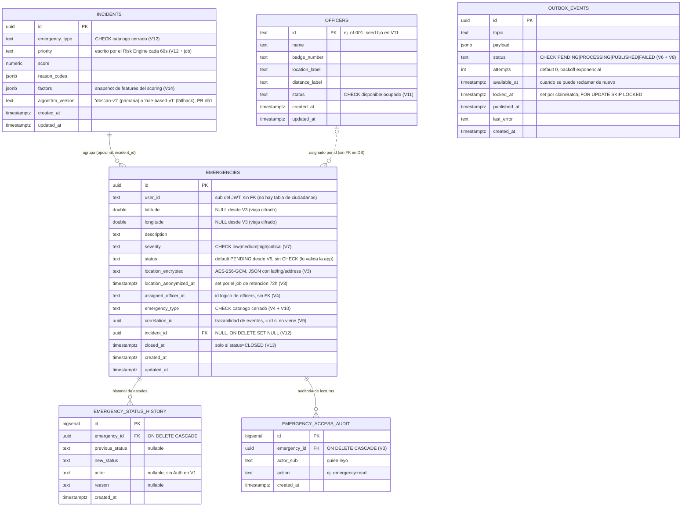

# Modelo entidad-relación

Para qué sirve: mostrar el schema real de Postgres tal como queda después de aplicar las 14
migraciones Flyway (`db/migrations/V1__...` a `V14__...`), con tipos, PK/FK y los `CHECK` que
importan para entender las reglas de negocio.

## Leyenda / notas de negocio

| Tema | Detalle |
|---|---|
| Cifrado de ubicación | `latitude`/`longitude` no se guardan en claro desde V3. Se cifran con **AES-256-GCM** y se persisten en `location_encrypted` (`src/security/location-crypto.js`); la clave sale de `LOCATION_ENCRYPTION_KEY`/`LOCATION_ENCRYPTION_KEYS` (keyring rotable). El plaintext cifrado es `{ latitude, longitude, address? }`: la dirección legible (`address`) **no tiene columna propia**, viaja dentro del mismo blob para heredar retención y saneo sin migración nueva. |
| Retención | Job en background (`src/security/location-retention.js`) anonimiza el ciphertext después de **72 horas** (`LOCATION_RETENTION_HOURS`, default 72): pone `location_encrypted`, `latitude`, `longitude` en `NULL` y marca `location_anonymized_at`. La emergencia sigue existiendo, solo se pierde la ubicación. |
| `status` (emergencies) | Sin `CHECK` en la base: la única fuente de verdad de las transiciones válidas es `src/domain/emergency-status.js` (ver `04-maquina-de-estados.md`). El `DEFAULT` original de V1 era `'CREATED'` (valor histórico fuera de vocabulario); V5 lo cambió a `'PENDING'`. |
| `severity` (emergencies) | `CHECK (severity IS NULL OR severity IN ('low','medium','high','critical'))` (V7). Se deriva del `emergency_type` en el controller (`src/domain/severity.js`), no la elige el cliente. |
| `emergency_type` (emergencies e incidents) | Catálogo cerrado igual en ambas tablas: `MEDICA, INCENDIO, INFRAESTRUCTURA, DISTURBIO_EVENTO_MASIVO, OTRO, PANICO` (V10, V12). `PANICO` representa el botón SOS y conceptualmente es un "origen", no un tipo — queda así hasta que se modele el origen aparte. |
| `assigned_officer_id` → `officers.id` | **No hay FK real en la base** (columna `TEXT` agregada en V4, `officers` recién nace en V11): la relación es solo aplicativa, resuelta con un `LEFT JOIN` en `emergency.repository.js`. Por eso el diagrama la marca con línea punteada. |
| `incident_id` → `incidents.id` | Sí es FK real (`ON DELETE SET NULL`, V12). Desde los PRs #36/#39/#41 (mergeados a `main`) el job `incident-detection-job.js` sí escribe acá: agrupa emergencias del mismo tipo y cercanas entre sí cada 60s y crea/actualiza filas de `incidents` vía `IncidentRepository.create`/`applyScoringDecision`. |
| `incidents.factors` (V14) | JSON con el snapshot de features que usó el Risk Engine para ese score: `reportCount`, `uniqueCitizenCount`, `minDistanceMeters`, `maxDistanceMeters`, `recencyMinutes`, `maxSeverity` (`src/domain/incident-detector.js`). Se sobrescribe en cada corrida del job que reevalúa el incidente, no es un historial. |
| `outbox_events` | Desacoplada a propósito: no tiene FK a `emergencies`. Ver `05-secuencias.md` y `06-eventos.md` para el ciclo de vida completo (`PENDING → PROCESSING → PUBLISHED/FAILED`). |

## Fuente en el código

- `db/migrations/V1__create_emergencias.sql` … `V14__add_incident_factors.sql`
- `src/security/location-crypto.js`, `src/security/location-retention.js`
- `src/repositories/emergency.repository.js` (mapeo de columnas, `LEFT JOIN officers`, `LEFT JOIN incidents`)
- `src/repositories/incident.repository.js` (`create`, `addMember`, `applyScoringDecision`)
- `src/domain/emergency-type.js`, `src/domain/severity.js`, `src/domain/incident-detector.js`
- `db/README.md` (decisiones de diseño del schema)
