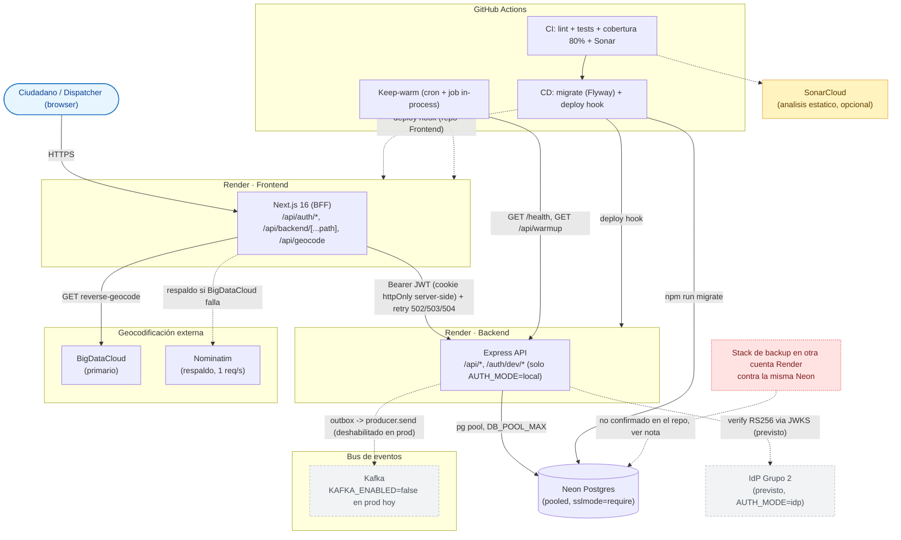
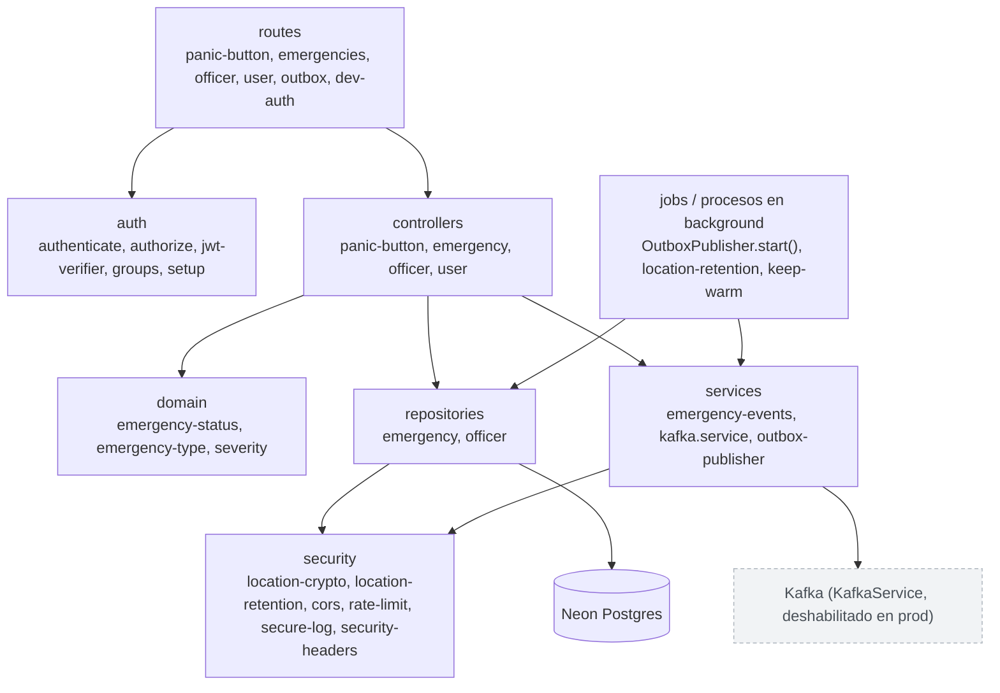

# Arquitectura

Para qué sirve: ubicar el módulo de Emergencias dentro de CityPass+ (estilo C4 — nivel de
contenedores) y después abrir el backend en sus componentes internos.

## Contenedores

> **Nota sobre el stack de backup:** no se encontró en `emergencias-backend`, `Frontend` ni
> `ADRs` ningún workflow, `render.yaml` o mención de un segundo despliegue de respaldo en otra
> cuenta de Render. Se incluye el nodo porque la consigna de este documento lo pide, pero queda
> marcado como **no verificado en el código** — ver la sección de inconsistencias en el resumen
> de esta tarea.

## Componentes internos del backend

## Leyenda

| Elemento | Estado |
|---|---|
| Línea sólida | Conexión activa hoy en el ambiente productivo |
| Línea punteada | Deshabilitado, previsto o de respaldo (no es el camino feliz actual) |
| `Kafka` | El código de producer existe (`src/services/kafka.service.js`) pero `render.yaml` fija `KAFKA_ENABLED=false`: los eventos quedan en `outbox_events` sin publicarse (ver `05-secuencias.md`) |
| `IdP Grupo 2` | Previsto: hoy corre `AUTH_MODE=local` (JWT propio con el mismo contrato de claims que usaría el IdP real, ver `src/auth/setup.js`) |
| SonarCloud | Corre solo si existe el secret `SONAR_TOKEN` (repo privado); `continue-on-error: true`, no bloquea el pipeline |
| Stack de backup | Incluido por la consigna de este documento; no se encontró evidencia en el repositorio (ver nota arriba) |

## Fuente en el código

- `src/app.js` (montaje de rutas y middlewares), `src/index.js` (composition root)
- `src/routes/*.js`, `src/controllers/*.js`, `src/domain/*.js`, `src/repositories/*.js`, `src/services/*.js`, `src/security/*.js`, `src/auth/*.js`
- `render.yaml` (backend), `Frontend/render.yaml`, `Frontend/app/api/backend/[...path]/route.js`, `Frontend/app/api/geocode/route.js`, `Frontend/lib/geocode-server.js`
- `.github/workflows/ci.yml`, `.github/workflows/cd.yml`, `.github/workflows/keep-warm.yml` (backend) y sus equivalentes en `Frontend/.github/workflows/`
- `sonar-project.properties` (backend y frontend)
