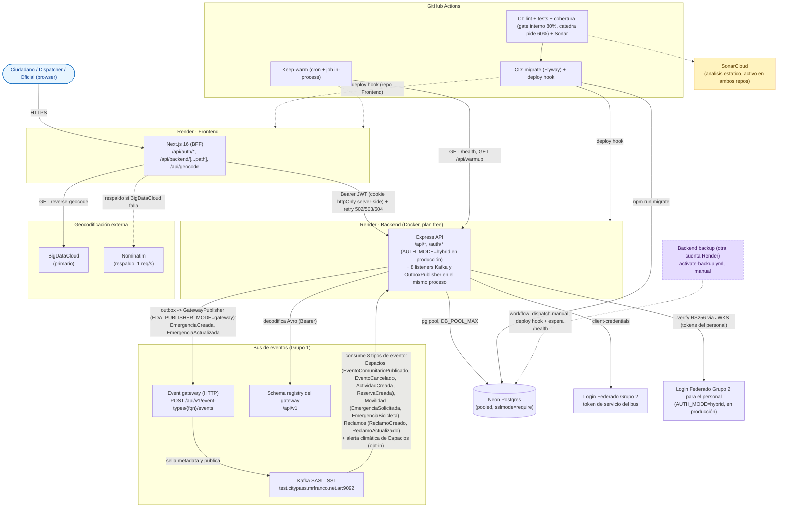
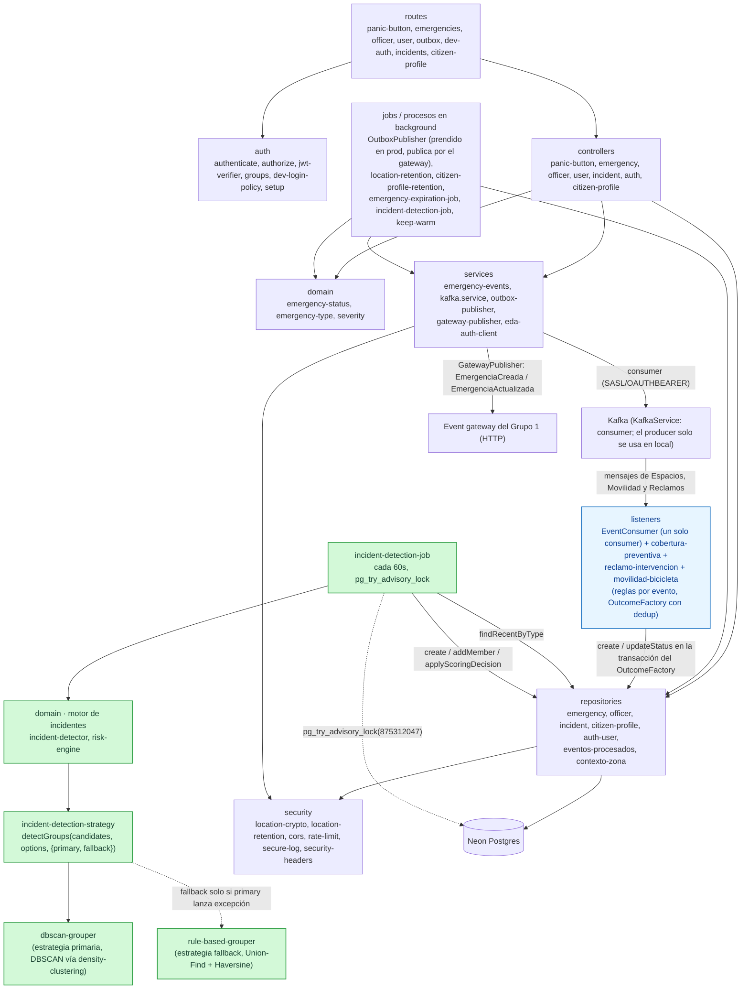

# Arquitectura

Para qué sirve: ubicar el módulo de Emergencias dentro de CityPass+ (estilo C4 — nivel de
contenedores) y después abrir el backend en sus componentes internos.

## Contenedores

> **Nota sobre el stack de backup:** existe de verdad, a diferencia de lo que decía la versión
> anterior de este documento. `.github/workflows/activate-backup.yml` (mergeado en el PR #38) es
> un workflow manual (`workflow_dispatch`, sin cron ni trigger automático): dispara el deploy
> hook de un segundo servicio backend en otra cuenta de Render (secret
> `RENDER_DEPLOY_HOOK_URL_BACKUP`) y espera hasta 6 minutos a que su `/health` responda 200
> (variable de repo `BACKUP_BACKEND_URL`). Ni la URL del servicio backup ni su propio
> `DATABASE_URL` están versionados en este repo (se configuran en el dashboard de Render); que
> apunte a la misma Neon primaria es una decisión operativa del equipo, no algo que se pueda leer
> en este código — se documenta igual porque así lo confirmó quien armó el stack. No hay
> failover automático: alguien tiene que correr el workflow a mano.

## Componentes internos del backend

> **Sobre `IncidentDetectionStrategy`:** implementada en el PR #51 (tarea #61, ADR-002
> "IncidentDetectionStrategy"), verificada en producción el 23/09. `src/domain/incident-detector.js`
> ya no importa `rule-based-grouper.js` directo: llama a `detectGroups(candidates, options, {
> primary, fallback })` de `src/domain/incident-detection-strategy.js`, con `DbscanGrouper`
> (`src/domain/dbscan-grouper.js`, librería `density-clustering`, mismo `haversineDistanceMeters`
> y `minPts = INCIDENT_MIN_CITIZENS` con filtro posterior de ciudadanos únicos) como estrategia
> primaria y `RuleBasedGrouper` como fallback determinístico. `detectGroups` cae a `fallback`
> **solo** ante una excepción de `primary` — nunca porque el resultado sea un array vacío, que es
> una respuesta válida. La estrategia que corrió queda en `algorithmVersion` (`dbscan-v1` o
> `rule-based-v1`). Los parámetros están calibrados con un dataset sintético en
> [`../ml/calibracion-dbscan.md`](../ml/calibracion-dbscan.md) (`scripts/calibrar-dbscan.js`): los
> defaults actuales quedan; falta contrastarlos con casos reales.

## Leyenda

| Elemento | Estado |
|---|---|
| Línea sólida | Conexión activa hoy en el ambiente productivo |
| Línea punteada | Deshabilitado, previsto o de respaldo (no es el camino feliz actual) |
| `Kafka` | Conectado al bus del Grupo 1 (`KAFKA_ENABLED=true`, SASL/OAUTHBEARER + SSL) para consumir: ocho listeners sobre un único consumer (`EventConsumer`) leen eventos de Espacios (`EventoComunitarioPublicado`, `EventoCancelado`, `ActividadCreada`, `ReservaCreada`), Movilidad (`EmergenciaSolicitada`, `EmergenciaBicicleta`) y Reclamos (`ReclamoCreado`, `ReclamoActualizado`). Los ocho figuran `running` en `GET /health` de producción (verificado el 16/11/2026). Los dos de alerta climática (`CriticidadClimaticaConfirmada` y `CriticidadClimaticaFinalizada`) son opt-in y figuran `disabled` hasta cargar `EDA_TOPIC_CRITICIDAD_CLIMATICA_CONFIRMADA` y `_FINALIZADA`. Los eventos propios salen por HTTP al gateway (`EDA_PUBLISHER_MODE=gateway`, `OUTBOX_PUBLISHER_ENABLED=true`), no por el producer de Kafka (ver `06-eventos.md`) |
| `Login Federado` (token de servicio) | Token client-credentials del bus y del schema registry (`EDA_OAUTH_*`, `src/services/eda-auth-client.js`) |
| `IdP Grupo 2` | En uso desde el 12/11/2026: producción corre `AUTH_MODE=hybrid`. Los tokens del personal se validan contra el JWKS del Login Federado y los de ciudadanos y atajos de demo contra la clave local, según el `iss` (ver `src/auth/setup.js` y `src/auth/hybrid-verifier.js`) |
| Render free | El backend duerme sin tráfico; mientras duerme no consume. Al despertar, el consumer group sigue desde su último offset confirmado |
| SonarCloud | Corre en los dos repos (secret `SONAR_TOKEN` cargado en backend y, desde el 21/09, en `Frontend`); sigue siendo `continue-on-error: true`, no bloquea el pipeline |
| Stack de backup | Confirmado en el código por `.github/workflows/activate-backup.yml` (PR #38); manual, sin failover automático (ver nota arriba) |
| `IncidentDetectionStrategy` | Implementada desde el PR #51 (verificado en producción el 23/09): `incident-detector.js` llama a `detectGroups()`, que corre `DbscanGrouper` como primaria y cae a `RuleBasedGrouper` solo ante una excepción de DBSCAN. Ver nota arriba |

## Fuente en el código

- `src/app.js` (montaje de rutas y middlewares), `src/index.js` (composition root, arranca `startIncidentDetectionJob`)
- `src/routes/*.js` (incluido `incidents.routes.js`), `src/controllers/*.js` (incluido `incident.controller.js`), `src/domain/*.js` (incluidos `rule-based-grouper.js`, `dbscan-grouper.js`, `incident-detection-strategy.js`, `risk-engine.js`, `incident-detector.js`), `src/repositories/*.js` (incluido `incident.repository.js`), `src/services/*.js` (incluido `incident-detection-job.js`), `src/security/*.js`, `src/auth/*.js`, `scripts/demo-dbscan.js` (dataset sintético de demo)
- `src/listeners/` (`event-consumer.js`, `cobertura-preventiva/`, `reclamo-intervencion/`, `movilidad-bicicleta/`), `src/services/eda-auth-client.js`, `src/services/gateway-publisher.js`
- `render.yaml` (backend), `Frontend/render.yaml`, `Frontend/app/api/backend/[...path]/route.js`, `Frontend/app/api/geocode/route.js`, `Frontend/lib/geocode-server.js`
- `.github/workflows/ci.yml`, `.github/workflows/cd.yml`, `.github/workflows/keep-warm.yml`, `.github/workflows/activate-backup.yml` (backend) y sus equivalentes en `Frontend/.github/workflows/`
- `sonar-project.properties` (backend y frontend)
