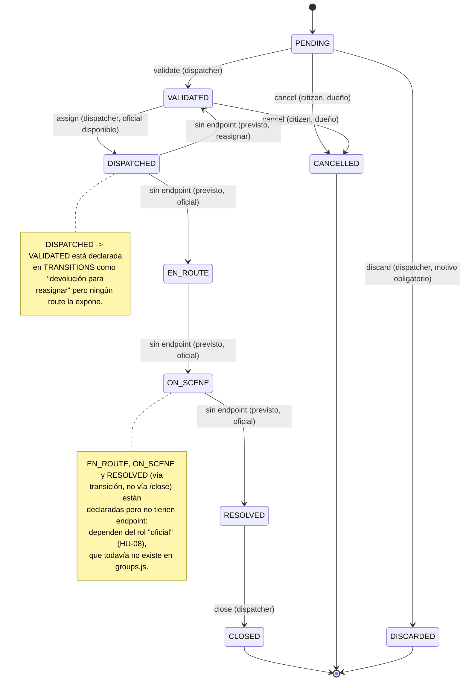

# Máquina de estados de una emergencia

Para qué sirve: reflejar exactamente las transiciones declaradas en
`src/domain/emergency-status.js` (única fuente de verdad, usada por los controllers y por el
repository como defensa en profundidad con `FOR UPDATE`), y marcar cuáles tienen un endpoint
HTTP real hoy y cuáles están declaradas en el código pero sin forma de dispararse todavía.

## Estados y transiciones

| Desde | Hacia | Disparador real hoy | Rol |
|---|---|---|---|
| `PENDING` | `VALIDATED` | `PATCH /api/emergencies/:id/validate` | `dispatcher` |
| `PENDING` | `CANCELLED` | `PATCH /api/emergencies/:id/cancel` | `citizen` (dueño) |
| `PENDING` | `DISCARDED` | `PATCH /api/emergencies/:id/discard` (`reason` obligatorio) | `dispatcher` |
| `VALIDATED` | `DISPATCHED` | `PATCH /api/emergencies/:id/assign` (`officerId`, debe estar `disponible`) | `dispatcher` |
| `VALIDATED` | `CANCELLED` | `PATCH /api/emergencies/:id/cancel` | `citizen` (dueño) |
| `DISPATCHED` | `EN_ROUTE` | **Sin endpoint** — declarada en `TRANSITIONS.DISPATCHED`, previsto para HU-08 | oficial (previsto) |
| `DISPATCHED` | `VALIDATED` | **Sin endpoint** — declarada como "devolución para reasignar" | — |
| `EN_ROUTE` | `ON_SCENE` | **Sin endpoint** — previsto para HU-08 | oficial (previsto) |
| `ON_SCENE` | `RESOLVED` | **Sin endpoint** — previsto para HU-08 | oficial (previsto) |
| `RESOLVED` | `CLOSED` | `PATCH /api/emergencies/:id/close` | `dispatcher` |

**Terminales** (sin transiciones de salida, `TERMINAL_STATUSES` en el código): `CLOSED`,
`CANCELLED`, `DISCARDED`.

Cualquier transición no listada en `TRANSITIONS` responde **409 Conflict**
(`ConflictError`, ej. `Invalid transition PENDING → RESOLVED`). La validación corre dos veces:
en el controller (`assertTransition`) y en `EmergencyRepository.updateStatus`/`assignOfficer`
con la fila bloqueada (`SELECT ... FOR UPDATE`), para que ningún endpoint futuro pueda saltarse
el flujo ni ganar una carrera.

## Fuente en el código

- `src/domain/emergency-status.js` (`EMERGENCY_STATUSES`, `TRANSITIONS`, `assertTransition`)
- `src/controllers/emergency.controller.js` (`validateEmergency`, `discardEmergency`,
  `assignOfficer`, `closeEmergency`, `cancelEmergency`)
- `src/repositories/emergency.repository.js` (`updateStatus`, `assignOfficer` — transacción +
  `FOR UPDATE`)
- `src/routes/emergencies.routes.js` (rutas y roles expuestos)
- `src/auth/groups.js` (no existe grupo `officer` todavía)
