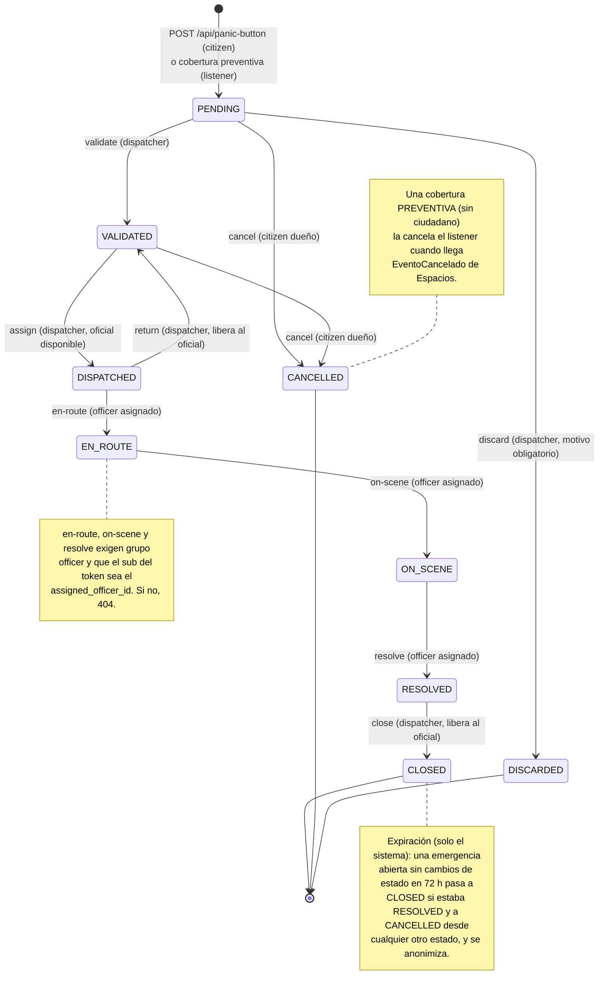

# Máquina de estados de una emergencia

Para qué sirve: reflejar exactamente las transiciones declaradas en
`src/domain/emergency-status.js` (única fuente de verdad, usada por los controllers y por el
repository como defensa en profundidad con `FOR UPDATE`) y qué endpoint dispara cada una. Hoy
todas las transiciones tienen endpoint, salvo las de expiración, que solo dispara el sistema.

## Estados y transiciones

| Desde | Hacia | Endpoint | Rol | Efectos además del cambio de estado |
|---|---|---|---|---|
| — | `PENDING` | `POST /api/panic-button` | `citizen` | `EmergenciaCreada` en el outbox |
| — | `PENDING` | listener `EventoComunitarioPublicado` | sistema | Emergencia `PREVENTIVA`, `source = EXTERNAL`; `EmergenciaCreada` en el outbox |
| `PENDING` | `VALIDATED` | `PATCH /api/emergencies/:id/validate` | `dispatcher` | — |
| `PENDING` | `CANCELLED` | `PATCH /api/emergencies/:id/cancel` | `citizen` (dueño) | `reason` opcional; `closed_at = now()` |
| `PENDING` | `DISCARDED` | `PATCH /api/emergencies/:id/discard` | `dispatcher` | `reason` obligatorio; `closed_at = now()` |
| `VALIDATED` | `DISPATCHED` | `PATCH /api/emergencies/:id/assign` | `dispatcher` | `officerId` tiene que estar `disponible`; pasa a `ocupado` |
| `VALIDATED` | `CANCELLED` | `PATCH /api/emergencies/:id/cancel` | `citizen` (dueño) | `reason` opcional; `closed_at = now()` |
| `DISPATCHED` | `VALIDATED` | `PATCH /api/emergencies/:id/return` | `dispatcher` | Devolución para reasignar: el oficial vuelve a `disponible` y `assigned_officer_id` queda en `NULL`; `reason` opcional |
| `DISPATCHED` | `EN_ROUTE` | `PATCH /api/emergencies/:id/en-route` | `officer` asignado | — |
| `EN_ROUTE` | `ON_SCENE` | `PATCH /api/emergencies/:id/on-scene` | `officer` asignado | — |
| `ON_SCENE` | `RESOLVED` | `PATCH /api/emergencies/:id/resolve` | `officer` asignado | `resueltoAt` en el evento; el oficial sigue `ocupado` |
| `RESOLVED` | `CLOSED` | `PATCH /api/emergencies/:id/close` | `dispatcher` | `closed_at = now()`; el oficial vuelve a `disponible` |
| `PENDING`, `VALIDATED` | `CANCELLED` | listener `EventoCancelado` | sistema (`eda:espacios`) | Solo coberturas `PREVENTIVA` de ese evento |
| `PENDING`, `VALIDATED`, `DISPATCHED`, `EN_ROUTE`, `ON_SCENE` | `CANCELLED` | job de expiración | sistema (`sistema:expiracion`) | Sin cambios de estado en `EMERGENCY_EXPIRATION_HOURS` (72). Anonimiza la ubicación, `closed_at = now()`, libera al oficial |
| `RESOLVED` | `CLOSED` | job de expiración | sistema (`sistema:expiracion`) | Igual que arriba: lo resuelto que nadie cerró se cierra solo |

Cada transición escribe, en la misma transacción, una fila en `emergency_status_history`
(`previous_status`, `new_status`, `actor` = `sub` del token, `reason`) y un evento
`EmergenciaActualizada` en `outbox_events` (ver `06-eventos.md`).

Al pasar a `VALIDATED`, `CANCELLED` o `CLOSED`, si la emergencia tiene `assigned_officer_id`,
ese oficial vuelve a `disponible` (si estaba `ocupado`). El id no se borra de la emergencia: una
emergencia devuelta sigue mostrando el último oficial que tuvo.

**Terminales** (sin transiciones de salida, `TERMINAL_STATUSES` en el código): `CLOSED`,
`CANCELLED`, `DISCARDED`.

**El motor de incidentes no toca esta máquina de estados.** `incident_id` y
`effectivePriority` viajan junto a la emergencia y afectan el orden en que la ve el dispatcher
(`sortBy=priority`), pero no agregan ni quitan transiciones de `status`.

Cualquier transición no listada en `TRANSITIONS` responde **409 Conflict**
(`ConflictError`, ej. `Invalid transition PENDING → RESOLVED`); saltear un estado operativo
(por ejemplo `DISPATCHED → ON_SCENE`) o repetirlo también da 409. La validación corre dos
veces: en el controller (`assertTransition`) y en `EmergencyRepository.updateStatus`/`assignOfficer`
con la fila bloqueada (`SELECT ... FOR UPDATE`). Para el oficial, además, el repository vuelve a
comprobar bajo el lock que siga asignado (`requireAssignedOfficerId`), por si el dispatcher
devolvió y reasignó entre la lectura y el `UPDATE`.

## Fuente en el código

- `src/domain/emergency-status.js` (`EMERGENCY_STATUSES`, `TRANSITIONS`, `assertTransition`)
- `src/controllers/emergency.controller.js` (`validateEmergency`, `discardEmergency`,
  `assignOfficer`, `returnEmergency`, `advanceOperationalStatus` → `markEnRoute`,
  `markOnScene`, `markResolved`, `closeEmergency`, `cancelEmergency`)
- `src/repositories/emergency.repository.js` (`updateStatus`, `applyStatusUpdate`,
  `assignOfficer` — transacción + `FOR UPDATE` + liberación del oficial)
- `src/routes/emergencies.routes.js` (rutas y roles expuestos)
- `src/auth/groups.js`, `src/auth/authorize.js` (`requireOfficer`, `canAdvanceEmergencyStatus`)
- `src/listeners/cobertura-preventiva/handlers/` (alta y cancelación de coberturas)
