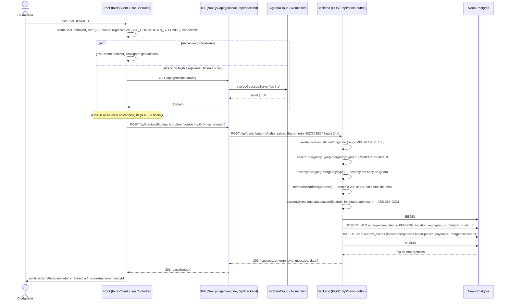
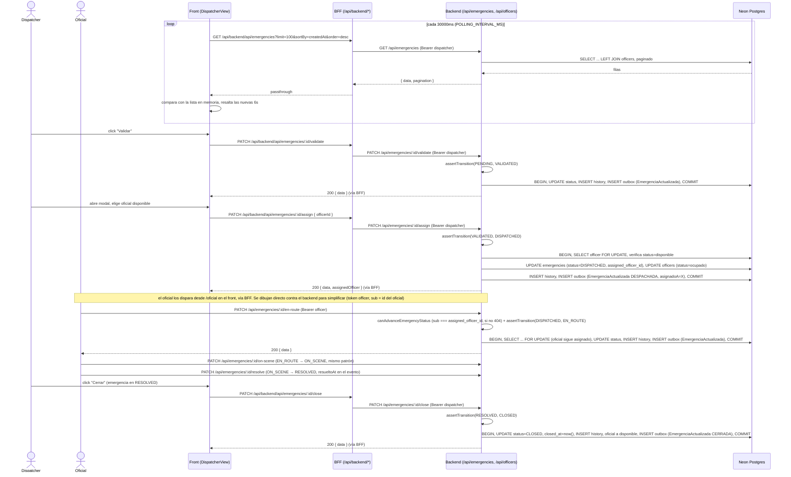
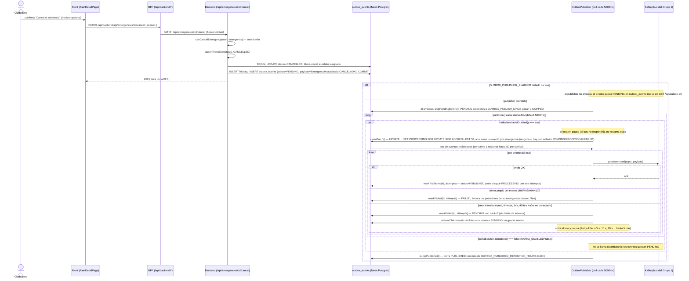
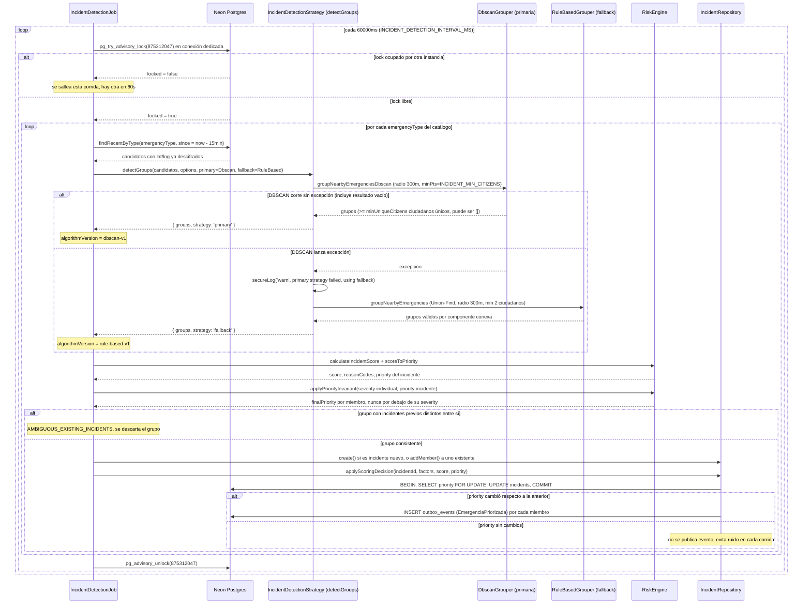
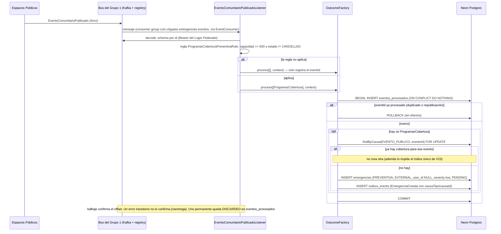
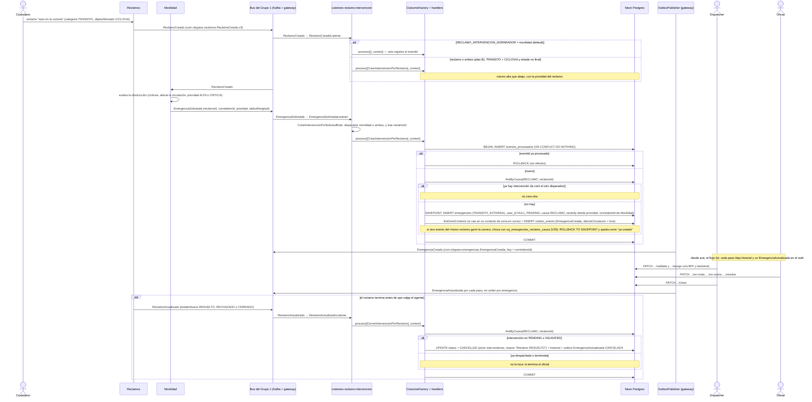
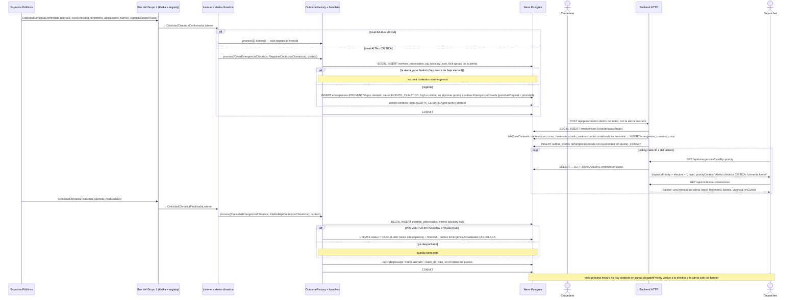

# Secuencias

Para qué sirve: mostrar paso a paso los flujos que se muestran en la demo, con los nombres
reales de funciones/archivos de front y back, para que sirvan de guion de demo y de referencia
de debugging. Las secuencias f) y g) son los casos transversales con otros módulos.

## a) Ciudadano dispara el botón SOS

## b) Dispatcher y oficial: listado, validar, asignar, seguimiento del oficial, cerrar

## c) Cancelación por el ciudadano y publicación confiable (outbox → Kafka)

## d) Job de detección de incidentes (cada 60s)

## e) Cobertura preventiva (consumo de un evento de Espacios)

`EventoCancelado` sigue el mismo camino con `CancelarCoberturaPreventivaRule`: si la cobertura
de ese `eventoId` está en `PENDING` o `VALIDATED`, la pasa a `CANCELLED` (actor `eda:espacios`)
con historial y `EmergenciaActualizada`.

## f) Caso transversal: reclamo por ciclovía obstruida → intervención `TRANSITO`

Caso 3 del Hito 2. Un vecino reclama por un auto estacionado en la ciclovía; Movilidad evalúa la
obstrucción y le pide la emergencia a Emergencias, que crea la intervención y la sigue con el
flujo normal de dispatcher y oficial. Qué evento crea la intervención lo decide
`RECLAMO_INTERVENCION_DISPARADOR` (`src/listeners/reclamo-intervencion/disparador.js`):
`movilidad` (default, el que corre en producción), `reclamo` (plan B: solo el `ReclamoCreado`) o
`ambos` (el primero que llegue; el otro la encuentra creada).

## g) Alerta climática: contextos de zona, `PREVENTIVA` y suba de prioridad

Espacios confirma una alerta climática y después la finaliza, con el mismo `alertaId`. Solo
`ALTA` y `CRITICA` hacen algo. Los dos listeners son opt-in: sin
`EDA_TOPIC_CRITICIDAD_CLIMATICA_CONFIRMADA` y `EDA_TOPIC_CRITICIDAD_CLIMATICA_FINALIZADA` el
consumer no se suscribe (en producción están cargadas desde el 17/11/2026).

## Leyenda

| Elemento | Notas |
|---|---|
| BFF | Next.js del repo `Frontend`, corre server-side en Render; guarda el JWT en cookie `httpOnly` (`citypass_session`) y nunca lo expone al browser |
| `fetchBackend` | Reintenta 502/503/504 hasta 6 veces (~24s) porque Render (free) duerme el backend tras 15 min sin tráfico |
| Outbox transaccional | El `INSERT` en `emergencies`/`emergency_status_history` y el `INSERT` en `outbox_events` van en la **misma transacción**: si Kafka está caído, la emergencia igual queda persistida |
| `OUTBOX_PUBLISHER_ENABLED=false` | El publisher del flujo (c) no arranca y los eventos se acumulan `PENDING`. Producción corre desde el 05/11 con `true` y `EDA_PUBLISHER_MODE=gateway` |
| Oficial (b) | El oficial opera desde `/oficial` en el `Frontend`: lista lo que tiene asignado y avanza con un botón por paso. Los tres endpoints validan que el `sub` del token sea el oficial asignado; en local, con el dev login sin modo estricto (`of-001`/`of-002`), también se pueden llamar por Swagger o Postman |
| `address` en el SOS | La dirección legible que resuelve el front (`resolveEmergencyAddress`, geocode inverso con timeout 2.5s) viaja al backend en el mismo body que `latitude`/`longitude`, como campo `address` (≤200 caracteres); `normalizeAddress` la sanea y `locationCrypto.encryptLocation` la guarda **dentro del mismo blob cifrado** que la ubicación (ver `02-modelo-entidad-relacion.md`) |
| Advisory lock del job (d) | `pg_try_advisory_lock` no bloquea: si otra instancia del backend (p. ej. el stack de backup activado) ya tiene el lock, esa corrida se saltea en vez de esperar — hay otra corrida 60s después |
| `EmergenciaPriorizada` condicional | Solo se publica si `applyScoringDecision` detecta que la `priority` del incidente cambió respecto a la que tenía antes (`NULL` cuenta como distinta, así que la primera vez siempre notifica); si no cambió, la corrida no genera evento nuevo aunque haya recalculado el score |
| `RECLAMO_INTERVENCION_DISPARADOR` (f) | Se lee al construir los listeners: un valor que no es `movilidad`, `reclamo` ni `ambos` frena el arranque en vez de descartar cada evento. El cierre por `ReclamoActualizado` no depende de esta variable. Nunca hay dos intervenciones por reclamo: `findByCausa` más el índice único de V29, también si los dos listeners procesan el mismo reclamo a la vez (el consumer procesa particiones en paralelo) |
| Advisory lock de la alerta (g) | Confirmación y finalización llegan por tópicos distintos y se pueden procesar a la vez. Las dos transacciones toman `pg_advisory_xact_lock` sobre el grupo de la alerta: la finalización gana aunque llegue antes, porque deja la marca de baja que la confirmación tardía consulta |
| Suba de prioridad (g) | Se mide una sola vez, al crear la emergencia, con la coordenada en memoria (no se guarda en claro). No sube las `PREVENTIVA` ni las que ya existían cuando empezó la alerta. `EmergenciaCreada` y `EmergenciaActualizada` publican la prioridad original; el vínculo saldría como `EmergenciaVinculadaAContextoZona`, hoy apagado en producción (`EVENTO_VINCULO_CONTEXTO_ENABLED=false`) |
| `detectGroups` (secuencia d) | Cae a `RuleBasedGrouper` **solo** ante una excepción de `DbscanGrouper` (falla técnica, ej. dataset no es un Array); un resultado vacío de DBSCAN es una respuesta válida y no dispara el fallback. Si el fallback también falla, la excepción se propaga sin capturar (PR #51, verificado en producción el 23/09) |

## Fuente en el código

- Front (`Frontend`): `app/(citizen)/inicio/InicioClient.js`, `app/lib/sosController.js`, `app/lib/api.js`, `app/lib/geocoding.js`, `lib/geocode-server.js`, `lib/backend-fetch.js`, `app/api/backend/[...path]/route.js`, `app/api/geocode/route.js`, `app/components/DispatcherView.js`, `app/(citizen)/mis-alertas/[id]/page.js`
- Back (`emergencias-backend`): `src/controllers/panic-button.controller.js` (`normalizeAddress`), `src/controllers/emergency.controller.js` (`advanceOperationalStatus`), `src/repositories/emergency.repository.js`, `src/security/location-crypto.js`, `src/services/outbox-publisher.js`, `src/services/kafka.service.js`, `src/services/emergency-events.js`
- Consumo (secuencia e): `src/listeners/event-listener.js`, `src/listeners/event-decoder.js`, `src/listeners/outcome-factory.js`, `src/listeners/cobertura-preventiva/`, `src/repositories/eventos-procesados.repository.js`
- Caso ciclovía (secuencia f): `src/listeners/reclamo-intervencion/disparador.js`, `reclamo-creado/`, `emergencia-solicitada/`, `reclamo-actualizado/` y `handlers/` (`crear-intervencion.handler.js`, `cerrar-intervencion.handler.js`), `db/migrations/V29__transito_y_emergencia_por_reclamo.sql`
- Alerta climática (secuencia g): `src/listeners/alerta-climatica/` (reglas y `handlers/`), `src/domain/alerta-climatica.js`, `src/repositories/contexto-zona.repository.js`, `src/repositories/emergency.repository.js` (`linkZoneContexts`, `ZONE_CONTEXT_JOIN_SQL`), `src/domain/severity.js` (`dispatchPriority`), `src/controllers/contexto-zona.controller.js`
- Motor de incidentes (secuencia d): `src/services/incident-detection-job.js` (`withDetectionLock`, `DETECTION_LOCK_KEY`), `src/domain/incident-detector.js`, `src/domain/incident-detection-strategy.js` (`detectGroups`), `src/domain/dbscan-grouper.js`, `src/domain/rule-based-grouper.js`, `src/domain/risk-engine.js`, `src/repositories/incident.repository.js` (`applyScoringDecision`)
