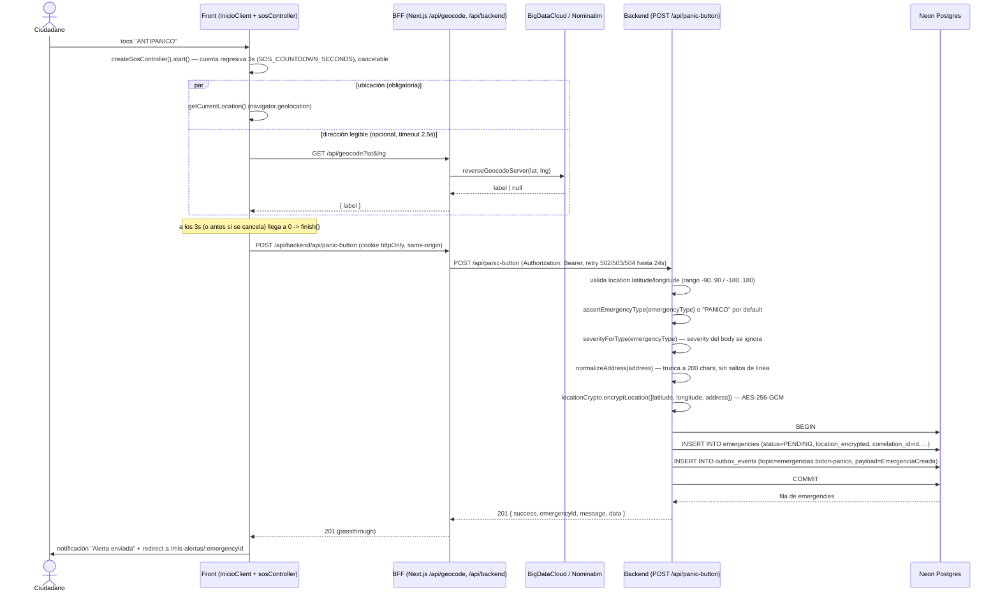
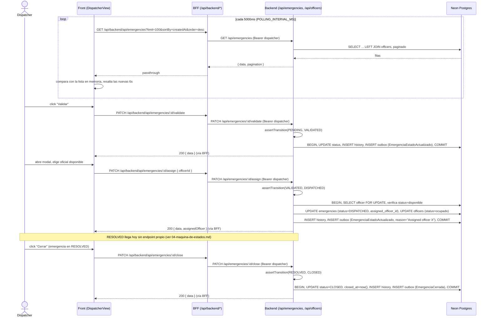
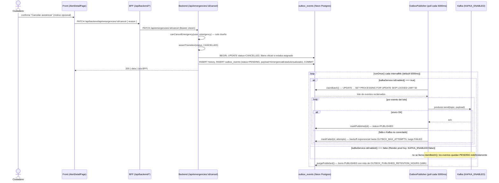

# Secuencias

Para qué sirve: mostrar paso a paso los tres flujos que se muestran en la demo del Hito 1, con
los nombres reales de funciones/archivos de front y back, para que sirvan de guion de demo y de
referencia de debugging.

## a) Ciudadano dispara el botón SOS

## b) Dispatcher: listado, validar, asignar oficial, cerrar

## c) Cancelación por el ciudadano y publicación confiable (outbox → Kafka)

## Leyenda

| Elemento | Notas |
|---|---|
| BFF | Next.js del repo `Frontend`, corre server-side en Render; guarda el JWT en cookie `httpOnly` (`citypass_session`) y nunca lo expone al browser |
| `fetchBackend` | Reintenta 502/503/504 hasta 6 veces (~24s) porque Render (free) duerme el backend tras 15 min sin tráfico |
| Outbox transaccional | El `INSERT` en `emergencies`/`emergency_status_history` y el `INSERT` en `outbox_events` van en la **misma transacción**: si Kafka está caído, la emergencia igual queda persistida |
| `KAFKA_ENABLED=false` | Configurado así en `render.yaml` de producción hoy: el flujo (c) nunca llega a la rama que publica de verdad; los eventos se acumulan `PENDING` |

## Fuente en el código

- Front (`Frontend`): `app/(citizen)/inicio/InicioClient.js`, `app/lib/sosController.js`, `app/lib/api.js`, `app/lib/geocoding.js`, `lib/geocode-server.js`, `lib/backend-fetch.js`, `app/api/backend/[...path]/route.js`, `app/api/geocode/route.js`, `app/components/DispatcherView.js`, `app/(citizen)/mis-alertas/[id]/page.js`
- Back (`emergencias-backend`): `src/controllers/panic-button.controller.js`, `src/controllers/emergency.controller.js`, `src/repositories/emergency.repository.js`, `src/services/outbox-publisher.js`, `src/services/kafka.service.js`, `src/services/emergency-events.js`
