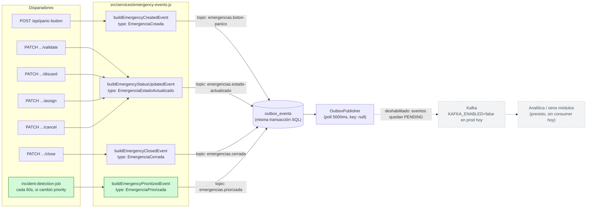

# Eventos de dominio

Para qué sirve: documentar qué eventos publica hoy el módulo (`src/services/emergency-events.js`),
por qué tópico, cuándo se disparan, y qué tan lejos está el payload actual del envelope que
pide Analítica (Grupo 8) en `tableros-analitica.md`.

## Eventos publicados hoy

| Evento (`type`) | Tópico (env var, default) | Cuándo | Payload resumido (`data`) |
|---|---|---|---|
| `EmergenciaCreada` | `TOPIC_PANIC_BUTTON` → `emergencias.boton-panico` | Al crear una emergencia vía `POST /api/panic-button` | `id, correlationId, userId, description, severity, status, assignedOfficerId, emergencyType, createdAt, updatedAt` |
| `EmergenciaEstadoActualizado` | `TOPIC_EMERGENCIA_ESTADO_ACTUALIZADO` → `emergencias.estado-actualizado` | En `validate`, `discard`, `assign` y `cancel` (los 4 endpoints reusan el mismo evento) | `id, correlationId, previousStatus, newStatus, actor, reason, timestamp` |
| `EmergenciaCerrada` | `TOPIC_EMERGENCIA_CERRADA` → `emergencias.cerrada` | En `PATCH .../close` | `id, correlationId, actor, closedAt` |
| `EmergenciaPriorizada` | `TOPIC_EMERGENCIA_PRIORIZADA` → `emergencias.priorizada` | Cada 60s, dentro de `incident-detection-job.js`, **solo si la `priority` del incidente cambió** respecto a la corrida anterior (`IncidentRepository.applyScoringDecision`); se dispara una vez por cada emergencia miembro del incidente | `id, correlationId, incidentId, priorityIndividual, incidentPriority, priority (finalPriority del miembro), score, reasonCodes, algorithmVersion` |

Cada evento lleva además, **fuera de `data`**: `type`, `eventId` (`randomUUID()`, generado en
`insertOutboxEvent`) y `correlationId` (duplicado: está en la raíz **y** dentro de `data`).

**El módulo hoy solo publica: no hay ningún consumer de Kafka en este repo** (`kafka.service.js`
únicamente crea un `producer`, nunca un `consumer`). Todos los mensajes salen con `key: null`
(`producer.send({ topic, messages: [{ key: null, value }] })` en `KafkaService.publishEvent`):
sin partition key, Kafka no puede garantizar orden entre eventos de la misma emergencia si caen
en particiones distintas. A eso se suma que `OutboxPublisher` reintenta con **backoff
exponencial** (`markFailed`, hasta `OUTBOX_MAX_ATTEMPTS`) cuando falla un envío: un evento viejo
que reintenta puede publicarse después que uno más nuevo del mismo `correlationId`. Ningún
consumidor previsto (Analítica u otro) debería asumir que el orden de llegada coincide con el
orden de negocio.

## Brecha contra el contrato de Analítica (`tableros-analitica.md`)

Analítica define un envelope común (`metadata.eventId`, `metadata.eventType`,
`metadata.occurredAt`, `metadata.source`, `metadata.version`, `data.correlationId`). El código
actual no lo respeta:

| Campo esperado | Estado en el código |
|---|---|
| `metadata.eventId` | Existe como `eventId`, pero **en la raíz del payload**, no dentro de un objeto `metadata` |
| `metadata.eventType` | Existe como `type` en la raíz (mismo valor PascalCase-pasado que pide el contrato: `EmergenciaCreada`, etc.), pero fuera de `metadata` |
| `metadata.occurredAt` | **No existe a nivel evento.** Solo `EmergenciaEstadoActualizado` trae `data.timestamp`; `EmergenciaCreada` y `EmergenciaCerrada` no traen ningún timestamp propio (habría que inferirlo de `createdAt`/`closedAt` dentro de `data`) |
| `metadata.source` | No existe en ningún evento |
| `metadata.version` | No existe en ningún evento |
| `data.correlationId` | Sí existe (además duplicado en la raíz del payload) |
| `EmergenciaPriorizada` | **Se publica** desde los PRs #36/#39/#41 (ver `01-casos-de-uso.md`, CU-04 implementado), pero solo cuando cambia la `priority` del incidente — no hay un evento por cada corrida del job, y su payload tampoco tiene el envelope `metadata.*` que pide Analítica (mismas brechas que los otros tres eventos) |
| `EmergenciaDespachada` | No se publica como tipo propio: `assign` reusa `EmergenciaEstadoActualizado` con `reason: "Assigned officer <id>"` en vez de un evento dedicado |
| Entrega real al bus | `KAFKA_ENABLED=false` en `render.yaml` de producción: ningún evento sale de `outbox_events` hoy, así que Analítica no podría consumir nada aunque el contrato estuviera alineado (ver `05-secuencias.md`, flujo c) |

## Semántica de orden y entrega

No prometemos orden estricto de entrega — no de los eventos hoy publicados, ni de los eventos pendientes cuando se prende Kafka. Los detalles:

| Aspecto | Comportamiento actual | Consecuencia |
|---|---|---|
| **Orden de reclamo** | `OutboxPublisher.claimBatch()` corre `SELECT ... ORDER BY created_at FOR UPDATE SKIP LOCKED` (`src/services/outbox-publisher.js:28`) | Dentro de un batch, los más viejos salen primero |
| **Retries** | Si `publishEvent` falla, `markFailed()` setea `available_at = now() + backoff` (30 s, 60 s, 120 s, … hasta 15 min). El evento vuelve a `PENDING` pero **demorado** | Un evento posterior con `created_at` mayor puede **adelantar** al fallido si el próximo poll (5 s) llega antes que el backoff |
| **Partition key en Kafka** | `producer.send({ messages: [{ key: null, value }] })` (`src/services/kafka.service.js:91`) | Sin key: Kafka distribuye round-robin entre las particiones del tópico. **Cero ordenamiento cross-partition**, ni siquiera para eventos de la misma emergencia |
| **Entrega** | Producer con `at-least-once` (default de KafkaJS + outbox transaccional) | Un consumer puede recibir el mismo evento más de una vez si el `markPublished` falla después de que Kafka confirmó |
| **Prender Kafka con eventos acumulados** | El poll de 5 s reclama el batch más viejo primero. Si alguno falla, el resto del batch sigue publicando y el fallido se demora | La afirmación "salen todos en orden al prender Kafka" es **falsa** en cuanto hay una falla intermedia |

### Qué habría que hacer si un consumer necesitase orden

- **Ordenamiento por emergencia:** setear `key = emergencyId` en `kafka.service.js` → Kafka garantiza orden dentro de la partición para una misma key. **No implementado.**
- **Ordenamiento estricto global:** un solo tópico con una sola partición y sin retries paralelos. Descarta throughput. **No aplica al diseño del gateway del Grupo 1.**
- **Ordenamiento por `correlationId`:** similar a `key = emergencyId` pero agrupa por cadena de eventos. **No implementado.**

Mientras ningún consumidor exija orden, el diseño actual está bien. Cuando aparezca alguno que lo necesite (Analítica podría), se decide `key` de tópico y se documenta en la ADR-005.

### Respuesta canónica para la presentación

Si preguntan "¿los eventos salen en orden cuando prende Kafka?": **no garantizamos orden estricto**. El outbox reclama por `created_at`, pero un fallo con retry deja al evento demorado mientras otros posteriores salen antes. Aparte, se publica con `key: null`, así que Kafka distribuye entre particiones sin ordenamiento cross-partition. Si algún consumer futuro necesita orden, se implementa `key = emergencyId` o `key = correlationId`.

## Fuente en el código

- `asyncapi.yaml` (spec AsyncAPI del contrato vigente, validado contra los builders en `src/tests/asyncapi.test.js`)
- `src/services/emergency-events.js` (builders de los 4 eventos, incluido `buildEmergencyPrioritizedEvent`)
- `src/repositories/emergency.repository.js` (`insertOutboxEvent` — genera `eventId`, arma el `INSERT` a `outbox_events`)
- `src/repositories/incident.repository.js` (`applyScoringDecision` — decide si notifica comparando `previousPriority` vs `priority`)
- `src/services/incident-detection-job.js` (dispara la decisión cada 60s)
- `src/services/outbox-publisher.js`, `src/services/kafka.service.js` (`publishEvent` — `key: null`, sin consumer)
- `src/controllers/panic-button.controller.js`, `src/controllers/emergency.controller.js` (tópicos vía `process.env.TOPIC_*`)
- `render.yaml` (`KAFKA_ENABLED`, `TOPIC_PANIC_BUTTON`, `TOPIC_EMERGENCIA_CERRADA`); `.env.example` trae además `TOPIC_EMERGENCIA_ESTADO_ACTUALIZADO` y `TOPIC_EMERGENCIA_PRIORIZADA`, que en producción no están seteadas y caen al default hardcodeado en cada builder
- Documento de producto: `tableros-analitica.md` (sección 1.2 y 3), `Emergencias - Roadmap y Historias de Usuario.md` (contrato de eventos del bus)
