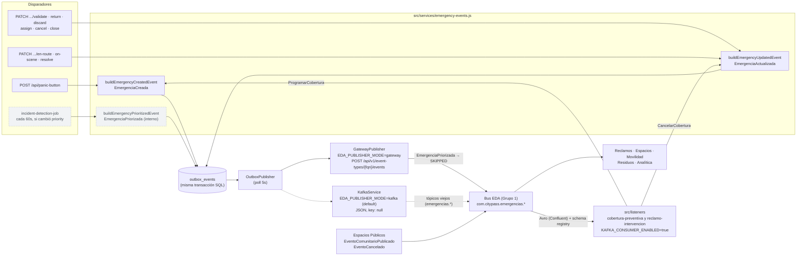

# Eventos de dominio

Para qué sirve: documentar qué eventos publica y consume hoy el módulo, cuándo se disparan,
por dónde salen y qué garantías de entrega y orden damos.

**Fuente de verdad del contrato (campos, tipos, enums): [`asyncapi.yaml`](../../asyncapi.yaml).**
Este documento no repite el schema campo por campo; `src/tests/asyncapi.test.js` valida en
`npm test` que los builders cumplen el spec. El detalle de cada campo y sus defaults también
está en el README (sección "Contrato de eventos (bus EDA)").

## Eventos publicados

| Evento | FQN en el bus (modo `gateway`) | Tópico en modo `kafka` (env var → default) | Cuándo |
|---|---|---|---|
| `EmergenciaCreada` | `com.citypass.emergencias.EmergenciaCreada` | `TOPIC_PANIC_BUTTON` → `emergencias.boton-panico` | Alta por `POST /api/panic-button`, o cobertura preventiva creada por el listener de `EventoComunitarioPublicado` (`categoria = PREVENTIVA`, `causaTipo = EVENTO_PUBLICO`) |
| `EmergenciaActualizada` | `com.citypass.emergencias.EmergenciaActualizada` | `TOPIC_EMERGENCIA_ESTADO_ACTUALIZADO` → `emergencias.estado-actualizado` | Todo cambio de estado: `validate`, `return`, `discard`, `assign`, `cancel`, `close`, `en-route`, `on-scene`, `resolve`, y la cancelación de una cobertura preventiva por `EventoCancelado` |
| `EmergenciaPriorizada` (interno) | — (no sale: el `GatewayPublisher` la marca `SKIPPED`) | `TOPIC_EMERGENCIA_PRIORIZADA` → `emergencias.priorizada` | Cada 60s en `incident-detection-job.js`, **solo si cambió la `priority` del incidente** (`IncidentRepository.applyScoringDecision`); un evento por cada emergencia miembro |

Puntos del contrato (issue #48, cerrado el 2026-11-02) que conviene tener presentes:

- Los campos viajan **en español** (`emergenciaId`, `categoria`, `prioridad`, `estado`,
  `estadoAnterior`/`estadoNuevo`, `ciudadanoId`, `usuarioId`...). La base sigue en inglés: la
  traducción se hace solo al armar el evento (`STATUS_TO_ESTADO`, `SEVERITY_TO_PRIORIDAD`).
- **No hay `EmergenciaCerrada` ni `EmergenciaDespachada`**: el cierre viaja como
  `EmergenciaActualizada` con `estadoNuevo = CERRADA`, y la asignación con
  `estadoNuevo = DESPACHADA` y `asignadoA` = oficial asignado.
- `descripcion`, `titulo` y `direccion` (texto libre) **nunca** van al bus.

## Eventos consumidos

| Evento (Espacios Públicos) | Tópico (env var) | Listener | Qué hace |
|---|---|---|---|
| `EventoComunitarioPublicado` | `EDA_TOPIC_EVENTO_PUBLICADO` (ej. `com.citypass.espacios.EventoComunitarioPublicado`) | `EventoComunitarioPublicadoListener` | Si `capacidad` (o `cupoMaximo`) ≥ `UMBRAL_CAPACIDAD_COBERTURA_PREVENTIVA` (default 500) y el evento no está `CANCELLED`, crea una única emergencia `PREVENTIVA` por `eventoId` → publica `EmergenciaCreada`. Sin importar la capacidad, registra un contexto de zona en el punto del evento con un radio fijo (`contexto_zona`, V28 y V31; `CONTEXTO_ZONA_RADIO_DEFAULT_METROS`, default 500): mientras dura (`inicio`–`fin`), las emergencias que se crean dentro de ese radio suben un nivel de prioridad de despacho |
| `EventoCancelado` | `EDA_TOPIC_EVENTO_CANCELADO` (ej. `com.citypass.espacios.EventoCancelado`) | `EventoCanceladoListener` | Cancela las coberturas de ese `eventoId` que sigan en `PENDING`/`VALIDATED` → publica `EmergenciaActualizada` con `estadoNuevo = CANCELADA`. Si ya fue despachada, no la toca. Da de baja el contexto de zona del evento: la prioridad de las emergencias cercanas vuelve a la normal |
| `EmergenciaBicicleta` (Movilidad) | `EDA_TOPIC_EMERGENCIA_BICICLETA` (default `com.citypass.movilidad.EmergenciaBicicleta`) | `EmergenciaBicicletaListener` | Crea una emergencia externa `MEDICA` en `PENDING`, mapea P1/P2/P3/P4 a critical/high/medium/low y deduplica por `data.emergenciaId` (`causaTipo = MOVILIDAD_BICICLETA`). Ese ID se conserva como `correlationId` en `EmergenciaCreada` y todas las actualizaciones. No reemplaza `EmergenciaSolicitada` |
| `EmergenciaSolicitada` (Movilidad) | `EDA_TOPIC_EMERGENCIA_SOLICITADA` (default `com.citypass.movilidad.EmergenciaSolicitada`) | `EmergenciaSolicitadaListener` | Disparador del caso de la ciclovía (default de `RECLAMO_INTERVENCION_DISPARADOR`): crea una única emergencia `TRANSITO` por `reclamoId` (causa `RECLAMO`) con la prioridad pedida → publica `EmergenciaCreada` |
| `ReclamoCreado` (Reclamos, v3) | `EDA_TOPIC_RECLAMO_CREADO` (default `com.citypass.reclamos.ReclamoCreado.v3`) | `ReclamoCreadoListener` | Plan B: solo con `RECLAMO_INTERVENCION_DISPARADOR` en `reclamo` o `ambos`. Con `categoria = TRANSITO` y `objetoAfectado = CICLOVIA` crea la misma emergencia `TRANSITO` por `reclamoId` → publica `EmergenciaCreada` |
| `CriticidadClimaticaConfirmada` (Espacios) | `EDA_TOPIC_CRITICIDAD_CLIMATICA_CONFIRMADA` (default `com.citypass.espacios.CriticidadClimaticaConfirmada`) | `CriticidadClimaticaConfirmadaListener` | Registra un contexto de zona `ALERTA_CLIMATICA` por cada punto de `ubicaciones` (referencia `<alertaId>#<n>`, radio `CONTEXTO_ZONA_RADIO_CLIMA_METROS`, default 2000 m) con la ventana `vigenciaDesde`–`vigenciaHasta`: las emergencias que se crean dentro de ese radio suben un nivel de prioridad de despacho. Con `nivelCriticidad` `ALTA` o `CRITICA` (y la alerta todavía vigente) crea además una única emergencia `PREVENTIVA` por `alertaId` (`causaTipo = EVENTO_CLIMATICO`) → publica `EmergenciaCreada` con `prioridadOriginal = prioridad` |
| `CriticidadClimaticaFinalizada` (Espacios) | `EDA_TOPIC_CRITICIDAD_CLIMATICA_FINALIZADA` (default `com.citypass.espacios.CriticidadClimaticaFinalizada`) | `CriticidadClimaticaFinalizadaListener` | Da de baja los contextos de ese `alertaId` (si llega antes que la confirmación, la confirmación tardía no crea contextos) y cancela la emergencia climática que siga en `PENDING`/`VALIDATED` → publica `EmergenciaActualizada` con `estadoNuevo = CANCELADA` |
| `ReclamoActualizado` (Reclamos) | `EDA_TOPIC_RECLAMO_ACTUALIZADO` (default `com.citypass.reclamos.ReclamoActualizado`) | `ReclamoActualizadoListener` | Con `estadoNuevo` `RESUELTO`, `RECHAZADO` o `CERRADO`, cancela la intervención que siga en `PENDING`/`VALIDATED` → publica `EmergenciaActualizada` con `estadoNuevo = CANCELADA` |

Los listeners arrancan solo con `KAFKA_CONSUMER_ENABLED=true` y cada uno necesita su tópico
seteado. Un solo consumer group, `com.citypass.emergencias.eventos`; deduplicación por
`metadata.eventId` en `eventos_procesados`, y los mensajes ilegibles o inválidos se descartan sin
frenar el tópico. Detalle en [`src/listeners/README.md`](../../src/listeners/README.md).

## Envelope según el modo de publicación

| Modo | Qué se manda | Envelope que ve el consumidor |
|---|---|---|
| `EDA_PUBLISHER_MODE=gateway` | Solo `data`, por HTTP al gateway con token OAuth2 client-credentials (`grupo5`) | `{ metadata, data }`: el gateway agrega `metadata` (`eventId`, `eventType`, `source`...) y escribe Avro en formato Confluent |
| `EDA_PUBLISHER_MODE=kafka` (default) | El payload completo del outbox, JSON, directo al broker | `{ type, eventId, correlationId, data }` (envelope propio, sin `metadata`) |

El modo `kafka` publica en los tópicos viejos (`emergencias.*`) y en JSON, mientras que los demás
grupos leen Avro de los FQN `com.citypass.*`. Por eso `OUTBOX_PUBLISHER_ENABLED=false` permite
prender Kafka solo para consumir sin publicar directo en el bus. El contrato que vale para los
otros módulos es el del modo `gateway`.

Producción corre desde el 05/11 con `EDA_PUBLISHER_MODE=gateway`, `OUTBOX_PUBLISHER_ENABLED=true`
y `OUTBOX_PUBLISH_SINCE=2026-11-05T15:06:00Z`: al prender el bus descartó como `SKIPPED` los
`PENDING` anteriores (issue #71). Sin `OUTBOX_PUBLISHER_ENABLED=true`, `OutboxPublisher` no
reclama eventos y quedan `PENDING` en `outbox_events`. `TOPIC_EMERGENCIA_CERRADA`, que sigue en `render.yaml`, ya no
lo lee ningún código.

## Campos del contrato todavía sin poblar

Viajan con su valor por defecto (`null`) hasta que se cierren los issues correspondientes:

| Campo | Evento | Pendiente de |
|---|---|---|
| `ubicacion.latitud`, `ubicacion.longitud` | `EmergenciaCreada` | Cargar `BUS_LOCATION_ENCRYPTION_KEY` en Render (sin clave salen `null`) |
| `causaId`, `causaTipo` | `EmergenciaCreada` | Los completan las emergencias que crean los listeners (`EVENTO_PUBLICO`, `RECLAMO`, `EVENTO_CLIMATICO`, `MOVILIDAD_BICICLETA`); faltan `INCIDENTE_VIAL` y `RESERVA` |
| `prioridadOriginal` | `EmergenciaCreada` | Solo con `causaTipo = EVENTO_CLIMATICO` (igual a `prioridad`); en el resto, `null` como pide el contrato |
| `areaResponsable` | `EmergenciaActualizada` | #85 |
| Un evento por recurso despachado | `EmergenciaActualizada` | #85 (hoy sale un único evento con `asignadoA`) |

## Semántica de orden y entrega

No prometemos orden estricto de entrega. Los detalles:

| Aspecto | Comportamiento actual | Consecuencia |
|---|---|---|
| **Orden de reclamo** | `OutboxPublisher.claimBatch()` corre `... ORDER BY created_at FOR UPDATE SKIP LOCKED` | Dentro de un batch, los más viejos salen primero |
| **Retries** | Si la publicación falla, `markFailed()` setea `available_at = now() + backoff` (30 s, 60 s, 120 s… hasta `OUTBOX_MAX_BACKOFF_MS`, 15 min por default; con 429 del gateway respeta `Retry-After`). El evento vuelve a `PENDING` pero **demorado**. Los errores permanentes del gateway (400/403/404/413, 401 tras reintentar) pasan a `FAILED` sin reintento | Un evento posterior puede **adelantar** al fallido si el próximo poll (5 s) llega antes que el backoff |
| **Lock vencido** | `claimBatch()` también reclama filas `PROCESSING` con `locked_at` de más de 1 minuto, y cada reclamo suma 1 a `attempts`. `markPublished`/`markSkipped`/`markFailed` solo actualizan si la fila sigue `PROCESSING` con el `attempts` de su reclamo | Si un proceso tarda más de 1 minuto y otro ya la reclamó y la publicó, el primero no la vuelve a `PENDING` (antes sí: el evento salía dos veces). Igual puede salir dos veces si los dos llegan a enviarla |
| **Partition key** | Modo `kafka`: `producer.send({ messages: [{ key: null, value }] })` en `KafkaService.publishEvent`. Modo `gateway`: la key la decide el gateway | En modo `kafka`, cero ordenamiento entre particiones, ni siquiera para la misma emergencia. En modo `gateway` no hay garantía documentada por nuestro lado |
| **Entrega** | Outbox transaccional + reintentos = **at-least-once** | Un consumidor puede recibir el mismo evento más de una vez (si `markPublished` falla después de que el bus confirmó). Deduplicar por `metadata.eventId`, como hace nuestro `OutcomeFactory` |
| **Prender el bus con eventos acumulados** | El poll reclama el batch más viejo primero. Si alguno falla, el resto sigue y el fallido se demora | "Salen todos en orden al prender el bus" es **falso** en cuanto hay una falla intermedia |

### Qué habría que hacer si un consumidor necesitase orden

- **Orden por emergencia:** usar `key = emergenciaId` (en `KafkaService`, o pedirle al gateway
  que particione por esa key). **No implementado.**
- **Orden por `correlationId`:** igual que lo anterior, agrupando por cadena de eventos.
  **No implementado.**
- **Orden estricto global:** un tópico con una sola partición y sin retries paralelos. Descarta
  throughput. **No aplica al diseño del gateway del Grupo 1.**

Mientras ningún consumidor exija orden, el diseño actual alcanza. Si alguno lo necesita, se
define la key y se documenta en la ADR correspondiente. Mientras tanto, los consumidores pueden
reordenar con `updatedAt` / `createdAt` del propio `data`.

### Respuesta canónica para la presentación

Si preguntan "¿los eventos salen en orden?": **no garantizamos orden estricto**. El outbox reclama
por `created_at`, pero un fallo con retry deja ese evento demorado mientras otros posteriores salen
antes, y no publicamos con partition key. La entrega es at-least-once: los consumidores deduplican
por `eventId`. Si un consumidor necesita orden, se publica con `key = emergenciaId`.

## Fuente en el código

- `asyncapi.yaml` (spec AsyncAPI del contrato vigente, validado contra los builders en `src/tests/asyncapi.test.js`)
- `src/services/emergency-events.js` (builders y tablas de traducción `STATUS_TO_ESTADO` / `SEVERITY_TO_PRIORIDAD`)
- `src/repositories/emergency.repository.js` (`insertOutboxEvent`: genera `eventId` y hace el `INSERT` en `outbox_events`, en la misma transacción que el cambio de negocio)
- `src/repositories/incident.repository.js` (`applyScoringDecision`: decide si emite `EmergenciaPriorizada`)
- `src/controllers/panic-button.controller.js`, `src/controllers/emergency.controller.js` (disparadores HTTP)
- `src/services/outbox-publisher.js` (poll, reintentos, `SKIPPED`/`FAILED`, `OUTBOX_PUBLISH_SINCE`, `OUTBOX_PUBLISHER_ENABLED`)
- `src/services/gateway-publisher.js` (modo `gateway`: `PUBLISHED_TYPES`, clasificación de errores HTTP)
- `src/services/kafka.service.js` (modo `kafka`: `key: null`, SASL OAUTHBEARER)
- `src/listeners/` (consumo: decoder Avro/JSON, reglas, `OutcomeFactory` con deduplicación)
- `src/index.js` (elección del publisher según `EDA_PUBLISHER_MODE`, arranque de listeners)
- `render.yaml`, `.env.example` (variables de entorno)
