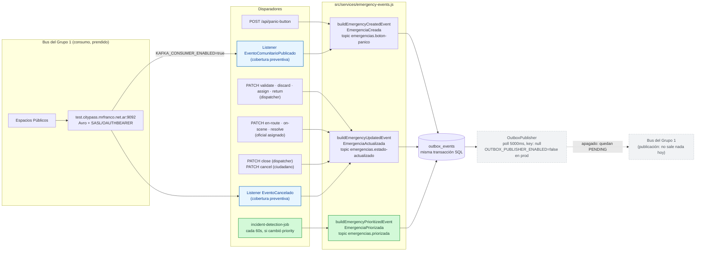

# Eventos de dominio

Para qué sirve: documentar qué eventos publica el módulo (`src/services/emergency-events.js`),
por qué tópico, cuándo se disparan, qué eventos de otros módulos consume, y qué parte de todo eso
sale de verdad al bus hoy.

## Eventos que publica el módulo

Los tres builders arman el mismo sobre: `{ type, eventId, correlationId, data }`. `eventId` es un
`randomUUID()` generado en `insertOutboxEvent`; `correlationId` va en la raíz y también dentro
de `data`.

| Evento (`type`) | Tópico (env var → default) | Cuándo | `data` |
|---|---|---|---|
| `EmergenciaCreada` | `TOPIC_PANIC_BUTTON` → `emergencias.boton-panico` | Alta por `POST /api/panic-button`, y alta de una emergencia `PREVENTIVA` por el listener de cobertura preventiva | `emergenciaId, categoria, prioridad, estado, barrio, ubicacion.barrio, afectaCirculacion, latitud, longitud, causaId, causaTipo, prioridadOriginal, ciudadanoId, correlationId, createdAt` |
| `EmergenciaActualizada` | `TOPIC_EMERGENCIA_ESTADO_ACTUALIZADO` → `emergencias.estado-actualizado` | Cada cambio de estado: `validate`, `discard`, `assign`, `return`, `en-route`, `on-scene`, `resolve`, `close`, `cancel`, y la cancelación de una cobertura preventiva cuando llega `EventoCancelado` | `emergenciaId, estadoAnterior, estadoNuevo, updatedAt, resueltoAt, usuarioId, asignadoA, areaResponsable, resolucion, prioridad, correlationId` |
| `EmergenciaPriorizada` | `TOPIC_EMERGENCIA_PRIORIZADA` → `emergencias.priorizada` | Cada 60s, dentro de `incident-detection-job.js`, **solo si la `priority` del incidente cambió** respecto a la corrida anterior (`IncidentRepository.applyScoringDecision`); uno por cada emergencia miembro del incidente | `id, correlationId, incidentId, priorityIndividual, incidentPriority, priority (finalPriority del miembro), score, reasonCodes, algorithmVersion` |

`EmergenciaCreada` y `EmergenciaActualizada` siguen el contrato cerrado en el
[issue #48](https://github.com/G6D2/demo-repository/issues/48#issuecomment-6589800911): campos
en español, prioridad `BAJA`/`MEDIA`/`ALTA`/`CRITICA`, estados traducidos (`PENDIENTE`,
`VALIDADA`, `DESPACHADA`, `EN_CAMINO`, `EN_LUGAR`, `RESUELTA`, `CERRADA`, `DESCARTADA`,
`CANCELADA`) y fechas ISO-8601. El detalle campo por campo está en el `README.md`
(sección "Eventos (bus EDA)"). Valores fijos hoy: `barrio`, `afectaCirculacion`, `latitud`,
`longitud`, `prioridadOriginal` y `areaResponsable` salen siempre en `null`; `asignadoA` solo
se completa en `DESPACHADA`; `causaTipo`/`causaId` solo en las coberturas preventivas
(`EVENTO_PUBLICO` + `eventoId`). `EmergenciaPriorizada` no forma parte de ese contrato y
conserva los nombres en inglés.

No hay `EmergenciaCerrada` ni `EmergenciaEstadoActualizado`: el cierre viaja como
`EmergenciaActualizada` con `estadoNuevo = CERRADA`, y el despacho como `EmergenciaActualizada`
con `estadoNuevo = DESPACHADA` y `asignadoA`.

## Qué sale al bus hoy

- **Nada de lo propio.** En producción `KAFKA_ENABLED=true` pero `OUTBOX_PUBLISHER_ENABLED=false`
  (`render.yaml`): el `OutboxPublisher` no arranca y los eventos quedan `PENDING` en
  `outbox_events`. Se pueden ver con `GET /api/outbox-events` (dispatcher).
- Los tópicos son los propios del módulo (`emergencias.*`), no los FQN del gateway
  (`com.citypass.emergencias.*`), y el producer manda JSON, no Avro.
- Si el publisher se prende, al arrancar pasa a `SKIPPED` los `PENDING` anteriores a
  `OUTBOX_PUBLISH_SINCE` (V21), para no mandar de golpe los eventos acumulados.

## Eventos que consume el módulo

Con `KAFKA_CONSUMER_ENABLED=true` (producción), `src/index.js` arranca los listeners de
`src/listeners/` en el mismo proceso web. Hoy hay un caso de negocio, la cobertura preventiva:

| Evento de Espacios | Topic (env) | Regla | Efecto |
|---|---|---|---|
| `EventoComunitarioPublicado` | `EDA_TOPIC_EVENTO_PUBLICADO` | `capacidad` (o `cupoMaximo`) ≥ `UMBRAL_CAPACIDAD_COBERTURA_PREVENTIVA` (500) y `estado` distinto de `CANCELLED` | Crea una emergencia `PREVENTIVA` por `eventoId` (`source = EXTERNAL`, sin ciudadano, `causaTipo = EVENTO_PUBLICO`, severidad `low`, `PENDING`; sin coordenadas, `requiresManualValidation = true`) y deja `EmergenciaCreada` en el outbox |
| `EventoCancelado` | `EDA_TOPIC_EVENTO_CANCELADO` | trae `eventoId` | Cancela la cobertura de ese evento si está en `PENDING` o `VALIDATED` (actor `eda:espacios`) y deja `EmergenciaActualizada`; si ya avanzó, solo lo loguea |

- Decodificación: Avro en formato Confluent contra el registry del gateway
  (`EDA_SCHEMA_REGISTRY_URL`, mismo token Bearer que el broker); lo que no empieza con el byte
  mágico se lee como JSON.
- Idempotencia: `OutcomeFactory` registra `metadata.eventId` en `eventos_procesados` (V22) en la
  misma transacción que los efectos. Un duplicado hace `ROLLBACK` sin efectos. Además, el índice
  único `uq_emergencies_preventiva_causa` (V23) impide dos coberturas para el mismo evento.
- Errores: uno transitorio (base, registry) se propaga y Kafka reentrega; uno permanente queda
  como `DISCARDED` con el motivo y el offset avanza.

## Semántica de orden y entrega

No prometemos orden estricto de entrega. Aplica a los eventos que publicaría el outbox:

| Aspecto | Comportamiento actual | Consecuencia |
|---|---|---|
| **Orden de reclamo** | `OutboxPublisher.claimBatch()` corre `SELECT ... ORDER BY created_at FOR UPDATE SKIP LOCKED` | Dentro de un batch, los más viejos salen primero |
| **Retries** | Si `publishEvent` falla, `markFailed()` setea `available_at = now() + backoff` (30 s, 60 s, 120 s, … hasta `OUTBOX_MAX_BACKOFF_MS`, 15 min). El evento vuelve a `PENDING` pero **demorado** | Un evento posterior puede **adelantar** al fallido si el próximo poll (5 s) llega antes que el backoff |
| **Partition key en Kafka** | `producer.send({ messages: [{ key: null, value }] })` en `KafkaService.publishEvent` | Sin key, Kafka reparte entre particiones: **cero orden cross-partition**, ni siquiera para eventos de la misma emergencia |
| **Entrega** | At-least-once (outbox transaccional + producer de KafkaJS) | Un consumer puede recibir el mismo evento más de una vez si `markPublished` falla después de que Kafka confirmó |
| **Prender el publisher con eventos acumulados** | Los `PENDING` anteriores a `OUTBOX_PUBLISH_SINCE` pasan a `SKIPPED`; el resto sale por `created_at`. Si alguno falla, el resto del batch sigue y el fallido se demora | "Salen todos en orden" es **falso** en cuanto hay una falla intermedia |

Si un consumer necesitara orden por emergencia, habría que publicar con `key = emergencyId` (o
`correlationId`): Kafka garantiza orden dentro de una partición para una misma key. **No está
implementado.**

### Respuesta canónica para la presentación

Si preguntan "¿los eventos salen en orden?": **no garantizamos orden estricto**. El outbox
reclama por `created_at`, pero un fallo con retry deja al evento demorado mientras otros
posteriores salen antes, y se publica con `key: null`. Y hoy, en producción, el outbox no
publica: Kafka está prendido solo para consumir los eventos de Espacios.

## Fuente en el código

- `src/services/emergency-events.js` (`buildEmergencyCreatedEvent`, `buildEmergencyUpdatedEvent`,
  `buildEmergencyPrioritizedEvent`, `STATUS_TO_ESTADO`, `SEVERITY_TO_PRIORIDAD`)
- `src/repositories/emergency.repository.js` (`insertOutboxEvent` — genera `eventId`, arma el
  `INSERT` a `outbox_events`)
- `src/repositories/incident.repository.js` (`applyScoringDecision` — decide si notifica
  comparando `previousPriority` vs `priority`)
- `src/services/outbox-publisher.js` (`isOutboxPublisherEnabled`, `skipPendingBefore`,
  `claimBatch`, `markFailed`), `src/services/kafka.service.js` (`publishEvent`, SASL/SSL)
- `src/controllers/panic-button.controller.js`, `src/controllers/emergency.controller.js`
  (tópicos vía `process.env.TOPIC_*`)
- `src/listeners/cobertura-preventiva/` (listeners, reglas y handlers),
  `src/listeners/outcome-factory.js`, `src/listeners/event-decoder.js`,
  `src/repositories/eventos-procesados.repository.js`
- `render.yaml` (`KAFKA_ENABLED`, `OUTBOX_PUBLISHER_ENABLED`, `KAFKA_CONSUMER_ENABLED`,
  `EDA_TOPIC_*`, `TOPIC_PANIC_BUTTON`); `TOPIC_EMERGENCIA_ESTADO_ACTUALIZADO` y
  `TOPIC_EMERGENCIA_PRIORIZADA` no están seteadas en `render.yaml` y caen al default del código
