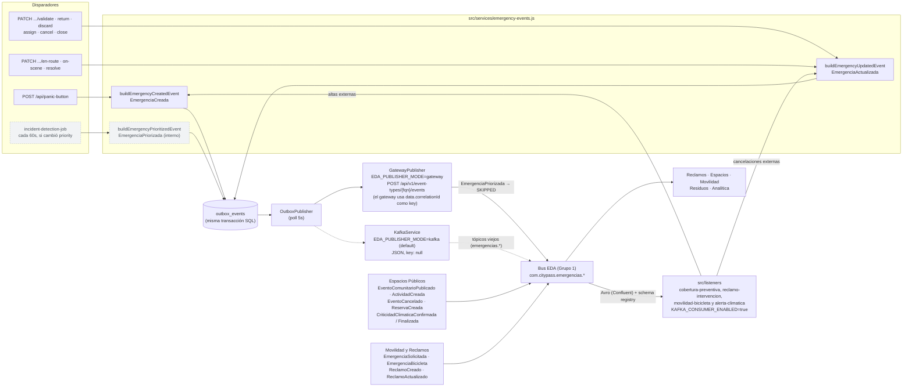

# Eventos de dominio

Para qué sirve: documentar qué eventos publica y consume hoy el módulo, cuándo se disparan,
por dónde salen y qué garantías de entrega y orden damos.

**Fuente de verdad del contrato (campos, tipos, enums): [`asyncapi.yaml`](../../asyncapi.yaml).**
Este documento no repite el schema campo por campo; `src/tests/asyncapi.test.js` valida en
`npm test` que los builders cumplen el spec. El detalle de cada campo y sus defaults también
está en el README (sección "Contrato de eventos (bus EDA)").

## Eventos publicados

| Evento | FQN en el bus (modo `gateway`) | Tópico en modo `kafka` (env var → default) | Cuándo |
|---|---|---|---|
| `EmergenciaCreada` | `com.citypass.emergencias.EmergenciaCreada` | `TOPIC_PANIC_BUTTON` → `emergencias.boton-panico` | Alta por `POST /api/panic-button`, o alta externa que crea un listener (ver [Eventos consumidos](#eventos-consumidos)): `PREVENTIVA` con `causaTipo` `EVENTO_PUBLICO`, `RESERVA` o `EVENTO_CLIMATICO`; `TRANSITO` con `RECLAMO`; `MEDICA` con `MOVILIDAD_BICICLETA` |
| `EmergenciaActualizada` | `com.citypass.emergencias.EmergenciaActualizada` | `TOPIC_EMERGENCIA_ESTADO_ACTUALIZADO` → `emergencias.estado-actualizado` | Todo cambio de estado: `validate`, `return`, `discard`, `assign`, `cancel`, `close`, `en-route`, `on-scene`, `resolve`; las cancelaciones que hacen los listeners (`EventoCancelado`, `ReclamoActualizado`, `CriticidadClimaticaFinalizada`), y la expiración de una emergencia abierta (actor `sistema:expiracion`) |
| `EmergenciaVinculadaAContextoZona` | `com.citypass.emergencias.EmergenciaVinculadaAContextoZona` | `TOPIC_EMERGENCIA_VINCULADA_CONTEXTO` → `emergencias.vinculada-contexto-zona` | Uno por vínculo de una emergencia con un contexto de zona, en la misma sentencia que la fila de `emergencia_contexto_zona`. **Solo con `EVENTO_VINCULO_CONTEXTO_ENABLED=true`: hoy apagado en producción** (`render.yaml`), hasta que el tipo esté registrado en el catálogo del gateway |
| `EmergenciaPriorizada` (interno) | — (no sale: el `GatewayPublisher` la marca `SKIPPED`) | `TOPIC_EMERGENCIA_PRIORIZADA` → `emergencias.priorizada` | Cada 60s en `incident-detection-job.js`, **solo si cambió la `priority` del incidente** (`IncidentRepository.applyScoringDecision`); un evento por cada emergencia miembro |

Puntos del contrato (issue #48, cerrado el 2026-11-02) que conviene tener presentes:

- Los campos viajan **en español** (`emergenciaId`, `categoria`, `prioridad`, `estado`,
  `estadoAnterior`/`estadoNuevo`, `ciudadanoId`, `usuarioId`...). La base sigue en inglés: la
  traducción se hace solo al armar el evento (`STATUS_TO_ESTADO`, `SEVERITY_TO_PRIORIDAD`).
- **No hay `EmergenciaCerrada` ni `EmergenciaDespachada`**: el cierre viaja como
  `EmergenciaActualizada` con `estadoNuevo = CERRADA`, y la asignación con
  `estadoNuevo = DESPACHADA` y `asignadoA` = oficial asignado.
- `descripcion`, `titulo` y `direccion` (texto libre) **nunca** van al bus.

## Eventos consumidos

| Evento (Espacios Públicos) | Tópico (env var) | Listener | Qué hace |
|---|---|---|---|
| `ActividadCreada` (Espacios, v3) | `EDA_TOPIC_ACTIVIDAD_CREADA` (default `com.citypass.espacios.ActividadCreada.v3`) | `ActividadCreadaListener` | Misma cobertura `PREVENTIVA` que `EventoComunitarioPublicado` (`causaId = actividadId`, que es el mismo `eventoId`, así que el dedup por causa evita una segunda), si `capacidad` llega al umbral, la actividad no está cancelada ni terminó y no es de un ciudadano. No registra contexto de zona |
| `EventoComunitarioPublicado` | `EDA_TOPIC_EVENTO_PUBLICADO` (ej. `com.citypass.espacios.EventoComunitarioPublicado`) | `EventoComunitarioPublicadoListener` | Si `capacidad` (o `cupoMaximo`) ≥ `UMBRAL_CAPACIDAD_COBERTURA_PREVENTIVA` (default 500) y el evento no está `CANCELLED`, crea una única emergencia `PREVENTIVA` por `eventoId` → publica `EmergenciaCreada`. Sin importar la capacidad, registra un contexto de zona en el punto del evento con un radio fijo (`contexto_zona`, V28 y V31; `CONTEXTO_ZONA_RADIO_DEFAULT_METROS`, default 500): mientras dura (`inicio`–`fin`), las emergencias que se crean dentro de ese radio suben un nivel de prioridad de despacho |
| `ReservaCreada` | `EDA_TOPIC_RESERVA_CREADA` (opt-in, ej. `com.citypass.espacios.ReservaCreada`) | `ReservaCreadaListener` | Con `tipoReserva = ESPACIO`, `cantidadPersonas` ≥ `UMBRAL_PERSONAS_COBERTURA_RESERVA` (default 500) y la reserva sin terminar, crea una única emergencia `PREVENTIVA` por `reservaId` con `causaTipo = RESERVA` → publica `EmergenciaCreada`. No registra contexto de zona ni tiene baja (Espacios no cancela reservas de espacio) |
| `EventoCancelado` | `EDA_TOPIC_EVENTO_CANCELADO` (ej. `com.citypass.espacios.EventoCancelado`) | `EventoCanceladoListener` | Cancela las coberturas de ese `eventoId` que sigan en `PENDING`/`VALIDATED` → publica `EmergenciaActualizada` con `estadoNuevo = CANCELADA`. Si ya fue despachada, no la toca. Da de baja el contexto de zona del evento: la prioridad de las emergencias cercanas vuelve a la normal. Si llega antes que la publicación (o que `ActividadCreada`), esa baja frena la cobertura tardía |
| `EmergenciaBicicleta` (Movilidad) | `EDA_TOPIC_EMERGENCIA_BICICLETA` (default `com.citypass.movilidad.EmergenciaBicicleta`) | `EmergenciaBicicletaListener` | Crea una emergencia externa `MEDICA` en `PENDING`, mapea P1/P2/P3/P4 a critical/high/medium/low y deduplica por `data.emergenciaId` (`causaTipo = MOVILIDAD_BICICLETA`). Ese ID se conserva como `correlationId` en `EmergenciaCreada` y todas las actualizaciones. No reemplaza `EmergenciaSolicitada` |
| `EmergenciaSolicitada` (Movilidad) | `EDA_TOPIC_EMERGENCIA_SOLICITADA` (default `com.citypass.movilidad.EmergenciaSolicitada`) | `EmergenciaSolicitadaListener` | Disparador del caso de la ciclovía (default de `RECLAMO_INTERVENCION_DISPARADOR`): crea una única emergencia `TRANSITO` por `reclamoId` (causa `RECLAMO`) con la prioridad pedida → publica `EmergenciaCreada` |
| `ReclamoCreado` (Reclamos, v3) | `EDA_TOPIC_RECLAMO_CREADO` (default `com.citypass.reclamos.ReclamoCreado.v3`) | `ReclamoCreadoListener` | Plan B: solo con `RECLAMO_INTERVENCION_DISPARADOR` en `reclamo` o `ambos`. Con `categoria = TRANSITO` y `objetoAfectado = CICLOVIA` crea la misma emergencia `TRANSITO` por `reclamoId` → publica `EmergenciaCreada` |
| `CriticidadClimaticaConfirmada` (Espacios) | `EDA_TOPIC_CRITICIDAD_CLIMATICA_CONFIRMADA` (opt-in, sin default; ej. `com.citypass.espacios.CriticidadClimaticaConfirmada`) | `CriticidadClimaticaConfirmadaListener` | Solo con `nivelCriticidad` `ALTA` o `CRITICA` (ADR "Responder a las alertas climáticas de Espacios"); `BAJA` y `MEDIA` no generan nada. Registra un contexto de zona `ALERTA_CLIMATICA` por cada punto de `ubicaciones` (referencia `<alertaId>#<n>`) con el radio del nivel (`CRITICA` 1000 m, `CONTEXTO_ZONA_RADIO_CLIMA_CRITICA_METROS`; `ALTA` 500 m, `CONTEXTO_ZONA_RADIO_CLIMA_ALTA_METROS`) y la ventana `vigenciaDesde`–`vigenciaHasta`: las emergencias que se crean dentro de ese radio suben un nivel de prioridad de despacho. Si la alerta sigue vigente y no se finalizó, crea además una única emergencia `PREVENTIVA` por `alertaId` (`causaTipo = EVENTO_CLIMATICO`, severidad `high`/`critical`) → publica `EmergenciaCreada` con `prioridadOriginal = prioridad` |
| `CriticidadClimaticaFinalizada` (Espacios) | `EDA_TOPIC_CRITICIDAD_CLIMATICA_FINALIZADA` (opt-in, sin default; ej. `com.citypass.espacios.CriticidadClimaticaFinalizada`) | `CriticidadClimaticaFinalizadaListener` | Da de baja los contextos de ese `alertaId` y cancela la emergencia climática que siga en `PENDING`/`VALIDATED` → publica `EmergenciaActualizada` con `estadoNuevo = CANCELADA`. Si llega antes que la confirmación (o a la vez), la confirmación tardía no crea contextos ni emergencia: las dos toman el mismo advisory lock por alerta |
| `ReclamoActualizado` (Reclamos) | `EDA_TOPIC_RECLAMO_ACTUALIZADO` (default `com.citypass.reclamos.ReclamoActualizado`) | `ReclamoActualizadoListener` | Con `estadoNuevo` `RESUELTO`, `RECHAZADO` o `CERRADO`, cancela la intervención que siga en `PENDING`/`VALIDATED` → publica `EmergenciaActualizada` con `estadoNuevo = CANCELADA` |

Los listeners arrancan solo con `KAFKA_CONSUMER_ENABLED=true` y cada uno necesita su tópico
seteado. Los opt-in (`ReservaCreada` y los dos de alerta climática) no tienen default: sin la
variable, el consumer no se suscribe y `/health` los muestra `disabled`. En producción los tres
están cargados en `render.yaml` desde el 17/11/2026. Un solo consumer group, `com.citypass.emergencias.eventos`; deduplicación por
`metadata.eventId` en `eventos_procesados`, y los mensajes ilegibles o inválidos se descartan sin
frenar el tópico. Detalle en [`src/listeners/README.md`](../../src/listeners/README.md).

## Envelope según el modo de publicación

| Modo | Qué se manda | Envelope que ve el consumidor |
|---|---|---|
| `EDA_PUBLISHER_MODE=gateway` | Solo `data`, por HTTP al gateway con token OAuth2 client-credentials (`grupo5`) | `{ metadata, data }`: el gateway agrega `metadata` (`eventId`, `eventType`, `source`...) y escribe Avro en formato Confluent |
| `EDA_PUBLISHER_MODE=kafka` (default) | El payload completo del outbox, JSON, directo al broker | `{ type, eventId, correlationId, data }` (envelope propio, sin `metadata`) |

El modo `kafka` publica en los tópicos viejos (`emergencias.*`) y en JSON, mientras que los demás
grupos leen Avro de los FQN `com.citypass.*`. Por eso `OUTBOX_PUBLISHER_ENABLED=false` permite
prender Kafka solo para consumir sin publicar directo en el bus. El contrato que vale para los
otros módulos es el del modo `gateway`.

Producción corre desde el 05/11 con `EDA_PUBLISHER_MODE=gateway`, `OUTBOX_PUBLISHER_ENABLED=true`
y `OUTBOX_PUBLISH_SINCE=2026-11-05T15:06:00Z`: al prender el bus descartó como `SKIPPED` los
`PENDING` anteriores (issue #71). Sin `OUTBOX_PUBLISHER_ENABLED=true`, `OutboxPublisher` no
reclama eventos y quedan `PENDING` en `outbox_events`. `TOPIC_EMERGENCIA_CERRADA` ya no existe
(el cierre viaja como `EmergenciaActualizada`) y salió de `render.yaml`.

## Campos del contrato todavía sin poblar

Viajan con su valor por defecto (`null`) hasta que se cierren los issues correspondientes:

| Campo | Evento | Pendiente de |
|---|---|---|
| `ubicacion.latitud`, `ubicacion.longitud` | `EmergenciaCreada` | Cargar `BUS_LOCATION_ENCRYPTION_KEY` en Render (sin clave salen `null`) |
| `causaId`, `causaTipo` | `EmergenciaCreada` | Los completan las emergencias que crean los listeners (`EVENTO_PUBLICO`, `RESERVA`, `RECLAMO`, `EVENTO_CLIMATICO`, `MOVILIDAD_BICICLETA`); falta `INCIDENTE_VIAL` |
| `prioridadOriginal` | `EmergenciaCreada` | Solo con `causaTipo = EVENTO_CLIMATICO` (igual a `prioridad`); en el resto, `null` como pide el contrato |
| `areaResponsable` | `EmergenciaActualizada` | #85 |
| Un evento por recurso despachado | `EmergenciaActualizada` | #85 (hoy sale un único evento con `asignadoA`) |

## Semántica de orden y entrega

**Orden por emergencia, no entre emergencias.** Desde el issue #104 (back #130) el outbox no
publica un evento mientras haya uno anterior de la misma emergencia sin publicar, así que los
eventos de cada emergencia salen hacia el bus en el orden en que se crearon. En producción
(modo `gateway`) el gateway del Grupo 1 además particiona por `data.correlationId`, que es fijo
para toda la vida de la emergencia: dentro de un tópico, el consumidor los lee en ese mismo
orden. Los detalles:

| Aspecto | Comportamiento actual | Consecuencia |
|---|---|---|
| **Orden de reclamo** | `OutboxPublisher.claimBatch()` corre `... ORDER BY created_at, id FOR UPDATE SKIP LOCKED` y no reclama un evento mientras haya uno anterior de la misma emergencia (`data.emergenciaId`, o `data.id` en `EmergenciaPriorizada`) en `PENDING`, `PROCESSING` o `FAILED`. Así entra a lo sumo un evento por emergencia por lote; `runOnce` vuelve a reclamar hasta 50 eventos por corrida | Los eventos de una emergencia salen en el orden en que se crearon, también con dos instancias: el siguiente se manda recién cuando el anterior quedó `PUBLISHED`. Los de la misma transacción comparten `created_at` y se ordenan por `id` |
| **Retries** | Si la publicación falla, `markFailed()` setea `available_at = now() + backoff` (30 s, 60 s, 120 s… hasta `OUTBOX_MAX_BACKOFF_MS`, 15 min por default; con 429 del gateway respeta `Retry-After`). Un error transitorio nunca deja la fila `FAILED`: se reintenta sin límite de intentos. Los errores permanentes del gateway (400/403/404/413, 401 tras reintentar) pasan a `FAILED` sin reintento | Un evento demorado frena a los posteriores de su emergencia, no a los demás. Un `FAILED` los frena hasta que se lo reencola o se lo descarta (`npm run outbox:requeue-failed`) |
| **Caída del bus** | Ante el primer error transitorio el publisher corta el lote (el resto vuelve a `PENDING` sin gastar intento) y se pausa: `Retry-After` si vino, si no 5 s, 10 s, 20 s… hasta 5 min. Cada corrida después de la pausa prueba con un solo envío. `/health` muestra `outbox.pausedUntil` | Una caída larga solo demora: no se pierde nada ni se desordena. Al volver, los eventos que quedaron con backoff largo salen cuando vence, como mucho 15 min después |
| **Lock vencido** | `claimBatch()` también reclama filas `PROCESSING` con `locked_at` de más de 1 minuto, y cada reclamo suma 1 a `attempts`. `markPublished`/`markSkipped`/`markFailed` solo actualizan si la fila sigue `PROCESSING` con el `attempts` de su reclamo | Si un proceso tarda más de 1 minuto y otro ya la reclamó y la publicó, el primero no la vuelve a `PENDING`. Igual puede salir dos veces si los dos llegan a enviarla |
| **Partition key** | Modo `gateway` (producción): el backend no manda key; el gateway usa `data.correlationId` (si falta, `userId`, y si no, su propio `eventId`), según `EventController.kt` del repo `carlos-illobre/citypass-event-gateway` (commit `b569dcf`, 26/10). `EmergenciaCreada` y `EmergenciaActualizada` llevan `data.correlationId`; `EmergenciaVinculadaAContextoZona` no, así que va con el `eventId` como key. Modo `kafka` (solo local): `key: null` en `KafkaService.publishEvent` | En producción, los eventos de una emergencia dentro de un tópico caen en la misma partición y se leen en orden. Cada tipo es su propio tópico: entre `EmergenciaCreada` y `EmergenciaActualizada` el orden de escritura es el correcto, pero un consumidor que lee los dos tópicos en paralelo puede procesar una actualización antes que el alta. En modo `kafka` no hay orden por partición |
| **Entrega** | Outbox transaccional + reintentos = **at-least-once**. En modo `gateway`, el gateway genera un `metadata.eventId` nuevo en cada POST y no acepta `Idempotency-Key`: si una publicación se corta por timeout (45 s) y el gateway igual la termina, el reintento sale con otro `eventId` | Un consumidor puede recibir el mismo evento más de una vez. Deduplicar por `metadata.eventId` cubre la reentrega del bus; para el duplicado por timeout hace falta una clave de negocio: `emergenciaId` en `EmergenciaCreada`, `(emergenciaId, estadoNuevo, updatedAt)` en `EmergenciaActualizada` |
| **Prender el bus con eventos acumulados** | El poll reclama el batch más viejo primero, a lo sumo 50 eventos por corrida. Si uno falla por el bus, el lote se corta y el publisher se pausa | Por emergencia salen en orden; entre emergencias, no |

### Qué falta si un consumidor necesita más orden

- **Entre tópicos** (`EmergenciaCreada` antes que `EmergenciaActualizada`, para quien lee los dos):
  el bus no lo garantiza. El consumidor ordena por `createdAt`/`updatedAt` de `data` o acepta una
  actualización de una emergencia que todavía no vio (upsert por `emergenciaId`).
- **En modo `kafka`:** faltaría `key = correlationId` en `KafkaService`. **No implementado**: ese
  modo solo se usa contra el Kafka local; el contrato para los otros módulos es el del gateway.
- **Orden estricto global:** un tópico con una sola partición y sin retries paralelos. Descarta
  throughput. **No aplica al diseño del gateway del Grupo 1.**

### Respuesta canónica para la presentación

Si preguntan "¿los eventos salen en orden?": **sí, por emergencia; entre emergencias distintas,
no.** Desde el back #130 el outbox no publica un evento mientras haya uno anterior de la misma
emergencia sin publicar, aunque haya reintentos, caídas del bus o dos instancias. En producción
el gateway del Grupo 1 particiona por `correlationId`, que es fijo por emergencia, así que dentro
de un tópico los eventos de una emergencia se leen en el orden en que pasaron. Lo que no
garantizamos: orden entre emergencias distintas, ni entre tópicos distintos si el consumidor los
lee en paralelo. La entrega es at-least-once: los consumidores deduplican.

## Fuente en el código

- `asyncapi.yaml` (spec AsyncAPI del contrato vigente, validado contra los builders en `src/tests/asyncapi.test.js`)
- `src/services/emergency-events.js` (builders y tablas de traducción `STATUS_TO_ESTADO` / `SEVERITY_TO_PRIORIDAD`)
- `src/repositories/emergency.repository.js` (`insertOutboxEvent`: genera `eventId` y hace el `INSERT` en `outbox_events`, en la misma transacción que el cambio de negocio)
- `src/repositories/incident.repository.js` (`applyScoringDecision`: decide si emite `EmergenciaPriorizada`)
- `src/controllers/panic-button.controller.js`, `src/controllers/emergency.controller.js` (disparadores HTTP)
- `src/services/outbox-publisher.js` (poll, reintentos, `SKIPPED`/`FAILED`, `OUTBOX_PUBLISH_SINCE`, `OUTBOX_PUBLISHER_ENABLED`)
- `src/services/gateway-publisher.js` (modo `gateway`: `PUBLISHED_TYPES`, clasificación de errores HTTP, `TIMEOUT_MS`)
- Gateway del Grupo 1 (repo `carlos-illobre/citypass-event-gateway`): `microservices/event-gateway/.../controller/EventController.kt` (key de partición)
- `src/services/kafka.service.js` (modo `kafka`: `key: null`, SASL OAUTHBEARER)
- `src/listeners/` (consumo: decoder Avro/JSON, reglas, `OutcomeFactory` con deduplicación)
- `src/index.js` (elección del publisher según `EDA_PUBLISHER_MODE`, arranque de listeners)
- `render.yaml`, `.env.example` (variables de entorno)
