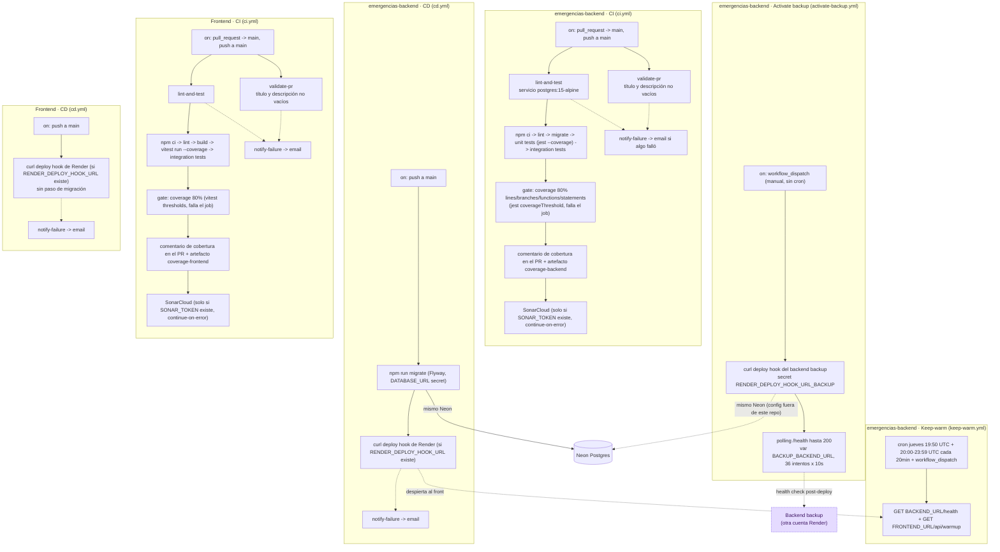

# CI/CD

Para qué sirve: mostrar los pipelines reales de GitHub Actions de los dos repos (`.github/workflows/*.yml`),
sus jobs, pasos y gates, para entender qué bloquea un merge y qué dispara un deploy.

## Gates que bloquean un merge

| Gate | Dónde | Qué pasa si falla |
|---|---|---|
| Título/descripción de PR no vacíos | `validate-pr` (back y front) | Falla el job, no bloquea el merge por sí solo pero dispara `notify-failure` |
| Lint (`eslint`) | `lint-and-test` | Falla el job |
| Migraciones aplican limpio contra Postgres efímero | `lint-and-test` (solo backend, servicio `postgres:15-alpine`) | Falla el job antes de llegar a los tests |
| Cobertura de tests **80%** en statements/branches/functions/lines | `jest coverageThreshold` (back) / `vitest coverage.thresholds` (front) | El comando de test sale con código de error, el job falla |
| Tests de integración | `lint-and-test` (`npm run test:integration` / `vitest run --config vitest.integration.config.mjs`) | Falla el job |
| SonarCloud | `lint-and-test`, paso final | **No bloquea**: `continue-on-error: true`; corre porque `SONAR_TOKEN` está cargado como secret en **ambos** repos (backend desde el inicio, `Frontend` desde el 21/09) |

## Gate efectivo del proyecto vs. análisis externos

Para no confundir lo que **bloquea** un merge con lo que **acompaña** como análisis auxiliar:

### Gate efectivo (bloqueante)

Un PR no puede mergearse si alguno de estos falla:

1. **Metadata del PR** — título y descripción no vacíos (`validate-pr`)
2. **Lint** — `eslint` limpio (`npm run lint`)
3. **Build** — `next build` (solo frontend, en `lint-and-test`)
4. **Migraciones** — Flyway aplica limpio contra Postgres efímero (solo backend)
5. **Tests unitarios + cobertura ≥ 80%** — `npm test` (backend con `jest coverageThreshold`) / `npm run test:coverage` (frontend con `vitest coverage.thresholds`)
6. **Tests de integración** — backend contra Postgres real; frontend BFF contra mocks (ver hallazgo #39)

### Análisis externo (no bloqueante)

- **SonarCloud** — corre solo si el repo tiene el secret `SONAR_TOKEN`, y el step usa `continue-on-error: true`. Un Quality Gate rojo en Sonar **no traba el CI**. Su rol es alertar sobre code smells, seguridad estática y cobertura sobre "new code"; se lee, no se depende de él para mergear.

### Respuesta canónica para la presentación

Si preguntan "¿SonarCloud es su quality gate?": **no**. El gate efectivo hoy es **ESLint + build + Vitest/Jest con cobertura ≥ 80% + integración**. SonarCloud es un análisis externo complementario que puede estar rojo sin trabar el pipeline. Si quisieran hacerlo gate real, habría que quitar `continue-on-error: true` del step en `ci.yml`.

## CD

| Repo | Trigger | Pasos | Nota |
|---|---|---|---|
| `emergencias-backend` | `push` a `main` | `npm run migrate` (Flyway contra `DATABASE_URL` secret) → deploy hook de Render | Sin `FLYWAY_BASELINE_VERSION` a propósito (ver comentario en `cd.yml`): una base nueva necesita correr V1..V14 completas |
| `Frontend` | `push` a `main` | Deploy hook de Render únicamente | No corre migraciones (no tiene schema propio) |

## Failover manual: `activate-backup.yml`

A diferencia de `ci.yml`/`cd.yml`, **no** dispara con `push`: es `workflow_dispatch` puro, para
correrlo a mano desde Actions cuando el backend primario está caído. Dos pasos con `curl`: (1)
dispara el deploy hook del servicio backup (secret `RENDER_DEPLOY_HOOK_URL_BACKUP`) y (2) hace
polling de su `/health` (variable de repo `BACKUP_BACKEND_URL`) hasta 36 intentos de 10s (6
minutos); si no responde 200 en ese tiempo, el job falla. No migra nada (asume que la base ya
está al día porque el `cd.yml` normal corrió `npm run migrate` contra la misma Neon) y no
reemplaza automáticamente al servicio primario en el DNS/URL pública: quien lo corre tiene que
avisar/redirigir tráfico a mano. Mergeado en el PR #38; el equipo tiene un workflow equivalente
en el repo `Frontend` (PR #36), no verificado en este clon porque este documento vive en
`emergencias-backend`.

## Fuente en el código

- `.github/workflows/ci.yml`, `.github/workflows/cd.yml`, `.github/workflows/keep-warm.yml`, `.github/workflows/activate-backup.yml` (`emergencias-backend`)
- `Frontend/.github/workflows/ci.yml`, `Frontend/.github/workflows/cd.yml`
- `package.json` (`jest.coverageThreshold`) y `Frontend/vitest.config.mjs` (`coverage.thresholds`)
- `sonar-project.properties` (backend y frontend)
