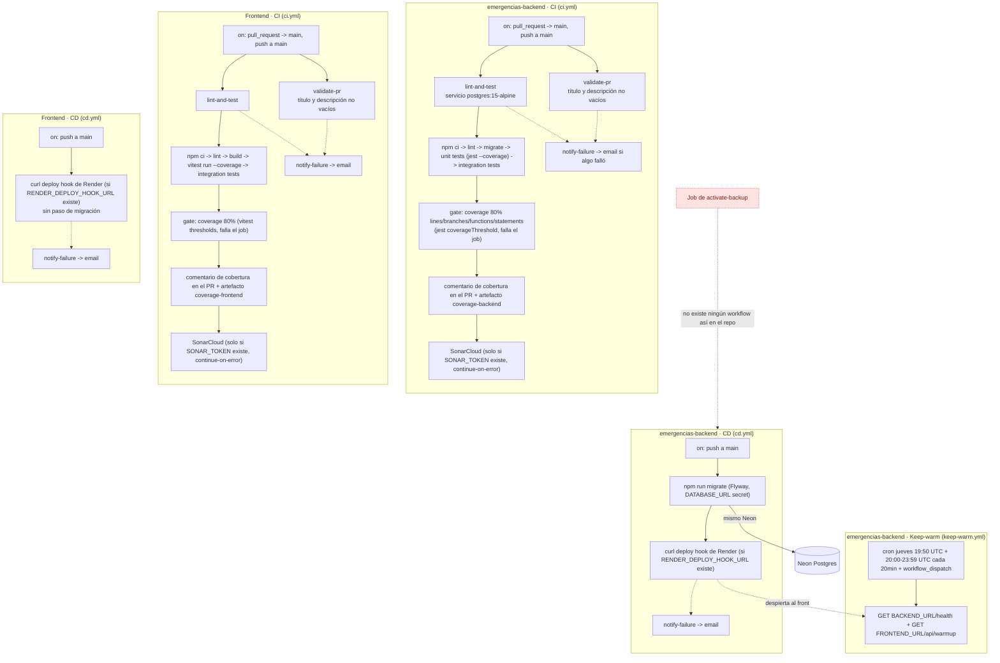

# CI/CD

Para qué sirve: mostrar los pipelines reales de GitHub Actions de los dos repos (`.github/workflows/*.yml`),
sus jobs, pasos y gates, para entender qué bloquea un merge y qué dispara un deploy.

## Gates que bloquean un merge

| Gate | Dónde | Qué pasa si falla |
|---|---|---|
| Título/descripción de PR no vacíos | `validate-pr` (back y front) | Falla el job, no bloquea el merge por sí solo pero dispara `notify-failure` |
| Lint (`eslint`) | `lint-and-test` | Falla el job |
| Migraciones aplican limpio contra Postgres efímero | `lint-and-test` (solo backend, servicio `postgres:15-alpine`) | Falla el job antes de llegar a los tests |
| Cobertura de tests **80%** en statements/branches/functions/lines | `jest coverageThreshold` (back) / `vitest coverage.thresholds` (front) | El comando de test sale con código de error, el job falla |
| Tests de integración | `lint-and-test` (`npm run test:integration` / `vitest run --config vitest.integration.config.mjs`) | Falla el job |
| SonarCloud | `lint-and-test`, paso final | **No bloquea**: `continue-on-error: true` y solo corre si hay `SONAR_TOKEN` |

## CD

| Repo | Trigger | Pasos | Nota |
|---|---|---|---|
| `emergencias-backend` | `push` a `main` | `npm run migrate` (Flyway contra `DATABASE_URL` secret) → deploy hook de Render | Sin `FLYWAY_BASELINE_VERSION` a propósito (ver comentario en `cd.yml`): una base nueva necesita correr V1..V13 completas |
| `Frontend` | `push` a `main` | Deploy hook de Render únicamente | No corre migraciones (no tiene schema propio) |

Ninguno de los dos `cd.yml` tiene un job de `activate-backup` ni ningún paso que apunte a una
segunda cuenta de Render: se buscó explícitamente y no aparece en ningún workflow de ninguno de
los tres repos clonados (`emergencias-backend`, `Frontend`, `ADRs`). Se deja marcado en el
diagrama como **no encontrado**, no como "deshabilitado".

## Fuente en el código

- `.github/workflows/ci.yml`, `.github/workflows/cd.yml`, `.github/workflows/keep-warm.yml` (`emergencias-backend`)
- `Frontend/.github/workflows/ci.yml`, `Frontend/.github/workflows/cd.yml`
- `package.json` (`jest.coverageThreshold`) y `Frontend/vitest.config.mjs` (`coverage.thresholds`)
- `sonar-project.properties` (backend y frontend)
