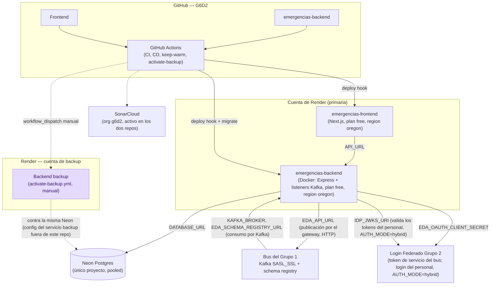

# Despliegue

Para qué sirve: mostrar dónde corre cada pieza en producción y qué variables de entorno usa
cada una (sin valores — ver `.env.example` y `render.yaml` para el detalle completo).

## Variables de entorno relevantes (sin valores)

### `emergencias-backend` (`render.yaml` / `.env.example`)

| Variable | Para qué |
|---|---|
| `NODE_ENV` | `production` fuerza HTTPS/HSTS, endurece CORS y dev login, y con `AUTH_MODE=local` exige `ALLOW_LOCAL_AUTH` (con `hybrid` no). Producción hoy **no** corre con `production` (no manda HSTS; verificado el 12/11/2026) |
| `DATABASE_URL` | Connection string pooled de Neon, `sslmode=require` |
| `DATABASE_SSL`, `DATABASE_SSL_VERIFY`, `DATABASE_SSL_CA` | SSL del pool (por default cifra sin verificar el certificado) |
| `DB_POOL_MAX` | Tope de conexiones del pool `pg` |
| `KAFKA_ENABLED`, `KAFKA_BROKER`, `KAFKA_SSL`, `KAFKA_CLIENT_ID` | Conexión al bus del Grupo 1 (en producción: prendido, SSL, `test.citypass.mrfranco.net.ar:9092`) |
| `KAFKA_CONSUMER_ENABLED`, `KAFKA_CONSUMER_GROUP_PREFIX`, `EDA_TOPIC_EVENTO_PUBLICADO`, `EDA_TOPIC_EVENTO_CANCELADO`, `UMBRAL_CAPACIDAD_COBERTURA_PREVENTIVA`, `CONTEXTO_ZONA_RADIO_DEFAULT_METROS` | Listeners de Espacios: cobertura preventiva y prioridad por evento en un radio (en producción: prendidos, radio por default de 500 m) |
| `EDA_TOPIC_EMERGENCIA_SOLICITADA`, `EDA_TOPIC_RECLAMO_CREADO`, `EDA_TOPIC_RECLAMO_ACTUALIZADO`, `RECLAMO_INTERVENCION_DISPARADOR` | Listeners del caso de la ciclovía: `EmergenciaSolicitada` de Movilidad y `ReclamoCreado` / `ReclamoActualizado` de Reclamos. El disparador dice quién crea la intervención: `movilidad` (default), `reclamo` o `ambos` (en producción: tópicos por default del código; los de Reclamos prendidos desde el 12/11/2026) |
| `EDA_CONSUMER_FROM_BEGINNING`, `EDA_CONSUMER_SINCE` | Grupo sin offset: lee desde el principio salteando lo anterior al piso (en producción: `EDA_CONSUMER_SINCE=2026-11-05T15:00:00Z`; tiene que quedar cargada) |
| `EDA_PUBLISHER_MODE`, `EDA_API_URL` | Publicación por el gateway (en producción: `gateway`, `https://test.citypass.mrfranco.net.ar`) |
| `EDA_SCHEMA_REGISTRY_URL` (+ `_USERNAME`/`_PASSWORD` opcionales) | Registry del gateway para decodificar Avro |
| `EDA_OAUTH_TOKEN_URL`, `EDA_OAUTH_CLIENT_ID`, `EDA_OAUTH_CLIENT_SECRET` | Token client-credentials del Login Federado para el broker (SASL/OAUTHBEARER) y el registry. Solo el secreto se setea en producción |
| `OUTBOX_PUBLISHER_ENABLED`, `OUTBOX_PUBLISH_SINCE`, `OUTBOX_MAX_BACKOFF_MS`, `OUTBOX_BATCH_SIZE`, `OUTBOX_POLL_INTERVAL_MS`, `OUTBOX_PUBLISHED_RETENTION_HOURS` | Publisher del outbox (en producción: prendido desde el 05/11, con `EDA_PUBLISHER_MODE=gateway`) |
| `TOPIC_PANIC_BUTTON`, `TOPIC_EMERGENCIA_ESTADO_ACTUALIZADO`, `TOPIC_EMERGENCIA_PRIORIZADA` | Tópicos de `EmergenciaCreada`, `EmergenciaActualizada` y `EmergenciaPriorizada` |
| `LOCATION_ENCRYPTION_KEY` / `LOCATION_ENCRYPTION_KEYS` / `LOCATION_ENCRYPTION_KEY_ID` | Cifrado AES-256-GCM de ubicación (obligatoria, el server no arranca sin ella) |
| `BUS_LOCATION_ENCRYPTION_KEY` / `BUS_*_KEYS` / `BUS_*_KEY_ID` | Cifrado de `ubicacion.latitud/longitud` en el bus (opcional; distinta a la de DB) |
| `LOCATION_RETENTION_HOURS`, `LOCATION_RETENTION_ENABLED` | Job de anonimización |
| `EMERGENCY_EXPIRATION_HOURS`, `EMERGENCY_EXPIRATION_ENABLED` | Job de expiración de emergencias abiertas (default: el plazo de retención, 72 h; prendido) |
| `CORS_ALLOWED_ORIGINS` | Origins permitidos (sin ella, producción cae a un default con warning) |
| `RATE_LIMIT_ENABLED` | Apaga el rate limit (login, panic-button) |
| `KEEP_WARM_ENABLED`, `KEEP_WARM_URLS`, `KEEP_WARM_WINDOWS`, `KEEP_WARM_TZ`, `KEEP_WARM_INTERVAL_MS` | Job in-process que evita el sleep de Render (free) |
| `AUTH_MODE`, `ALLOW_LOCAL_AUTH` | En producción: `hybrid` desde el 12/11/2026 = Login Federado del Grupo 2 para el personal + cuentas locales para los ciudadanos y los atajos de demo, elegido por el `iss` del token (no mira `NODE_ENV` ni `ALLOW_LOCAL_AUTH`). `local` = solo JWT propio. `idp` = solo Login Federado |
| `DEV_LOGIN_STRICT` | `true` en producción: `/auth/dev/login` solo emite tokens para los subs demo |
| `IDP_ISSUER`, `IDP_AUDIENCE`, `IDP_MODULE`, `IDP_CLOCK_TOLERANCE_SECONDS` | Cargadas en producción. En `hybrid` e `idp` son el iss/aud del Login Federado: `https://idp.citypass.local` (sin barra final) y `citypass-emergencias-api`, confirmados con un token real el 12/11/2026. En `local`, los de los tokens propios |
| `IDP_JWKS_URI` | JWKS del Login Federado (`https://api.citypass-login.pp.ua/.well-known/jwks.json`). Obligatoria en `hybrid` e `idp`; cargada en producción desde el 12/11/2026 |
| `IDP_REQUIRE_TOKEN_USE`, `IDP_REQUIRE_TOKEN_VER`, `IDP_SUBJECT_CLAIM`, `IDP_GROUPS_CLAIM`, `IDP_GROUP_MAP`, `IDP_SUB_ALIASES` | Solo `hybrid`: claims del token federado, grupos federados → internos y sub federado → id de oficial (README > Login Federado + cuentas locales). En producción no hicieron falta para el dispatcher (su grupo LDAP, `dispatcher`, está en el mapa por default); faltan para los oficiales, que todavía no tienen usuario LDAP |
| `LOCAL_JWT_ISSUER`, `LOCAL_JWT_AUDIENCE` | Solo `hybrid`: iss/aud de los tokens locales (el iss tiene que ser distinto de `IDP_ISSUER`) |
| `LOCAL_TOKEN_TTL_SECONDS`, `LOCAL_JWT_PRIVATE_KEY_PEM` | `AUTH_MODE=local` e `hybrid`. El TTL por default es 900 s: una sesión local (ciudadano o atajo de demo) dura 15 minutos y no se renueva |
| `FORCE_HTTPS` | Forzar HTTPS fuera de `production` |
| `CITIZEN_PII_RETENTION_*`, `INCIDENT_*`, `LOCATION_RETENTION_INTERVAL_MS` | Jobs de retención del perfil y de detección de incidentes (defaults del código en producción) |

La lista completa, con defaults y comentarios, está en `.env.example`.

### `Frontend` (`render.yaml`)

| Variable | Para qué |
|---|---|
| `NODE_ENV` | `production` |
| `API_URL` | URL pública del backend; la usan el BFF (`/api/backend/*`) y el login desde el servidor, nunca se expone al browser |
| `BACKEND_WARMUP_PATH` | Path de health-check que dispara `/api/warmup` |

### Secrets de CI/CD (GitHub Actions, ambos repos)

| Secret | Para qué |
|---|---|
| `DATABASE_URL` | CD del backend, para correr `npm run migrate` contra Neon |
| `RENDER_DEPLOY_HOOK_URL` | CD de ambos repos, dispara el redeploy en Render |
| `RENDER_DEPLOY_HOOK_URL_BACKUP` | `activate-backup.yml`, dispara el redeploy del backend backup en la otra cuenta de Render |
| `SONAR_TOKEN` | Análisis de SonarCloud; cargado en ambos repos (backend desde el inicio, `Frontend` desde el 21/09) |
| `MAIL_USERNAME`, `MAIL_PASSWORD`, `MAIL_TO` | Notificación por email si falla CI/CD |
| `GITHUB_TOKEN` | Comentario de cobertura en el PR (provisto automáticamente por Actions) |

### Variables de repo (no secretas) usadas por `activate-backup.yml`

| Variable | Para qué |
|---|---|
| `BACKUP_BACKEND_URL` | URL pública del backend backup, usada para el polling de `/health` post-deploy |

## Notas

- **Ambas apps duermen** en el plan free de Render tras 15 minutos sin tráfico (50-60s de
  arranque en frío). Por eso existen `keep-warm.yml` + `src/jobs/keep-warm.js` (backend) y
  `/api/warmup` (frontend) — ver `07-ci-cd.md`.
- El stack de backup en otra cuenta de Render **sí existe**: `.github/workflows/activate-backup.yml`
  (PR #38) lo confirma, con secret `RENDER_DEPLOY_HOOK_URL_BACKUP` y variable `BACKUP_BACKEND_URL`.
  Es manual (`workflow_dispatch`, sin cron ni failover automático) y no migra nada por sí solo.
  Que apunte contra la misma Neon que el primario es una decisión de configuración del servicio
  backup en el dashboard de Render — no vive en este repo, así que no se puede verificar línea
  por línea contra código, pero es la config que el equipo reporta estar usando.
- No hay object storage separado para adjuntos (fotos/evidencias): esas historias (HU-02 con
  foto, HU-09 observaciones) todavía no están implementadas.

## Fuente en el código

- `render.yaml` (backend: servicio Docker con `autoDeployTrigger: off`), `Frontend/render.yaml`
- `.env.example` (backend)
- `.github/workflows/*.yml` (backend y frontend), incluido `.github/workflows/activate-backup.yml`
- `src/jobs/keep-warm.js`, `Frontend/app/api/warmup/route.js`, `Frontend/app/components/BackendWarmup.js`
