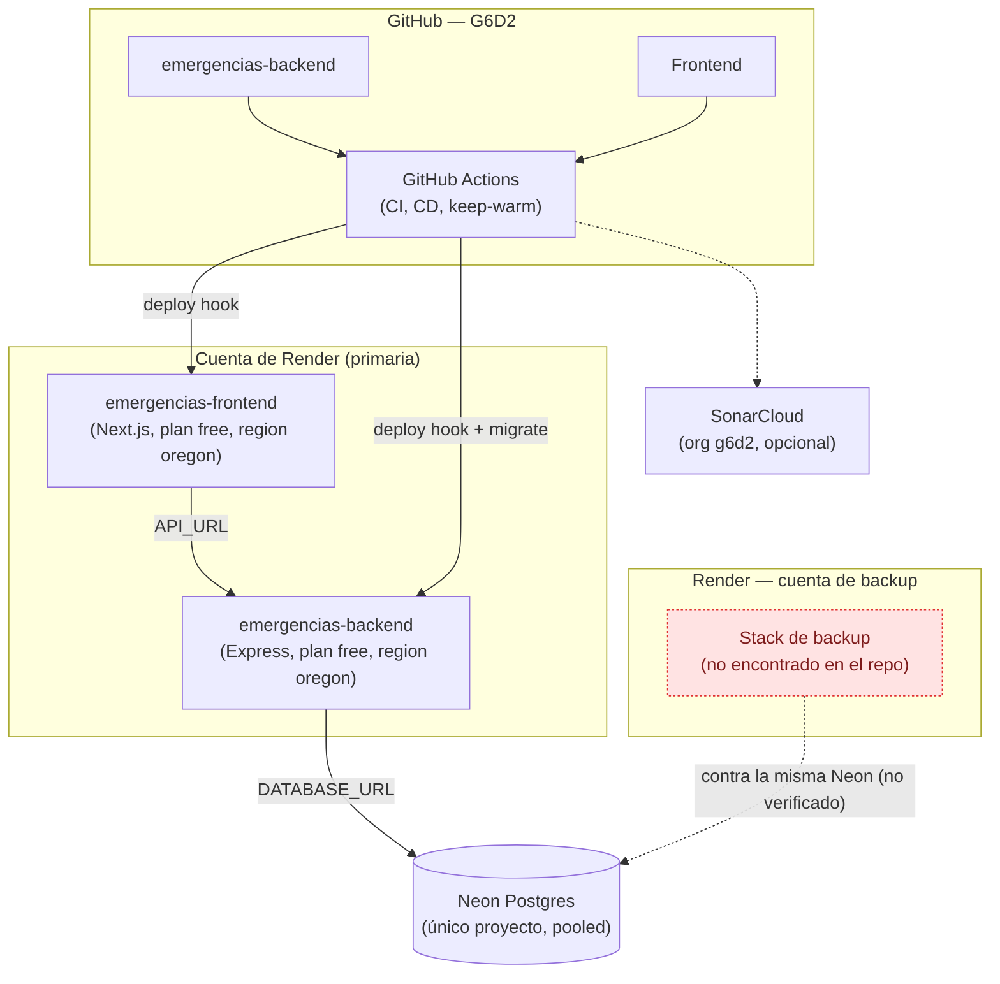

# Despliegue

Para qué sirve: mostrar dónde corre cada pieza en producción y qué variables de entorno usa
cada una (sin valores — ver `.env.example` y `render.yaml` para el detalle completo).

## Variables de entorno relevantes (sin valores)

### `emergencias-backend` (`render.yaml` / `.env.example`)

| Variable | Para qué |
|---|---|
| `NODE_ENV` | `production` fuerza HTTPS/HSTS y exige `CORS_ALLOWED_ORIGINS` |
| `DATABASE_URL` | Connection string pooled de Neon, `sslmode=require` |
| `DB_POOL_MAX` | Tope de conexiones del pool `pg` |
| `KAFKA_ENABLED`, `KAFKA_BROKER`, `KAFKA_CLIENT_ID` | Producer de eventos (hoy `KAFKA_ENABLED=false`) |
| `TOPIC_PANIC_BUTTON`, `TOPIC_EMERGENCIA_ESTADO_ACTUALIZADO`, `TOPIC_EMERGENCIA_CERRADA` | Nombres de tópico por tipo de evento |
| `LOCATION_ENCRYPTION_KEY` / `LOCATION_ENCRYPTION_KEYS` / `LOCATION_ENCRYPTION_KEY_ID` | Cifrado AES-256-GCM de ubicación (obligatoria, el server no arranca sin ella) |
| `LOCATION_RETENTION_HOURS`, `LOCATION_RETENTION_ENABLED` | Job de anonimización |
| `CORS_ALLOWED_ORIGINS` | Origins permitidos (sin ella, producción cae a un default con warning) |
| `RATE_LIMIT_ENABLED` | Apaga el rate limit (login, panic-button) |
| `KEEP_WARM_ENABLED`, `KEEP_WARM_URLS`, `KEEP_WARM_WINDOWS`, `KEEP_WARM_TZ`, `KEEP_WARM_INTERVAL_MS` | Job in-process que evita el sleep de Render (free) |
| `AUTH_MODE`, `ALLOW_LOCAL_AUTH` | `local` (JWT propio) hoy; `idp` cuando conecte el Grupo 2 |
| `IDP_ISSUER`, `IDP_AUDIENCE`, `IDP_MODULE`, `IDP_CLOCK_TOLERANCE_SECONDS`, `IDP_JWKS_URI` | Claims/validación esperados del IdP real (previsto) |
| `LOCAL_TOKEN_TTL_SECONDS`, `LOCAL_JWT_PRIVATE_KEY_PEM` | Solo `AUTH_MODE=local` |
| `FORCE_HTTPS` | Forzar HTTPS fuera de `production` |

### `Frontend` (`render.yaml`)

| Variable | Para qué |
|---|---|
| `NODE_ENV` | `production` |
| `API_URL` | URL pública del backend; la usan el BFF (`/api/backend/*`) y el login desde el servidor, nunca se expone al browser |
| `BACKEND_WARMUP_PATH` | Path de health-check que dispara `/api/warmup` |

### Secrets de CI/CD (GitHub Actions, ambos repos)

| Secret | Para qué |
|---|---|
| `DATABASE_URL` | CD del backend, para correr `npm run migrate` contra Neon |
| `RENDER_DEPLOY_HOOK_URL` | CD de ambos repos, dispara el redeploy en Render |
| `SONAR_TOKEN` | Análisis opcional de SonarCloud |
| `MAIL_USERNAME`, `MAIL_PASSWORD`, `MAIL_TO` | Notificación por email si falla CI/CD |
| `GITHUB_TOKEN` | Comentario de cobertura en el PR (provisto automáticamente por Actions) |

## Notas

- **Ambas apps duermen** en el plan free de Render tras 15 minutos sin tráfico (50-60s de
  arranque en frío). Por eso existen `keep-warm.yml` + `src/jobs/keep-warm.js` (backend) y
  `/api/warmup` (frontend) — ver `07-ci-cd.md`.
- El stack de backup en otra cuenta de Render contra la misma Neon **no se encontró en el
  código** de ninguno de los tres repos clonados. Se lo incluye porque lo pide la consigna de
  este documento, marcado como no verificado.
- No hay object storage separado para adjuntos (fotos/evidencias): esas historias (HU-02 con
  foto, HU-09 observaciones) todavía no están implementadas.

## Fuente en el código

- `render.yaml` (backend), `Frontend/render.yaml`
- `.env.example` (backend)
- `.github/workflows/*.yml` (backend y frontend)
- `src/jobs/keep-warm.js`, `Frontend/app/api/warmup/route.js`, `Frontend/app/components/BackendWarmup.js`
