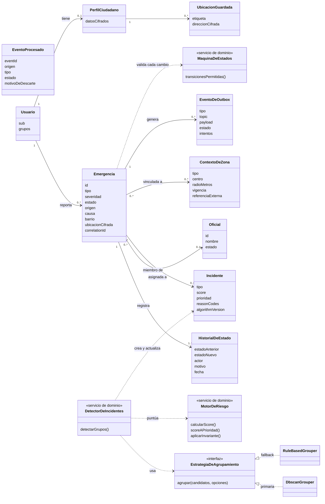
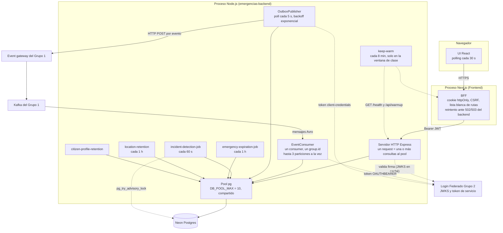
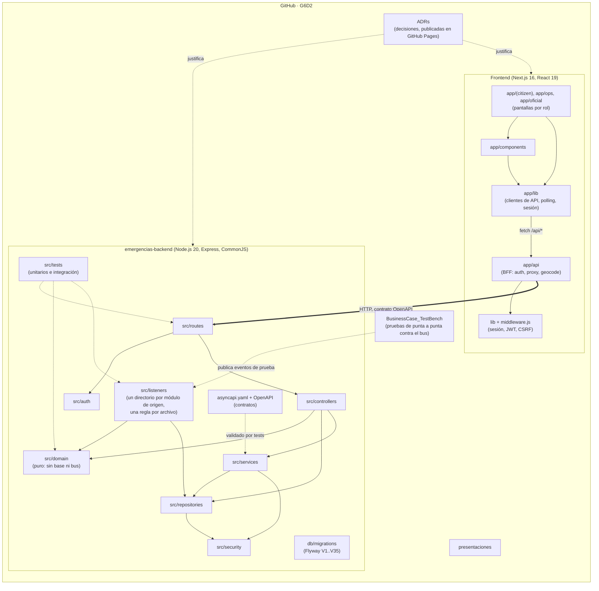
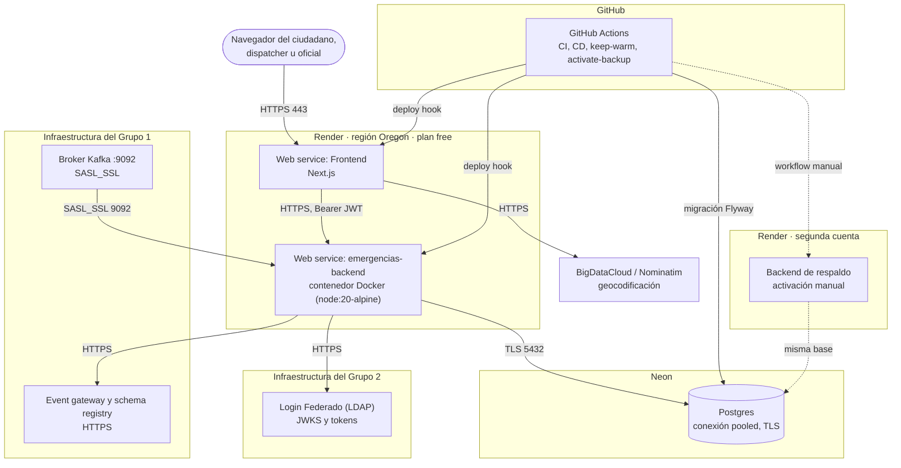

# Vista 4+1

Para qué sirve: presentar la arquitectura del módulo **Emergencias y Seguridad** con el modelo
4+1 de Kruchten, que es uno de los tres formatos que pide la rúbrica de la cátedra (dimensión 2:
"Diagramas 4+1 / C4 / Cloud"). Los demás documentos de esta carpeta están organizados por C4 y
por tema; este los ordena en las cinco vistas, agrega los dos diagramas que faltaban (procesos y
desarrollo) y dice en qué archivo está el detalle de cada una.

| Vista | A quién le sirve | Qué responde | Dónde está |
|---|---|---|---|
| **Lógica** | Producto, analistas | Qué conceptos maneja el módulo y cómo se relacionan | Sección 1 de este documento, `02-modelo-entidad-relacion.md`, `04-maquina-de-estados.md` |
| **De procesos** | Back, DevOps | Qué corre a la vez en ejecución, cómo se sincroniza y qué pasa si algo falla | Sección 2 de este documento, `05-secuencias.md`, `06-eventos.md` |
| **De desarrollo** | Desarrolladores | Cómo está organizado el código, qué depende de qué y cómo llega a producción | Sección 3 de este documento, `03-arquitectura.md` (componentes), `07-ci-cd.md` |
| **Física** | DevOps, cátedra | En qué nodos corre cada pieza y cómo se conectan | Sección 4 de este documento, `08-despliegue.md`, `03-arquitectura.md` (contenedores) |
| **Escenarios (+1)** | Todos | Qué casos de uso validan que las cuatro vistas encajan | Sección 5 de este documento, `01-casos-de-uso.md`, `05-secuencias.md` |

El contexto del sistema (actores y sistemas vecinos) es común a las cinco vistas y está en
`00-contexto.md`.

## 1. Vista lógica

Los conceptos del dominio y las reglas que los gobiernan, sin tecnología. Una **emergencia**
nace de un ciudadano (botón de pánico o reporte) o de un evento de otro módulo, recorre una
máquina de estados y puede quedar agrupada en un **incidente** que le sube la prioridad.

| Concepto | Regla que importa | Código |
|---|---|---|
| Tipo de emergencia | Catálogo cerrado de 8 tipos (`MEDICA`, `INCENDIO`, `INFRAESTRUCTURA`, `DISTURBIO_EVENTO_MASIVO`, `OTRO`, `PANICO`, `PREVENTIVA`, `TRANSITO`). `PREVENTIVA` solo la crea el sistema | `src/domain/emergency-type.js` |
| Severidad y prioridad | Cuatro niveles (`low`, `medium`, `high`, `critical`). La prioridad efectiva nunca queda por debajo de la severidad individual | `src/domain/severity.js`, `src/domain/risk-engine.js` (`applyPriorityInvariant`) |
| Estado | `PENDING → VALIDATED → DISPATCHED → EN_ROUTE → ON_SCENE → RESOLVED → CLOSED`, con `CANCELLED` y `DISCARDED` como terminales. Cada transición tiene un rol dueño | `src/domain/emergency-status.js`, `04-maquina-de-estados.md` |
| Incidente | Agrupa emergencias del mismo tipo, cercanas y de ciudadanos distintos; un solo usuario repitiendo reportes no forma incidente | `src/domain/incident-detector.js`, `dbscan-grouper.js`, `rule-based-grouper.js` |
| Contexto de zona | Mientras dura un evento público o una alerta climática `ALTA`/`CRITICA`, lo que se crea dentro de su radio sube un nivel de prioridad | `src/domain/contexto-zona.js`, `src/domain/alerta-climatica.js` |
| Evento de outbox | Se guarda en la misma transacción que el cambio que lo origina | `src/repositories/emergency.repository.js`, `src/services/emergency-events.js` |
| Evento procesado | Un evento externo se aplica una sola vez, aunque el bus lo entregue repetido | `src/repositories/eventos-procesados.repository.js`, `src/listeners/outcome-factory.js` |

El modelo físico de datos (tablas, columnas y claves) está en `02-modelo-entidad-relacion.md`.

## 2. Vista de procesos

Qué se ejecuta a la vez y cómo se coordina. El backend es **un solo proceso Node.js** que
atiende HTTP, consume del bus, publica el outbox y corre los jobs periódicos; todo comparte el
mismo pool de conexiones a Postgres.

| Aspecto | Cómo se resuelve | Código |
|---|---|---|
| Concurrencia del consumo | Un único consumer para los 10 listeners (el bus limita las conexiones por IP). Procesa una partición por tópico, hasta 3 a la vez, para no agotar el pool | `src/listeners/event-consumer.js` (`KAFKA_CONSUMER_CONCURRENCY`) |
| Entrega repetida (at-least-once) | Cada evento externo se procesa dentro de una transacción que también registra su `eventId`; el repetido se descarta | `src/listeners/outcome-factory.js`, tabla `eventos_procesados` |
| Publicación confiable | El evento se escribe en `outbox_events` en la misma transacción que el cambio de estado; el publisher lo envía después y reintenta | `src/services/outbox-publisher.js`, `src/services/gateway-publisher.js` |
| Dos instancias a la vez (primario y backup) | El job de incidentes toma un advisory lock de Postgres: solo una instancia detecta por vez. El outbox no pisa una fila que otro proceso ya reclamó | `src/services/incident-detection-job.js`, `src/services/outbox-publisher.js` |
| Reintento de un alta (SOS) | Con `Idempotency-Key`, el mismo usuario y la misma clave dentro de 24 h devuelven la emergencia ya creada; la clave se reserva en la base, en la misma transacción que el alta, así que también vale con dos instancias y con pedidos simultáneos | `src/repositories/emergency.repository.js` (`createWithIdempotencyKey`), tabla `idempotency_keys` |
| Errores de un evento externo | Transitorio (base o red caídas): no se confirma el offset y Kafka lo reentrega. Permanente (payload inválido): se registra como descartado, con su motivo, y el tópico sigue | `src/listeners/error-classifier.js` |
| Caída del consumer | Se reinicia con backoff en vez de quedar muerto hasta el próximo deploy | `src/listeners/listener-supervisor.js` |
| Servicio dormido (Render free) | Mientras duerme no consume ni publica; al despertar retoma desde el último offset confirmado y drena el outbox pendiente | `src/jobs/keep-warm.js`, `.github/workflows/keep-warm.yml` |
| Apagado | Con `SIGTERM` deja de aceptar requests, espera los que están en curso, cierra consumer, producer y pool, con tope de 10 s | `src/index.js`, `src/utils/graceful-shutdown.js` |
| Refresco de las pantallas | Polling cada 30 s desde el navegador; no hay push | `Frontend/app/lib/api.js` (`POLLING_INTERVAL_MS`), `Frontend/app/lib/polling.js` |

Limitaciones conocidas de esta vista: no hay *dead-letter topic* (un evento con error
permanente se registra como descartado en `eventos_procesados`, sin un tópico desde donde
reprocesarlo), y el BFF sigue reintentando `POST /api/panic-button` solo ante un 502 o 503 o
si no llegó a conectar, aunque el backend ya deduplica por `Idempotency-Key`.

Los intercambios paso a paso están en `05-secuencias.md`; la semántica de orden y entrega de
los eventos, en `06-eventos.md`.

## 3. Vista de desarrollo

Cómo está partido el código y qué puede depender de qué. Son cinco repositorios en la
organización `G6D2`; dos tienen código que corre en producción.

| Regla | Detalle |
|---|---|
| Sentido de las dependencias | `routes → controllers → domain / repositories / services`. `domain` no importa nada de base ni de bus, y por eso se testea sin mocks de infraestructura |
| Composición | Las dependencias se arman a mano en un solo lugar (`src/index.js`) y se inyectan por constructor o por fábrica (`createApp`, `createAuthSetup`), lo que permite reemplazarlas en los tests |
| Extensión por evento externo | Sumar un evento es agregar un listener y sus reglas en `src/listeners/<módulo>/<evento>/rules/`, sin tocar el consumer (`load-rules.js`) |
| Estrategias reemplazables | Agrupamiento de incidentes (`DbscanGrouper` / `RuleBasedGrouper`), verificación de token (`local` / `idp` / `hybrid`) y publicación (`KafkaService` / `GatewayPublisher`) se eligen por configuración |
| Frontend | El navegador nunca llama al backend: todo pasa por el BFF (`app/api/backend/[...path]`), que agrega el token y solo deja pasar las rutas de una lista |
| Esquema de base | Solo cambia con una migración versionada nueva en `db/migrations`; nunca se edita una ya aplicada |
| Contratos | REST en OpenAPI (generado desde las rutas, servido en `/api-docs`) y eventos en `asyncapi.yaml` (servido en `/asyncapi`); `src/tests/asyncapi.test.js` falla si un evento no cumple el spec |
| Camino a producción | Rama → PR con plantilla y `CODEOWNERS` → CI (lint, unitarios con cobertura mínima de 80 %, integración contra Postgres) → merge a `main` → CD (migración Flyway y deploy hook de Render). Detalle en `07-ci-cd.md` |

Deuda conocida de esta vista: `src/repositories/emergency.repository.js` concentra consultas,
transiciones y escritura del outbox en un solo archivo de más de 1.300 líneas, y no hay una capa
de casos de uso entre controllers y repositories. El código es JavaScript sin tipos estáticos.

## 4. Vista física

En qué nodos corre cada proceso de la vista 2. Todo está en servicios administrados; el equipo
no opera servidores.

| Nodo | Proceso de la vista 2 | Observación |
|---|---|---|
| Render · Frontend | Proceso Next.js | Se duerme tras 15 minutos sin tráfico |
| Render · emergencias-backend | Proceso Node.js completo (HTTP, consumer, outbox y jobs) | Una sola instancia. Se duerme igual que el frontend; el arranque en frío tarda cerca de un minuto |
| Render · segunda cuenta | Otra copia del proceso Node.js | Apagada salvo contingencia; comparte la base con el primario, así que cubre la caída de Render pero no la de Neon |
| Neon | Base de datos | Único almacenamiento con estado del módulo |
| Grupo 1 | Bus de eventos | Fuera de nuestro control: si cae, lo propio queda pendiente en el outbox y se publica al volver |
| Grupo 2 | Identidad del personal y token de servicio | Si cae, el personal no puede entrar y el consumer no renueva su token |
| GitHub Actions | CI y CD | Único camino para cambiar el esquema de la base y desplegar |

Limitaciones conocidas de esta vista: hay un solo ambiente (no existe uno de pruebas separado
de producción) y el servicio se creó desde el panel de Render; `render.yaml` describe su
configuración pero Render no la aplica desde el archivo.

Variables de entorno, secretos y notas operativas: `08-despliegue.md`.

## 5. Escenarios (+1)

Siete escenarios recorren las cuatro vistas y sirven para comprobar que encajan: cinco son
propios del módulo y dos son transversales, con otros módulos de CityPass+ (filas 5.f y 5.g).
Cada uno tiene su diagrama de secuencia en `05-secuencias.md`.

| Escenario | Caso de uso | Lógica | Procesos | Desarrollo | Física | Secuencia |
|---|---|---|---|---|---|---|
| Un ciudadano dispara el SOS | CU-01 | Nace una `Emergencia` `PANICO` en `PENDING` y su `EventoDeOutbox` | Request HTTP y, después, el poll del outbox | `panic-button.routes` → controller → `emergency.repository` | Navegador → Frontend → backend → Neon → gateway | 5.a |
| El dispatcher valida y asigna, el oficial resuelve | CU-05, CU-06, CU-07, CU-09 | La `MaquinaDeEstados` valida cada paso y el rol; se ocupa y se libera un `Oficial` | Requests HTTP de dos usuarios distintos; las pantallas se enteran por polling | `emergencies.routes` + `auth/authorize` | Igual que el anterior, con el JWT del personal validado contra el Grupo 2 | 5.b |
| El ciudadano cancela y el resto de la ciudad se entera | HU-03 | Transición a `CANCELLED` y `EmergenciaActualizada` | El cambio y el evento van en una transacción; la publicación es asíncrona y reintenta | `emergency-events` → `outbox-publisher` → `gateway-publisher` | Backend → gateway del Grupo 1 → Kafka → otros módulos | 5.c |
| Varios reportes cercanos se vuelven un incidente | CU-04 | `DetectorDeIncidentes` agrupa y `MotorDeRiesgo` sube la prioridad sin bajar nunca la individual | Job cada 60 s con advisory lock | `incident-detection-job` → `domain/*` → `incident.repository` | Solo backend y Neon | 5.d |
| Espacios publica un evento masivo | CU-03 | Se crea una `Emergencia` `PREVENTIVA` y un `ContextoDeZona` | Mensaje de Kafka, dedup por `eventId`, transacción única | `listeners/cobertura-preventiva/.../rules` → `OutcomeFactory` | Kafka del Grupo 1 → backend → Neon | 5.e |
| **Transversal:** un reclamo por ciclovía obstruida termina en una intervención | CU-03, CU-05 a CU-09 | Nace una `Emergencia` `TRANSITO` con causa `RECLAMO`, una sola por reclamo, y recorre la `MaquinaDeEstados` completa; un `ReclamoActualizado` final la cancela si no se despachó | Dos mensajes de otros módulos por el mismo consumer (el disparador elige cuál crea), dedup por `eventId` e índice único; después, requests HTTP del personal y el outbox en orden por emergencia | `listeners/reclamo-intervencion` (`disparador.js`, reglas, handlers) → `emergency.repository` → `emergency-events` | Reclamos y Movilidad → Kafka del Grupo 1 → backend → Neon → gateway → Kafka | 5.f |
| **Transversal:** una alerta climática sube la prioridad en la zona | CU-03, CU-04 | `ContextoDeZona` `ALERTA_CLIMATICA` por punto y una `PREVENTIVA` por alerta; las `Emergencia` nuevas dentro del radio suben un nivel mientras dura | Confirmación y finalización por tópicos distintos, serializadas con un advisory lock por alerta; la suba se calcula al leer, sin job | `listeners/alerta-climatica` → `contexto-zona.repository`; `linkZoneContexts` en el alta; `GET /api/contextos-zona/activos` | Espacios → Kafka del Grupo 1 → backend → Neon; tablero del dispatcher por polling | 5.g |

### 5.1 Escenario transversal en detalle: reclamo por ciclovía obstruida

Es el caso 3 del Hito 2 ("Reclamo ciudadano que desencadena una intervención urbana"): un vecino
reporta un auto que bloquea la ciclovía, Movilidad evalúa la obstrucción y Emergencias manda un
agente. Así lo cubre cada vista:

| Vista | Qué pasa | Dónde mirarlo |
|---|---|---|
| Lógica | La intervención es una `Emergencia` más: tipo `TRANSITO` (severidad base `medium`, o la prioridad que pide Movilidad), origen `EXTERNAL`, sin ciudadano, causa `RECLAMO` con el `reclamoId` y el `correlationId` de Movilidad. Sigue la misma `MaquinaDeEstados` que un SOS; la única transición propia es la cancelación por `ReclamoActualizado`, y solo desde `PENDING` o `VALIDATED`, igual que la del ciudadano | `src/domain/emergency-type.js`, `src/domain/emergency-status.js`, `src/listeners/reclamo-intervencion/handlers/` |
| Procesos | `EmergenciaSolicitada` (Movilidad) y `ReclamoCreado` (Reclamos) llegan por tópicos distintos al mismo consumer, que procesa particiones en paralelo. `RECLAMO_INTERVENCION_DISPARADOR` decide cuál crea la intervención (`movilidad` por defecto); con `ambos`, el índice único `uq_emergencies_reclamo_causa` y un `SAVEPOINT` resuelven la carrera. Cada mensaje es una transacción con su `eventId` en `eventos_procesados`. Después, dispatcher y oficial operan por HTTP y cada cambio sale por el outbox, en orden por emergencia | `src/listeners/event-consumer.js`, `src/listeners/outcome-factory.js`, `src/services/outbox-publisher.js` |
| Desarrollo | Un subpaquete por caso de negocio (`src/listeners/reclamo-intervencion/`): un listener por evento, una regla por archivo y dos handlers registrados en el `OutcomeFactory`. Pasar al plan B (`ReclamoCreado`) es cambiar `RECLAMO_INTERVENCION_DISPARADOR`, sin tocar código ni el consumer | `src/listeners/README.md`, `src/index.js` |
| Física | Reclamos y Movilidad publican en el bus del Grupo 1; el backend (Render) consume por Kafka con SASL_SSL, escribe en Neon y publica `EmergenciaCreada` y `EmergenciaActualizada` por HTTP al gateway, que las deja en Kafka con `correlationId` como clave. El dispatcher y el oficial entran por el Login Federado (LDAP) desde el Frontend | `render.yaml`, `08-despliegue.md` |

Secuencia completa en `05-secuencias.md` (f); contrato de los eventos en `asyncapi.yaml`.

## Fuente en el código

- Lógica: `src/domain/*.js`, `db/migrations/V*.sql`
- Procesos: `src/index.js`, `src/listeners/event-consumer.js`, `src/listeners/listener-supervisor.js`,
  `src/listeners/outcome-factory.js`, `src/listeners/error-classifier.js`,
  `src/services/outbox-publisher.js`, `src/services/gateway-publisher.js`,
  `src/services/incident-detection-job.js`, `src/services/emergency-expiration-job.js`,
  `src/security/location-retention.js`, `src/security/citizen-profile-retention.js`,
  `src/jobs/keep-warm.js`, `src/utils/graceful-shutdown.js`, `src/db/pool.js`
- Desarrollo: estructura de `src/` y de `Frontend/app/`, `Frontend/app/api/backend/[...path]/route.js`,
  `.github/workflows/ci.yml`, `.github/workflows/cd.yml`, `.github/CODEOWNERS`
- Física: `render.yaml`, `Dockerfile`, `Frontend/render.yaml`, `.github/workflows/activate-backup.yml`
- Escenarios: `docs/diagramas/01-casos-de-uso.md`, `docs/diagramas/05-secuencias.md`,
  `src/listeners/reclamo-intervencion/`, `src/listeners/alerta-climatica/`
